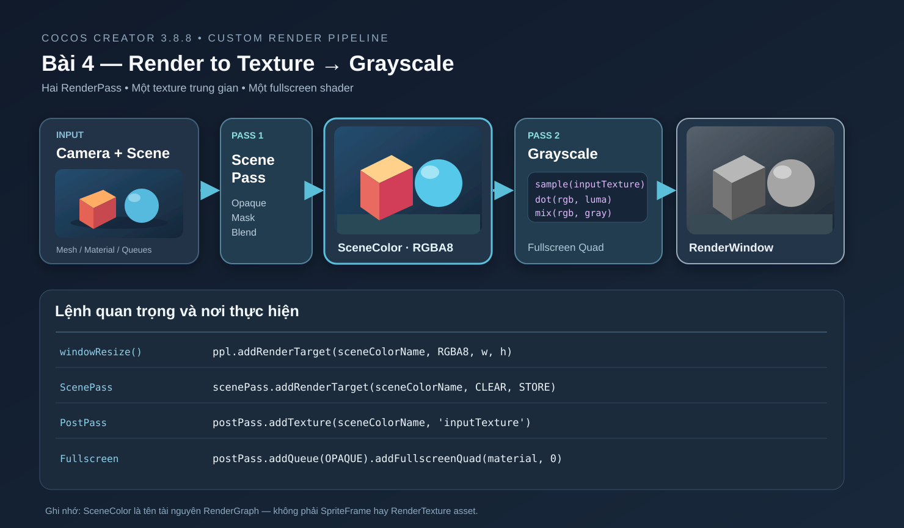

# Cocos Creator 3.8.8 — Custom Render Pipeline
## Bài 4: Render Scene vào Texture trung gian và Grayscale Fullscreen Pass

> **Mức độ:** Trung bình (bắt đầu post-processing).  
> **Học tiếp từ:** Bài 1 (RenderPass), Bài 2 (RenderQueue), Bài 3 (Clear/Depth/Multi-Camera).  
> **Mục tiêu:** Thực sự có **hai RenderPass**, Pass 1 ghi Scene vào `SceneColor`, Pass 2 sample texture và biến màn hình thành grayscale.  
> **Trạng thái kiểm thử:** Đã đối chiếu luồng API với tài liệu CRP Cocos Creator 3.8; file SVG được kiểm tra cú pháp XML; mã TS được kiểm tra ở mức cú pháp, **chưa có runtime Cocos Creator 3.8.8 trong môi trường này**. Trước khi tích hợp vào project thật, hãy chạy các bước kiểm chứng.  
> **Phạm vi:** Một Camera chiếm toàn viewport cho mỗi RenderWindow. Chưa có shadow map, HDR, tone-mapping, camera stacking hoàn chỉnh.



---

## 0. Điểm mới so với Bài 3

Bài 3 ghi thẳng vào màn hình và giải thích hai Camera dùng chung RenderWindow. Ở Bài 4, chỉ cần **một Camera** nhưng chia thành **hai pass**:

```text
Camera → ScenePass [Opaque, Mask, Blend, UI]
                     | ghi color
                     v
                 SceneColor (RGBA8, managed)
                     | đọc qua sampler2D inputTexture
                     v
               Grayscale PostPass
               | fullscreen quad + .effect
               v
                 RenderWindow
```

**Vì sao phải render gián tiếp?** Nếu Scene được vẽ thẳng ra RenderWindow, pass shader phía sau không tự có sẵn texture để `texture(...)` lấy màu từng pixel. Ta cần một resource có thể **được ghi bằng RenderPass, rồi đọc bằng shader**.

> `SceneColor` trong ví dụ là **resource nội bộ của RenderGraph** do `ppl.addRenderTarget()` đăng ký; **không phải** `RenderTexture` asset để gắn vào UI `Sprite` trong Inspector. Chuyện tạo RenderTexture asset để dùng ở nơi khác là chủ đề riêng.

## 1. Phân biệt bốn đối tượng quan trọng

| Khái niệm | API trong ví dụ | Ý nghĩa |
|---|---|---|
| Đăng ký color resource | `ppl.addRenderTarget(name, format, width, height)` | Tạo resource mô tả một texture render đích |
| Gắn output cho một pass | `scenePass.addRenderTarget(name, CLEAR, STORE)` | Ghi pixel vào resource này |
| Đọc texture ở pass sau | `postPass.addTexture(name, 'inputTexture')` | Bind resource vào sampler shader |
| Vẽ fullscreen | `postPass.addQueue(...).addFullscreenQuad(material, 0)` | Chạy shader trên một quad phủ màn hình |

`ppl.addRenderWindow(...)` vẫn cần vì **output cuối** là framebuffer gắn với cửa sổ. Chúng ta dùng hai resource color khác nhau:

- `Lesson4SceneColor_{renderWindowId}`: texture ở giữa pipeline.
- `window.colorName`: đích cuối ra màn hình.

Tên được tạo theo `window.renderWindowId` thay vì `camera.name` để định danh resource theo RenderWindow. Với nhiều Camera trong cùng cửa sổ, ở Bài 4 chúng ta chỉ xử lý Camera đầu tiên và có cảnh báo rõ ràng, **không coi đây là giải pháp Multi-Camera hoàn chỉnh**.

### 1.1. Depth đi đâu?

Pass 1 vẫn cần DepthStencil để các Cube che nhau chính xác theo độ sâu. Shader grayscale chỉ đọc Color nên **Pass 2 không cần Depth attachment**:

```text
ScenePass
  output A: SceneColor   → STORE → GrayscalePass (đọc texture)
  output B: SceneDepth   → DISCARD (không đọc lại)
```

Ở bài này, ta cố tình `CLEAR` Color/Depth trong ScenePass vì đang thử trên một Camera duy nhất. Khi quay lại nhiều Camera hoặc partial viewport, phải xét lại `LOAD/CLEAR` như Bài 3.

### 1.2. Tại sao texture sử dụng `RGBA8`?

- Dễ kiểm tra, phổ biến, mỗi pixel cần khoảng 4 byte cho RGBA8.
- 1920×1080 cần 1920×1080×4 ≈ 8.29 MB (≈ 7.91 MiB) **chỉ cho một texture màu**, chưa gồm depth, framebuffer và phần tài nguyên GPU khác.
- Chưa xử lý HDR. Nếu Scene yêu cầu HDR/tone mapping thực tế, không nên chỉ thay format rồi coi là hoàn tất.

---

## 2. Chuẩn bị Scene và assets

Để giảm biến số, tạo **Scene mới**:

```text
assets/
├── scripts/
│   └── rendering/
│       └── LearnCRPPipeline.ts
├── shaders/
│   └── Grayscale.effect
└── materials/
    └── Mat_Grayscale.mtl       # tạo từ Editor

Scene
├── Main Camera                 # 1 camera đầu tiên
├── Directional Light           # có thể bỏ trong thí nghiệm unlit
├── Cube_Red                    # builtin-unlit màu đỏ
├── Sphere_Blue                 # builtin-unlit màu xanh
└── CRPEntry                    # component LearnCRPLesson4Entry
```

Điều kiện:

1. Trong **Project Settings → Graphics Settings**, bật `Render Pipeline (New)`; chọn pipeline tên **`LearnCRP`**.
2. **Chỉ giữ một file** gọi `rendering.setCustomPipeline('LearnCRP', ...)`. Nếu còn mã đăng ký ở Bài 1/2/3, bỏ bản cũ hoặc thay thế bằng bản này.
3. Camera có `TargetTexture = null`, viewport toàn màn hình `(0, 0, 1, 1)` để thí nghiệm đầu không bị lỗi vùng vẽ.
4. Scene ban đầu chỉ để **một Camera**, không thêm Canvas sử dụng Camera khác. Nếu có hai Camera cùng cửa sổ, code sẽ cảnh báo và bỏ qua Camera sau.
5. Mesh dùng material unlit để không phụ thuộc lighting/shadow pipeline tối giản.

### 2.1. Tạo shader

- Tạo `assets/shaders/Grayscale.effect` và dán code trong mục 4.
- Chờ Cocos Editor import shader. Nếu có lỗi ở Editor Console, sửa shader trước khi tiếp tục.

### 2.2. Tạo Material

- Trong Assets, tạo **Material** mới (`Mat_Grayscale`).
- Chọn **Effect** là `Grayscale` vừa tạo.
- Không gán `Mat_Grayscale` lên Cube; Material này chỉ dùng khi `addFullscreenQuad()` render PostPass.

### 2.3. Gắn Entry

- Tạo Node `CRPEntry`.
- Gắn component `LearnCRPLesson4Entry` (class export trong `LearnCRPPipeline.ts`).
- Kéo `Mat_Grayscale` vào trường `Post Material`.
- Đặt `Grayscale Strength = 1`.

`LearnCRPLesson4Entry.onEnable()` sẽ cung cấp Material cho PipelineBuilder đã đăng ký khi module được nạp. Nếu Material chưa được gán, Builder dùng **fallback direct rendering** thay vì cố chạy shader không hợp lệ.

---

## 3. Mã TypeScript đầy đủ — `LearnCRPPipeline.ts`

> Thay toàn bộ file từ bài trước bằng mã này. Có thể dùng file `.ts` đi kèm để tránh lỗi copy khi Markdown format code.

```typescript
/**
 * Bài 4 — Custom Render Pipeline, Cocos Creator 3.8.8.
 * Mục đích: 1 Camera -> SceneColor -> fullscreen Grayscale -> RenderWindow.
 *
 * LƯU Ý:
 * - Giữ duy nhất MỘT file đăng ký pipeline tên LearnCRP trong project.
 * - Học 1 Camera trước. Nhiều Camera trên cùng RenderWindow được phát cảnh báo.
 * - Code minh họa CRP tối giản, không thay thế Builtin (không shadow/HDR/lighting đầy đủ).
 */
import {
    _decorator,
    Component,
    gfx,
    Material,
    renderer,
    rendering,
    Vec4,
} from 'cc';

const { ccclass, property } = _decorator;

class LearnCRPPipeline implements rendering.PipelineBuilder {
    private readonly clearColor = new gfx.Color();
    private readonly viewport = new gfx.Viewport();
    private readonly grayscaleParams = new Vec4(1, 0, 0, 0);

    private postMaterial: Material | null = null;
    private warnedMultipleCameras = false;

    public setOptions(material: Material | null, strength: number): void {
        this.postMaterial = material;
        this.grayscaleParams.x = Math.min(1, Math.max(0, strength));
    }

    private sceneColorName(window: renderer.RenderWindow): string {
        return `Lesson4SceneColor_${window.renderWindowId}`;
    }

    private sceneDepthName(window: renderer.RenderWindow): string {
        return `Lesson4SceneDepth_${window.renderWindowId}`;
    }

    public windowResize(
        ppl: rendering.BasicPipeline,
        window: renderer.RenderWindow,
        camera: renderer.scene.Camera,
        nativeWidth: number,
        nativeHeight: number,
    ): void {
        // Cần đăng ký đầy đủ resource trong windowResize trước khi dùng ở setup().
        ppl.addRenderWindow(
            window.colorName,
            gfx.Format.RGBA8,
            nativeWidth,
            nativeHeight,
            window,
            window.depthStencilName,
        );

        // Texture màu trung gian: vừa là attachment của ScenePass,
        // vừa là texture được sample trong PostPass.
        ppl.addRenderTarget(
            this.sceneColorName(window),
            gfx.Format.RGBA8,
            nativeWidth,
            nativeHeight,
        );

        // Depth dùng trong ScenePass, không cần sample ở bài này.
        ppl.addDepthStencil(
            this.sceneDepthName(window),
            gfx.Format.DEPTH_STENCIL,
            nativeWidth,
            nativeHeight,
        );
    }

    public setup(
        cameras: renderer.scene.Camera[],
        ppl: rendering.BasicPipeline,
    ): void {
        const visitedWindows = new Set<number>();

        for (const camera of cameras) {
            if (!camera.scene || !camera.window) continue;

            // Bài 4 chủ ý chỉ xử lý 1 camera / RenderWindow.
            // Tránh ngộ nhận code này đã xử lý xếp chồng nhiều camera.
            const id = camera.window.renderWindowId;
            if (visitedWindows.has(id)) {
                if (!this.warnedMultipleCameras) {
                    this.warnedMultipleCameras = true;
                    console.warn(
                        '[Lesson4] Phát hiện nhiều Camera cùng RenderWindow. ' +
                        'Bài 4 chỉ render Camera đầu tiên của mỗi window. ' +
                        'Hãy thử với đúng 1 Camera trước.',
                    );
                }
                continue;
            }
            visitedWindows.add(id);
            this.buildCamera(camera, ppl);
        }
    }

    private buildCamera(
        camera: renderer.scene.Camera,
        ppl: rendering.BasicPipeline,
    ): void {
        const window = camera.window;
        const width = Math.max(Math.floor(window.width), 1);
        const height = Math.max(Math.floor(window.height), 1);

        const vp = camera.viewport;
        this.viewport.left = Math.round(vp.x * width);
        this.viewport.top = Math.round(vp.y * height);
        this.viewport.width = Math.max(Math.round(vp.width * width), 1);
        this.viewport.height = Math.max(Math.round(vp.height * height), 1);

        const c = camera.clearColor;
        this.clearColor.x = c.x;
        this.clearColor.y = c.y;
        this.clearColor.z = c.z;
        this.clearColor.w = c.w;

        // Chế độ dự phòng: chưa gắn material -> render thẳng lên màn hình.
        const hasPost = this.postMaterial !== null;
        const sceneOutput = hasPost
            ? this.sceneColorName(window)
            : window.colorName;

        // ===== PASS 1: render thế giới 3D (và UI thử nghiệm) =====
        const scenePass = ppl.addRenderPass(width, height, 'default');
        scenePass.setViewport(this.viewport);
        scenePass.addRenderTarget(
            sceneOutput,
            gfx.LoadOp.CLEAR,
            gfx.StoreOp.STORE,
            this.clearColor,
        );
        scenePass.addDepthStencil(
            hasPost ? this.sceneDepthName(window) : window.depthStencilName,
            gfx.LoadOp.CLEAR,
            gfx.StoreOp.DISCARD,
            camera.clearDepth,
            camera.clearStencil,
            gfx.ClearFlagBit.DEPTH_STENCIL,
        );

        scenePass.addQueue(rendering.QueueHint.OPAQUE)
            .addScene(camera, rendering.SceneFlags.OPAQUE);
        scenePass.addQueue(rendering.QueueHint.MASK)
            .addScene(camera, rendering.SceneFlags.MASK);
        scenePass.addQueue(rendering.QueueHint.BLEND)
            .addScene(
                camera,
                rendering.SceneFlags.BLEND | rendering.SceneFlags.UI,
            );

        if (!this.postMaterial) return;

        // ===== PASS 2: sample SceneColor và vẽ fullscreen ra RenderWindow =====
        // 'lesson4-grayscale' phải KHỚP với "pass:" trong Grayscale.effect.
        const postPass = ppl.addRenderPass(width, height, 'lesson4-grayscale');
        postPass.setViewport(this.viewport);
        postPass.addRenderTarget(
            window.colorName,
            gfx.LoadOp.CLEAR,
            gfx.StoreOp.STORE,
            this.clearColor,
        );

        // 'inputTexture' phải KHỚP với tên sampler trong Grayscale.effect.
        postPass.addTexture(this.sceneColorName(window), 'inputTexture');
        postPass.setVec4('lesson4Params', this.grayscaleParams);
        postPass.addQueue(rendering.QueueHint.OPAQUE)
            .addFullscreenQuad(this.postMaterial, 0);
    }
}

const BUILDER = new LearnCRPPipeline();
if (rendering) {
    // Tên phải trùng trong Project Settings > Graphics Settings > Render Pipeline (New).
    rendering.setCustomPipeline('LearnCRP', BUILDER);
}

/**
 * Gắn component này vào Node CRPEntry, kéo Material được tạo từ Grayscale.effect.
 * Tránh đặt nhiều component này cùng lúc trong Scene.
 */
@ccclass('LearnCRPLesson4Entry')
export class LearnCRPLesson4Entry extends Component {
    @property({ type: Material })
    public postMaterial: Material | null = null;

    @property({ range: [0, 1, 0.05] })
    public grayscaleStrength = 1;

    protected onEnable(): void {
        BUILDER.setOptions(this.postMaterial, this.grayscaleStrength);
    }

    protected update(): void {
        // Hỗ trợ điều chỉnh Strength trong Inspector khi Preview đang chạy.
        BUILDER.setOptions(this.postMaterial, this.grayscaleStrength);
    }

    protected onDisable(): void {
        BUILDER.setOptions(null, 1);
    }
}
```

### 3.1. Vì sao cần đăng ký tài nguyên trong `windowResize()`?

```typescript
ppl.addRenderTarget(
    this.sceneColorName(window),
    gfx.Format.RGBA8,
    nativeWidth,
    nativeHeight,
);
```

Tài liệu Cocos nói rõ: output resource phải được đăng ký trước, thường trong `windowResize()`, thì `setup()` mới dùng được. Việc gọi `addRenderTarget()` chỉ mô tả resource; không mặc định yêu cầu cấp phát ngay nếu nó không được dùng.

### 3.2. Pass 1 ghi Scene vào đâu?

```typescript
const sceneOutput = hasPost
    ? this.sceneColorName(window)
    : window.colorName;
scenePass.addRenderTarget(sceneOutput, gfx.LoadOp.CLEAR, gfx.StoreOp.STORE, this.clearColor);
```

- Material chưa có: **trực tiếp** vào RenderWindow (dễ xác định lỗi pipeline cơ bản).
- Material đã có: **gián tiếp** vào SceneColor cho shader sử dụng.

Đây là một cách debug hữu ích: chưa gắn Material mà Scene vẫn hiển thị nghĩa là phần render Scene chính có cơ hội hoạt động. Nếu sau khi gắn Material bị đen, tập trung kiểm tra PostPass / `.effect` / sampler.

### 3.3. Pass 2 làm gì?

```typescript
const postPass = ppl.addRenderPass(width, height, 'lesson4-grayscale');
postPass.addRenderTarget(window.colorName, gfx.LoadOp.CLEAR, gfx.StoreOp.STORE, this.clearColor);
postPass.addTexture(this.sceneColorName(window), 'inputTexture');
postPass.setVec4('lesson4Params', this.grayscaleParams);
postPass.addQueue(rendering.QueueHint.OPAQUE)
    .addFullscreenQuad(this.postMaterial, 0);
```

Bốn điều kiện phải khớp:

| TypeScript | `.effect` |
|---|---|
| `'lesson4-grayscale'` | `pass: lesson4-grayscale` |
| `'inputTexture'` | `uniform sampler2D inputTexture;` |
| `setVec4('lesson4Params', ...)` | `uniform Lesson4Params { vec4 lesson4Params; };` |
| `addFullscreenQuad(material, 0)` | `techniques[0].passes[0]` là pass grayscale |

Chú ý: **`default`** là layout của ScenePass, trong khi **`lesson4-grayscale`** là layout của PostPass. Đây không phải tùy ý đặt hai tên khác nhau: PostPass cần layout đúng với pass trong effect.

---

## 4. Mã shader đầy đủ — `Grayscale.effect`

```glsl
// Cocos Creator 3.8.8 — Bài 4: SceneColor -> Grayscale.
// Material này chỉ dùng với fullscreen render pass, không gán lên MeshRenderer.
CCEffect %{
  techniques:
  - passes:
    - vert: lesson4-vs
      frag: lesson4-fs
      pass: lesson4-grayscale
      rasterizerState:
        cullMode: none
      depthStencilState:
        depthTest: false
        depthWrite: false
}%

CCProgram lesson4-vs %{
  precision highp float;
  #include <legacy/decode-standard>
  #include <builtin/uniforms/cc-global>
  #include <common/common-define>

  out vec2 v_uv;

  void main() {
    StandardVertInput In;
    CCDecode(In);
    CC_HANDLE_GET_CLIP_FLIP(In.position.xy);
    gl_Position = In.position;
    v_uv = a_texCoord;
  }
}%

CCProgram lesson4-fs %{
  precision highp float;
  in vec2 v_uv;

  // "pass" để RenderGraph biết texture này được liên kết qua postPass.addTexture().
  #pragma rate inputTexture pass
  uniform sampler2D inputTexture;

  #pragma rate Lesson4Params pass
  uniform Lesson4Params {
    vec4 lesson4Params; // x = grayscale strength [0, 1]
  };

  layout(location = 0) out vec4 fragColor;

  void main() {
    vec4 src = texture(inputTexture, v_uv);
    // Hệ số luma gần đúng theo Rec.709 trong không gian giá trị được sample.
    float luminance = dot(src.rgb, vec3(0.2126, 0.7152, 0.0722));
    vec3 gray = vec3(luminance);
    float amount = clamp(lesson4Params.x, 0.0, 1.0);
    fragColor = vec4(mix(src.rgb, gray, amount), src.a);
  }
}%
```

### 4.1. `#pragma rate inputTexture pass` quan trọng thế nào?

`postPass.addTexture(name, 'inputTexture')` không làm việc bằng cách gán trực tiếp một `Texture2D` vào Material. Nó khai báo resource đầu vào của RenderGraph. Shader phải đánh dấu sampler ở mức **pass frequency**, như tài liệu CRP hướng dẫn:

```glsl
#pragma rate inputTexture pass
uniform sampler2D inputTexture;
```

RenderGraph sử dụng thông tin đọc/ghi để theo dõi trạng thái tài nguyên và xử lý chuyển tiếp cần thiết giữa pass. Không sử dụng chung một texture làm input và output trong *chính* postpass này; làm vậy có thể gây read/write feedback hazard.

### 4.2. `#pragma rate Lesson4Params pass`

`lesson4Params.x` là cường độ hiệu ứng do TypeScript chuyển vào. Nếu `0`, shader giữ nguyên màu gốc; nếu `1`, chuyển hoàn toàn sang grayscale:

```glsl
float amount = clamp(lesson4Params.x, 0.0, 1.0);
fragColor = vec4(mix(src.rgb, gray, amount), src.a);
```

Alpha vẫn giữ nguyên. Đây là công thức luma **gần đúng trên giá trị RGB đã sample**, không phải pipeline quản lý màu chuẩn HDR/linear/sRGB hoàn chỉnh.

### 4.3. Fullscreen Quad không phải Mesh trong Scene

`addFullscreenQuad()` tạo công việc vẽ fullscreen từ Material được truyền vào. Nó **không** dùng MeshRenderer của Cube và **không** phụ thuộc Camera nhìn thấy một Quad 3D trong Scene. Vì vậy, bạn không cần tự tạo Plane fullscreen.

Vertex Shader sử dụng các include `legacy/decode-standard`, `cc-global`, `common/common-define` và `CC_HANDLE_GET_CLIP_FLIP()` theo mẫu shader render pass Cocos, giúp xử lý tọa độ clip phù hợp backend.

---

## 5. Bốn thí nghiệm phải làm theo thứ tự

### Thí nghiệm A — Kiểm tra fallback (không shader)

- Để `CRPEntry.Post Material = null`.
- Chạy Preview.
- **Kỳ vọng:** Cube đỏ và Sphere xanh vẫn có màu bình thường.
- Nếu chỉ một màu nền: kiểm tra pipeline được chọn, Camera, visibility/layer, material unlit, Console. Đừng vội tìm lỗi Grayscale.

### Thí nghiệm B — Kiểm tra PostPass không biến đổi màu

- Gắn `Mat_Grayscale`.
- `Grayscale Strength = 0`.
- **Kỳ vọng:** Hình giống thí nghiệm A về cơ bản, nhưng đường dữ liệu đã đi qua SceneColor → shader → RenderWindow.
- Nếu màn hình đen lúc này: nghi ngờ Material chưa được import, pass name, sampler name, resource chưa đăng ký, hoặc GPU pipeline layout.

### Thí nghiệm C — Grayscale hoàn toàn

- `Grayscale Strength = 1`.
- **Kỳ vọng:** Toàn cảnh có sắc độ xám (độ sáng khác nhau), không đơn thuần biến thành một màu phẳng.
- **So sánh:** chụp ảnh A và C để xem đúng là chuyển cả Scene chứ không phải chỉ một Mesh.

### Thí nghiệm D — Điều chỉnh động và thay shader

- Thử `Grayscale Strength = 0.25`, `0.5`, `0.75`, `1`.
- Sau đó, thay đoạn cuối shader thành **invert color**:

```glsl
vec4 src = texture(inputTexture, v_uv);
fragColor = vec4(1.0 - src.rgb, src.a);
```

- Lưu để Cocos recompile effect và chạy lại.
- **Kỳ vọng:** Invert ảnh của toàn Scene. Nếu ảnh vẫn grayscale, kiểm tra Material có thực sự trỏ đến effect vừa sửa.

---

## 6. Bảng chẩn đoán lỗi

| Dấu hiệu | Nghi ngờ đầu tiên | Kiểm tra |
|---|---|---|
| Camera bình thường khi chưa gán Material, nhưng đen khi gán | PostPass hoặc shader không hợp lệ | `pass: lesson4-grayscale`, `inputTexture`, log shader compile |
| Scene không hiện kể cả fallback | Không phải lỗi grayscale | Camera/visibility, `LearnCRP`, registration, pipeline, unlit Mesh |
| Vẫn có màu dù Strength = 1 | Material chưa được gắn hoặc đang fallback | Inspector `Post Material`, entry `onEnable()`, Console |
| Thay Strength không thấy thay đổi | Entry không được kích hoạt hoặc `setVec4` không match | Class entry, node active, `lesson4Params` |
| Ảnh lật ngược | Khác biệt clip/UV giữa backend | Shader vertex, `CC_HANDLE_GET_CLIP_FLIP`, backend đang chạy |
| `texture inputTexture` thiếu hoặc resource không tìm thấy | Sampler không khớp hoặc chưa đăng ký | `windowResize`, `sceneColorName()`, `#pragma rate ... pass` |
| Cảnh báo nhiều Camera | Giới hạn cố ý của ví dụ | Chỉ để một Camera cho thí nghiệm |
| WebGPU: UBO (18) vượt max (12) | Layout shader / backend / material vượt giới hạn | A/B Builtin so với LearnCRP, WebGL2 so với WebGPU, scene tối giản |

**Không nhầm các thông báo:** `onboarding.js` thường liên quan extension; `mouse-input.ts` violation của Chrome không phải lỗi post-processing. Lỗi WebGPU `CreatePipelineLayout` cần xử lý riêng; việc thêm pass mới không tự sửa lỗi đó.

Nếu Cocos Editor báo type/module `'cc'` trong IDE nhưng Preview vẫn build, cũng cần phân biệt vấn đề TypeScript language service của IDE với lỗi engine runtime.

## 7. Những giới hạn cố ý của Bài 4

- **Một Camera mỗi RenderWindow:** để không trộn lẫn với Camera stacking của Bài 3. Không dùng file này cho UI Camera riêng nếu chưa mở rộng.
- **UI cũng bị grayscale:** ví dụ đang thêm `SceneFlags.UI` vào ScenePass. Để UI giữ màu, ở bài nâng cao sẽ vẽ UI sau PostPass vào RenderWindow, lưu ý thứ tự queue và camera.
- **Không có shadow map/lighting/HDR hoàn chỉnh:** dùng material unlit để cô lập bài học. Production pipeline nên mở rộng từ Builtin.
- **RenderGraph resource không phải asset:** không kéo `Lesson4SceneColor...` vào Inspector như texture bình thường.
- **Color Clear cố định:** ScenePass và PostPass đều CLEAR, phù hợp case 1 Camera full viewport. Chưa áp dụng các quy tắc LoadOp xếp chồng Camera.
- **CPU vs GPU:** `setup()` dựng đồ thị ở CPU; shader grayscale tính toán pixel trên GPU. Hai thứ không xảy ra đồng thời theo cách diễn giải “TypeScript gọi texture()”.

## 8. Kiểm tra kiến thức (tự trả lời)

1. Vì sao `RenderWindow` không được dùng trực tiếp làm `inputTexture` theo cách của bài này?
2. Khác biệt giữa `ppl.addRenderTarget()` và `scenePass.addRenderTarget()`?
3. Nếu `SceneColor` không `STORE`, bước nào có thể bị ảnh hưởng?
4. Nếu đổi `'inputTexture'` trong TypeScript thành `'sourceTexture'` nhưng không đổi shader, chuyện gì xảy ra?
5. Cách kiểm tra shader grayscale có thực sự chạy dù Strength = 0?
6. Vì sao dùng `window.renderWindowId` để đặt tên resource thay vì `camera.name`?
7. Nếu muốn UI giữ nguyên màu trong khi Scene bị grayscale, nên đặt việc vẽ UI trước hay sau PostPass?

<details>
<summary>Gợi ý đáp án</summary>

1. Phải tạo tài nguyên color được cho phép sử dụng như texture sampling, thay vì chỉ render thẳng vào swapchain/backbuffer.
2. Một lệnh đăng ký resource với pipeline; lệnh kia gắn resource làm output của một render pass cụ thể.
3. Kết quả ScenePass không được bảo toàn theo yêu cầu của pass sau; sampling có thể không hợp lệ.
4. Không còn khớp sampler, shader có thể không nhận input hoặc pass lỗi khi build.
5. Đặt shader xuất màu cố định (ví dụ magenta) hoặc đổi thuật toán sang invert và kiểm tra output.
6. Resource gắn với đích render; tên Camera không phải unique key cho RenderWindow.
7. Sau PostPass, bằng một UI queue/pass đầu ra phù hợp, tránh CLEAR màu vừa xử lý.
</details>

## 9. Lộ trình tiếp theo

**Bài 5:** phát triển từ hai pass thành **3+ pass**, tách các hiệu ứng `Grayscale`, `Invert`, `Color Tint`; thử render ở 1/2 độ phân giải và quan sát chi phí bộ nhớ/băng thông. Sau đó mới chuyển sang Gaussian Blur và Bloom.

## 10. Nguồn đối chiếu

- Cocos Creator 3.8: [Writing a Customizable Render Pipeline](https://docs.cocos.com/creator/3.8/manual/en/render-pipeline/write-render-pipeline.html). Đặc biệt các phần Resource Registration, Adding Post-Processing Effects, `addTexture`, `#pragma rate`, `addFullscreenQuad`.
- Cocos Creator 3.8: [Render Pipeline Overview](https://docs.cocos.com/creator/3.8/manual/en/render-pipeline/overview.html).
- Ví dụ shader postprocess của Cocos: [cocos-example-render-pipeline/custom.effect](https://github.com/cocos/cocos-example-render-pipeline/blob/main/assets/shared-res/material/custom.effect).

**Chú ý độ chắc chắn:** Các API minh họa được đối chiếu theo tài liệu CRP 3.8, nhưng không thay cho kiểm thử trong project 3.8.8 trên thiết bị/backend thực tế. Khi gặp lỗi, ghi lại **đúng dòng Console**, cấu hình Camera và kiểu graphics backend.
