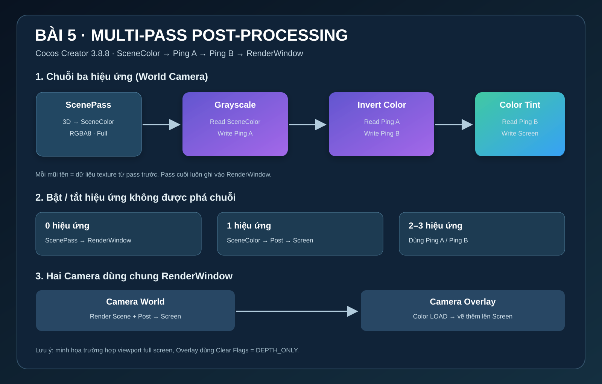

# Cocos Creator 3.8.8 — Custom Render Pipeline, Bài 5

## Post-processing nhiều pass: Grayscale, Invert Color, Color Tint

**Độ khó:** Trung bình. **Nền tảng:** Bài 1–4. **API:** New Render Pipeline / CRP, `rendering.BasicPipeline`.

> **Trạng thái kiểm chứng:** Các tên API được đối chiếu với tài liệu Cocos 3.8, TypeScript đã qua kiểm tra cú pháp và cú pháp YAML trong `.effect` đã được phân tích. **Chưa thực thi trong Editor Cocos Creator 3.8.8 hay engine custom của bạn.** Khi phát sinh lỗi, hãy kiểm tra log đầu tiên thay vì dựa vào kết quả kỳ vọng.



## 1. Mục tiêu của bài

Sau bài này bạn có thể:

1. Giải thích vì sao mỗi post-processing stage cần input và output khác tên.
2. Xây dựng RenderGraph động với 0, 1, 2 hoặc 3 hiệu ứng.
3. Truyền texture qua `pass.addTexture(name, 'inputTexture')` và uniform theo pass bằng `pass.setVec4(...)`.
4. Hiểu cách tổ chức hai texture trung gian `Ping A` / `Ping B`, kể cả khi thứ tự pass không đổi.
5. Thử chạy các pass trung gian ở kích thước toàn màn hình và nửa màn hình.
6. Giữ Camera Overlay (render sau) mà không bắt buộc tắt Camera thứ hai, trong phạm vi thí nghiệm.

### Những gì chưa học ở bài này

- Shader shadow, lighting PBR và các pass của Builtin.
- HDR, MSAA, Depth of Field, Bloom và tone mapping đúng chuẩn.
- Split-screen viewport, nhiều Camera xử lý post riêng trên cùng cửa sổ.
- Tối ưu thực tế của `ResourceResidency` và hàng rào GPU trên Native.

**Phạm vi Scene:** Camera World + Camera Overlay + Cube/Sphere từ bài cũ, nhưng để kiểm chứng đầu tiên nên bật duy nhất World (viewport = toàn màn hình) và dùng material Unlit. Sau đó mới bật Overlay.

---

## 2. Ôn lại dữ liệu đi qua RenderGraph

```text
World Camera
   └─ ScenePass (default)
      └─ SceneColor [RGBA8]
          └─ GrayscalePass (lesson5-colorfx)
             └─ Ping A [RGBA8]
                 └─ InvertPass (lesson5-colorfx)
                    └─ Ping B [RGBA8]
                        └─ TintPass (lesson5-colorfx)
                           └─ RenderWindow [screen]

Overlay Camera (nếu bật và cùng RenderWindow)
   └─ ScenePass (default)
      └─ RenderWindow, Color LOAD (nếu Clear Flags không có COLOR)
```

Không dùng cùng resource làm input và output của **một** pass để tránh việc vừa đọc vừa ghi không có cơ chế đồng bộ phù hợp. Trong bài này `SceneColor`, `Ping A`, `Ping B` và `window.colorName` luôn là những tên khác nhau.

### `#pragma rate` quan trọng thế nào?

Fragment shader khai báo:

```glsl
#pragma rate inputTexture pass
uniform sampler2D inputTexture;

#pragma rate Lesson5FXParams pass
uniform Lesson5FXParams {
    vec4 fxParams;
    vec4 fxTint;
};
```

Khi đó ta đặt per-pass data tại TypeScript:

```ts
pass.addTexture(inputName, 'inputTexture');
pass.setVec4('fxParams', new Vec4(mode, strength, 0, 0));
pass.setVec4('fxTint', tintVec4);
```

`pass` trong `#pragma rate ... pass` nói về **tần suất/binding dữ liệu**. Nó khác với thuộc tính `pass: lesson5-colorfx` trong `CCEffect`, thuộc tính dùng để khớp `addRenderPass(width,height,'lesson5-colorfx')`.

---

## 3. Cấu trúc project và thiết lập Editor

```text
assets/
  scripts/rendering/
    LearnCRPPipeline_Bai05.ts
  shaders/
    Lesson5ColorFX.effect
  materials/
    Mat_Lesson5ColorFX.mtl   (tạo trong Editor)
Scene
  CameraWorld
  CameraOverlay
  Cube
  Sphere
  RenderPipelineManager (gắn LearnCRPLesson5Entry)
```

**Trước khi import Bài 5:** Không để cả code đăng ký pipeline cũ Bài 4 và code đăng ký Bài 5 cùng hoạt động. Cả hai đều gọi `rendering.setCustomPipeline('LearnCRP', ...)`. Hãy xóa/di chuyển file đăng ký cũ ra khỏi `assets` hoặc loại bỏ lời gọi đăng ký cũ rồi mới chạy Bài 5. Trong Inspector cũng gỡ component Entry cũ.

Cách thao tác:

1. Đảm bảo `Project Settings → Graphics Settings → Render Pipeline (New)` đang chọn **LearnCRP**, New Render Pipeline bật.
2. Đưa `LearnCRPPipeline_Bai05.ts` vào `assets/scripts/rendering/`.
3. Đưa `Lesson5ColorFX.effect` vào `assets/shaders/`. Chờ import thành công (không có lỗi `Invalid render pass`).
4. Tạo Material `Mat_Lesson5ColorFX` và chọn Effect của Bài 5.
5. Tạo một Node root `RenderPipelineManager` độc lập với Camera; gắn component `LearnCRPLesson5Entry`, rồi kéo Material vào `Post Material`.
6. Cho `CameraWorld` Priority thấp hơn `CameraOverlay`; Camera Overlay nếu muốn vẽ đè thường để `Clear Flags = DEPTH_ONLY`, Camera World `SOLID_COLOR`.
7. Bật `enableGrayscale`, tắt `enableInvert` và `enableTint`, rồi Preview để kiểm tra một pass trước.
8. Khi chạy ổn mới bật các pass khác và tùy chọn half resolution.

**Quan trọng về lifecycle:** Không gắn `LearnCRPLesson5Entry` vào Camera World nếu dự kiến tắt Node World để test Overlay. Nếu tắt Node có Entry, `onDisable()` sẽ xóa Material khỏi builder.

**Viewport:** Bài này giả định World Camera là fullscreen. Không nên sử dụng sơ đồ post fullscreen của bài này cho split-screen vì post-pass đang dùng viewport `(0,0,width,height)` để dễ tập trung vào vấn đề texture.

---

## 4. Thuật toán của ba hiệu ứng

### A. Grayscale

```glsl
float luma = dot(color.rgb, vec3(0.2126, 0.7152, 0.0722));
vec3 gray = vec3(luma);
```

Cường độ `s` trong khoảng 0..1:

```glsl
mix(color.rgb, gray, s)
```

Ví dụ `(1,0,0)` có luma xấp xỉ `0.2126` nên thành `(0.2126,0.2126,0.2126)` khi `s = 1`.

### B. Invert Color

```glsl
vec3 inverted = vec3(1.0) - color.rgb;
vec3 outputRGB = mix(color.rgb, inverted, s);
```

Ví dụ màu `(0.2, 0.6, 0.9)` trở thành `(0.8,0.4,0.1)` khi `s=1`.

### C. Color Tint

```glsl
vec3 tinted = color.rgb * tint.rgb;
vec3 outputRGB = mix(color.rgb, tinted, s);
```

Đây là **multiplicative tint**, không phải cộng màu. Nếu tint đỏ `(1,0,0)`, output giữ thành phần đỏ và giảm các thành phần xanh lá/xanh dương.

**Alpha:** Tất cả ba hiệu ứng giữ nguyên `sourceColor.a`.

**Không gian màu:** Các phép tính được áp dụng trực tiếp lên giá trị sample từ `RGBA8`. Đây là ví dụ học RenderGraph; chưa xử lý đầy đủ gamma/linear/HDR.

---

## 5. Cách xây dựng 0/1/2/3 pass

| Số hiệu ứng bật | ScenePass ghi vào | Post 1 ghi vào | Post 2 ghi vào | Post 3 ghi vào |
|---|---|---|---|---|
| 0 | `window.colorName` | — | — | — |
| 1 | `SceneColor` | `window.colorName` | — | — |
| 2 | `SceneColor` | `Ping A` | `window.colorName` | — |
| 3 | `SceneColor` | `Ping A` | `Ping B` | `window.colorName` |

Một biến `applyPost` quyết định nhất quán **ScenePass output** và **có tạo PostPass hay không**. Đây là bài học quan trọng rút ra từ lỗi Bài 4 `Could not find texture with resource name Lesson4SceneColor_0`.

Sau mỗi pass:

```ts
inputName = outputName;
```

Pass sau sẽ đọc đúng resource vừa được viết. `Ping A`/`Ping B` chỉ cần thiết khi có nhiều pass.

### Phân biệt 0 stage và strength = 0

Code Bài 5 loại bỏ các stage tắt hoặc có `strength = 0`, vì kết quả của chúng về lý thuyết là đồng nhất với đầu vào. Vì thế giảm số stage thực thi. Đây là tối ưu cơ bản nhằm giảm draw call không cần thiết.

---

## 6. Thí nghiệm cần làm trong Editor

### Thí nghiệm 1: Không hiệu ứng

- `postMaterial = null` **hoặc** tắt cả `enableGrayscale`, `enableInvert`, `enableTint`.
- Kỳ vọng: ScenePass ghi trực tiếp vào RenderWindow; không tạo post-pass, không cố đọc `SceneColor`.
- Console `[Lesson5:Camera]`: `applyPost: false`.

### Thí nghiệm 2: Grayscale (1 pass)

- Grayscale bật, strength = 1; các hiệu ứng khác tắt.
- Kỳ vọng: Scene → SceneColor → RenderWindow; Cube và Sphere đen trắng.

### Thí nghiệm 3: Invert (1 pass)

- Grayscale tắt, Invert bật, strength = 1.
- Kỳ vọng: màu sáng thành tối và ngược lại trong không gian sample.

### Thí nghiệm 4: Tint (1 pass)

- Chỉ Tint bật, chọn màu `(255,170,120)` và strength = 0.5.
- Kỳ vọng: ảnh có xu hướng ấm hơn theo phép nhân màu; không thay đổi alpha.

### Thí nghiệm 5: Cả ba pass

- Bật Grayscale, Invert và Tint. Strength ban đầu lần lượt 1, 1, 0.5.
- Console log đầu 2 frame dự kiến ghi 3 post pass với input/output như hình ở đầu file.
- Lưu ý: Invert(Grayscale(X)) và Grayscale(Invert(X)) có thể gần nhau về độ sáng, nhưng Tint trước/sau Grayscale **không tương đương**. Thứ tự là một phần của thuật toán.

### Thí nghiệm 6: Nửa độ phân giải

- Giữ cả ba pass; tắt rồi bật `halfResolutionIntermediates`.
- Full: Ping A/B dùng WxH. Half: Ping A/B dùng floor(W/2) x floor(H/2).
- Pass cuối vẫn ghi ra RenderWindow WxH. Đầu vào của pass cuối được sample từ texture nhỏ hơn, nên có thể thấy mềm/mờ hoặc răng cưa tùy sampler.
- Đây **không phải đo tốc độ benchmark**, hiệu năng còn phụ thuộc GPU, shader, bandwidth, load/store và số pass.

### Thí nghiệm 7: Bật Camera Overlay (theo Scene Bài 3)

- World có Priority thấp; Overlay cao hơn và Clear Flags `DEPTH_ONLY`.
- Camera đầu tiên dùng post; Camera sau vẽ thẳng lên `RenderWindow` bằng `Color LOAD`.
- Nếu Overlay có Visibility nhận đúng layer Cube, bản thân nó có thể vẽ Cube lên ảnh đã xử lý **với màu gốc**. Đó là chủ ý để minh họa post chỉ áp dụng cho World.
- Nếu chỉ bật Overlay, nó trở thành Camera đầu tiên và có thể được áp dụng post-processing. Việc có thấy Cube hay không vẫn phụ thuộc Visibility, Camera projection/frustum, material và culling; bài này không tự khắc phục vấn đề Scene của những lần thử trước.

---

## 7. Giải thích các điểm cốt lõi trong code

### 7.1 Đăng ký trước resource Full và Half

Trong `windowResize()`, ta đăng ký `SceneColor` (full), `SceneDepth` và cả hai Ping Full/Half. Khi đổi toggle runtime, code chỉ thay tên resource được tham chiếu, không cố sử dụng một resource chưa khai báo.

### 7.2 ScenePass và PostPass phải tách biệt

- ScenePass render Mesh theo `SceneFlags.OPAQUE`, `MASK`, `BLEND|UI` vào một Color/Depth attachment.
- PostPass không gọi `addScene()`; nó dùng `addFullscreenQuad(material, 0)` để đọc texture trước và ghi kết quả.
- `QueueHint.OPAQUE` của post chỉ là hint; behavior blending thực tế do RenderState của Material.

### 7.3 Nhiều Camera

`visitedWindows` chỉ dùng để nhận diện **Camera đầu tiên** trong cùng RenderWindow, **không skip** Camera thứ hai. Với Camera sau không có bit Color Clear, ScenePass dùng `LoadOp.LOAD` để giữ ảnh đã có. Nếu Camera sau chủ động yêu cầu Color Clear, code giữ hành vi Clear.

Để bài học đơn giản, mỗi Camera dùng Depth mới, không chia sẻ depth kiểm tra che khuất giữa World và Overlay. Đây là quyết định demo, không phải đặc tả đầy đủ của Builtin.

### 7.4 Chú ý hạn chế của `LoadOp.CLEAR` + Viewport nhỏ

`LoadOp.CLEAR` có thể xóa Color attachment ở phạm vi vượt ra ngoài vùng viewport cần render. Vì thế bài này đặt hậu xử lý fullscreen; split-screen cần thiết kế riêng logic attachment/viewport và thường dùng scissor hoặc pass quản lý output khác.

---

## 8. Bảng xử lý lỗi hay gặp

| Log/triệu chứng | Thao tác kiểm tra | Điều không nên làm |
|---|---|---|
| `Could not find texture with resource name ...` | Kiểm tra mọi `outputName` có được đăng ký ở `windowResize`, không bị trùng tên, và `inputName` của pass sau bằng output pass trước. | Không chỉ đổi tên texture một chỗ. |
| `Invalid render pass, program ...` | Xác nhận `pass: lesson5-colorfx` trong `.effect` và `addRenderPass(...,'lesson5-colorfx')` khớp; chờ import/restart Editor nếu cần. | Không giả định lỗi chỉ nằm ở Vertex Shader. |
| `Unsupported Format ...` | Kiểm tra `SceneColor` và `SceneDepth` tên riêng, format `RGBA8` và `DEPTH_STENCIL` đúng. | Không đăng ký Depth đè tên Color. |
| Thấy màu Clear nhưng không thấy Cube | Thử chỉ bật World và 0 effect. Kiểm tra Camera Visibility/Frustum, SceneFlags/Phase. | Không sửa shader khi chưa xác minh ScenePass. |
| Overlay chỉ màu nền | Kiểm tra Camera nào render trước, `clearFlag`, `visibility`; thử mỗi Camera riêng ở chế độ 0 effect. | Không tự kết luận shader Grayscale lỗi. |
| Shader ra đen hoặc hồng | Kiểm tra Material đã gán, Effect import, `#pragma rate` và các bindings `inputTexture/fxParams/fxTint`. | Không gán `Material` null khi tạo post. |
| Lỗi UBO 18 > 12 WebGPU | Kiểm tra graphics backend và layout shader riêng; đây là lỗi khác với texture thiếu. | Không xóa bừa RenderQueue. |
| `onboarding.js` | Có thể do browser extension, thử Incognito không extension. | Không xem đây là bằng chứng lỗi pipeline. |

### Log được bổ sung

`[Lesson5:Camera]`: tên camera, có phải Camera đầu tiên không, có dùng post không, sceneTarget và clear mode.

`[Lesson5:PostPass]`: chỉ số effect, mode (0 gray/1 invert/2 tint), input, output, kích thước pass.

Các log chỉ in hai frame đầu tránh spam Console.

---

## 9. Bài tập tự làm

1. Đổi thứ tự hiệu ứng thành Invert → Tint → Grayscale; so sánh ảnh với thứ tự gốc.
2. Chỉ bật 2 hiệu ứng: kiểm tra `Ping B` không xuất hiện trong log.
3. Thử strength = 0 cho mọi hiệu ứng và kiểm tra đường render trực tiếp.
4. Thêm mode Sepia: cần bổ sung một branch shader và một lựa chọn stage mới.
5. Tìm hiểu tại sao Half Resolution chỉ có tác dụng khi **ít nhất 2 hiệu ứng** đang bật trong mã hiện tại.

Câu hỏi tự kiểm tra:

- Vì sao `RenderWindow` không nên đồng thời là input/output trong cùng post-pass?
- `pass: lesson5-colorfx` và `#pragma rate inputTexture pass` khác nhau như thế nào?
- Khi có 3 effect, tại sao cần Ping A/B mà không cần Ping C?
- Khi tắt toàn bộ effect, tài nguyên `SceneColor` có bắt buộc được GPU cấp phát không?

---

## 10. Tài liệu tham khảo

- Cocos 3.8 – Writing a Customizable Render Pipeline: https://docs.cocos.com/creator/3.8/manual/en/render-pipeline/write-render-pipeline.html
- Cocos 3.8 – Using the Built-in Render Pipeline: https://docs.cocos.com/creator/3.8/manual/en/render-pipeline/use-builtin-pipeline.html
- Cocos 3.8 – BasicPipeline API: https://docs.cocos.com/creator/3.8/api/en/interface/rendering.BasicPipeline
- Cocos example Effect: https://github.com/cocos/cocos-example-render-pipeline/blob/main/assets/shared-res/material/custom.effect

---

## 11. Mã nguồn TypeScript đầy đủ

Tệp tương ứng: `assets/scripts/rendering/LearnCRPPipeline_Bai05.ts`. Sao chép nguyên tệp bên dưới vào Cocos để thực hành.


```typescript
import {
    _decorator,
    Color,
    Component,
    gfx,
    Material,
    math,
    renderer,
    rendering,
    Vec4,
} from 'cc';

const { ccclass, property } = _decorator;

/**
 * BÀI 5 - Cocos Creator 3.8.8 (New Render Pipeline / CRP)
 *
 * - 0 effect: Scene -> RenderWindow
 * - 1 effect: SceneColor -> RenderWindow
 * - 2 effect: SceneColor -> Ping A -> RenderWindow
 * - 3 effect: SceneColor -> Ping A -> Ping B -> RenderWindow
 * - Camera đầu tiên trong mỗi RenderWindow được post-process.
 * - Camera tiếp theo render trực tiếp lên màn hình; COLOR LOAD khi
 *   Camera không yêu cầu clear màu (vd. Overlay DEPTH_ONLY).
 *
 * Hạn chế học tập: dùng camera viewport full screen, vật liệu unlit,
 * không shadow/HDR/MSAA/complex lighting. Chưa kiểm thử runtime ở dự án.
 */

type EffectKind = 0 | 1 | 2;
type EffectStage = { kind: EffectKind; amount: number };

type Lesson5Settings = {
    material: Material | null;
    grayscale: boolean;
    grayscaleAmount: number;
    invert: boolean;
    invertAmount: number;
    tint: boolean;
    tintAmount: number;
    tintColor: Color;
    halfResolution: boolean;
};

export class LearnCRPPipeline implements rendering.PipelineBuilder {
    private readonly settings: Lesson5Settings = {
        material: null,
        grayscale: true,
        grayscaleAmount: 1,
        invert: false,
        invertAmount: 1,
        tint: false,
        tintAmount: 0.5,
        tintColor: new Color(255, 170, 120, 255),
        halfResolution: false,
    };

    private debugFramesLeft = 2;

    public setOptions(options: Lesson5Settings): void {
        const s = this.settings;
        s.material = options.material;
        s.grayscale = options.grayscale;
        s.grayscaleAmount = math.clamp01(options.grayscaleAmount);
        s.invert = options.invert;
        s.invertAmount = math.clamp01(options.invertAmount);
        s.tint = options.tint;
        s.tintAmount = math.clamp01(options.tintAmount);
        s.tintColor.set(options.tintColor);
        s.halfResolution = options.halfResolution;
    }

    public clearOptions(): void {
        this.settings.material = null;
    }

    private sceneColorName(window: renderer.RenderWindow): string {
        return `Lesson5SceneColor_${window.renderWindowId}`;
    }

    private sceneDepthName(window: renderer.RenderWindow): string {
        return `Lesson5SceneDepth_${window.renderWindowId}`;
    }

    private pingName(
        window: renderer.RenderWindow,
        index: number,
        halfResolution: boolean,
    ): string {
        const slot = index % 2 === 0 ? 'A' : 'B';
        const scale = halfResolution ? 'Half' : 'Full';
        return `Lesson5Ping${slot}${scale}_${window.renderWindowId}`;
    }

    public windowResize(
        ppl: rendering.BasicPipeline,
        window: renderer.RenderWindow,
        _camera: renderer.scene.Camera,
        nativeWidth: number,
        nativeHeight: number,
    ): void {
        const width = Math.max(Math.floor(nativeWidth), 1);
        const height = Math.max(Math.floor(nativeHeight), 1);
        const halfWidth = Math.max(Math.floor(width / 2), 1);
        const halfHeight = Math.max(Math.floor(height / 2), 1);

        ppl.addRenderWindow(
            window.colorName,
            gfx.Format.RGBA8,
            width,
            height,
            window,
            window.depthStencilName,
        );

        // Tên và loại resource khác nhau; không ghi đè nhau.
        ppl.addRenderTarget(
            this.sceneColorName(window),
            gfx.Format.RGBA8,
            width,
            height,
        );
        ppl.addDepthStencil(
            this.sceneDepthName(window),
            gfx.Format.DEPTH_STENCIL,
            width,
            height,
        );

        // Đăng ký cả Full và Half từ windowResize. Khi đổi Inspector
        // lúc runtime, các pass có thể chọn resource đã đăng ký sẵn.
        for (let i = 0; i < 2; i++) {
            ppl.addRenderTarget(
                this.pingName(window, i, false),
                gfx.Format.RGBA8,
                width,
                height,
            );
            ppl.addRenderTarget(
                this.pingName(window, i, true),
                gfx.Format.RGBA8,
                halfWidth,
                halfHeight,
            );
        }
    }

    public setup(
        cameras: renderer.scene.Camera[],
        ppl: rendering.BasicPipeline,
    ): void {
        const visitedWindows = new Set<renderer.RenderWindow>();
        const stages = this.makeStages();
        const hasPost = this.settings.material !== null && stages.length > 0;

        for (const camera of cameras) {
            if (!camera.scene || !camera.window) continue;

            const isFirstInWindow = !visitedWindows.has(camera.window);
            visitedWindows.add(camera.window);

            // World (đầu tiên) dùng post; Overlay (sau) vẽ lên RenderWindow.
            const applyPost = isFirstInWindow && hasPost;
            this.buildCamera(camera, ppl, applyPost, isFirstInWindow, stages);
        }
        if (this.debugFramesLeft > 0) this.debugFramesLeft--;
    }

    private makeStages(): EffectStage[] {
        const s = this.settings;
        const result: EffectStage[] = [];
        if (s.grayscale && s.grayscaleAmount > 0) {
            result.push({ kind: 0, amount: s.grayscaleAmount });
        }
        if (s.invert && s.invertAmount > 0) {
            result.push({ kind: 1, amount: s.invertAmount });
        }
        if (s.tint && s.tintAmount > 0) {
            result.push({ kind: 2, amount: s.tintAmount });
        }
        return result;
    }

    private buildCamera(
        camera: renderer.scene.Camera,
        ppl: rendering.BasicPipeline,
        applyPost: boolean,
        isFirstInWindow: boolean,
        stages: EffectStage[],
    ): void {
        const window = camera.window;
        const width = Math.max(Math.floor(window.width), 1);
        const height = Math.max(Math.floor(window.height), 1);
        const viewport = this.cameraViewport(camera, width, height);
        const color = new gfx.Color(
            camera.clearColor.x,
            camera.clearColor.y,
            camera.clearColor.z,
            camera.clearColor.w,
        );

        const sceneTarget = applyPost
            ? this.sceneColorName(window)
            : window.colorName;
        const depthTarget = applyPost
            ? this.sceneDepthName(window)
            : window.depthStencilName;

        const scenePass = ppl.addRenderPass(width, height, 'default');
        scenePass.setViewport(viewport);

        // Pass đầu của mỗi window luôn CLEAR. Pass sau tuân theo camera.clearFlag:
        // Camera Overlay DEPTH_ONLY sẽ dùng Color LOAD để giữ màu World.
        const sceneColorLoad = isFirstInWindow || applyPost ||
            !!(camera.clearFlag & gfx.ClearFlagBit.COLOR)
            ? gfx.LoadOp.CLEAR
            : gfx.LoadOp.LOAD;

        scenePass.addRenderTarget(
            sceneTarget,
            sceneColorLoad,
            gfx.StoreOp.STORE,
            color,
        );

        // Đơn giản hóa cho bài học: mỗi Camera dùng depth mới.
        // Không chia sẻ kiểm tra che khuất giữa Camera World/Overlay.
        scenePass.addDepthStencil(
            depthTarget,
            gfx.LoadOp.CLEAR,
            gfx.StoreOp.DISCARD,
            camera.clearDepth,
            camera.clearStencil,
            gfx.ClearFlagBit.DEPTH_STENCIL,
        );

        const S = rendering.SceneFlags;
        const H = rendering.QueueHint;
        scenePass.addQueue(H.OPAQUE).addScene(camera, S.OPAQUE);
        scenePass.addQueue(H.MASK).addScene(camera, S.MASK);
        scenePass.addQueue(H.BLEND).addScene(camera, S.BLEND | S.UI);

        if (this.debugFramesLeft > 0) {
            console.log('[Lesson5:Camera]', {
                camera: camera.node?.name,
                windowId: window.renderWindowId,
                isFirstInWindow,
                applyPost,
                sceneTarget,
                stages: stages.map(s => s.kind),
                colorLoad: sceneColorLoad === gfx.LoadOp.CLEAR ? 'CLEAR' : 'LOAD',
            });
        }

        if (!applyPost || !this.settings.material) return;

        const half = this.settings.halfResolution;
        const postWidth = half ? Math.max(Math.floor(width / 2), 1) : width;
        const postHeight = half ? Math.max(Math.floor(height / 2), 1) : height;
        const tint = this.settings.tintColor;
        const tintVec = new Vec4(
            tint.r / 255,
            tint.g / 255,
            tint.b / 255,
            tint.a / 255,
        );
        const black = new gfx.Color(0, 0, 0, 1);
        let inputName = sceneTarget;

        for (let i = 0; i < stages.length; i++) {
            const last = i === stages.length - 1;
            const outputName = last
                ? window.colorName
                : this.pingName(window, i, half);
            const targetWidth = last ? width : postWidth;
            const targetHeight = last ? height : postHeight;

            const postPass = ppl.addRenderPass(
                targetWidth,
                targetHeight,
                'lesson5-colorfx',
            );
            postPass.setViewport(this.fullViewport(targetWidth, targetHeight));
            postPass.addRenderTarget(
                outputName,
                gfx.LoadOp.CLEAR,
                gfx.StoreOp.STORE,
                black,
            );
            postPass.addTexture(inputName, 'inputTexture');
            postPass.setVec4(
                'fxParams',
                new Vec4(stages[i].kind, stages[i].amount, 0, 0),
            );
            postPass.setVec4('fxTint', tintVec);
            postPass.addQueue(rendering.QueueHint.OPAQUE)
                .addFullscreenQuad(this.settings.material, 0);

            if (this.debugFramesLeft > 0) {
                console.log('[Lesson5:PostPass]', {
                    index: i,
                    mode: stages[i].kind,
                    inputName,
                    outputName,
                    size: `${targetWidth}x${targetHeight}`,
                });
            }
            // Đầu vào của pass kế tiếp là output vừa tạo.
            inputName = outputName;
        }
    }

    private cameraViewport(
        camera: renderer.scene.Camera,
        width: number,
        height: number,
    ): gfx.Viewport {
        const v = camera.viewport;
        const result = new gfx.Viewport();
        result.left = Math.round(v.x * width);
        result.top = Math.round(v.y * height);
        result.width = Math.max(Math.round(v.width * width), 1);
        result.height = Math.max(Math.round(v.height * height), 1);
        return result;
    }

    private fullViewport(width: number, height: number): gfx.Viewport {
        const v = new gfx.Viewport();
        v.left = 0;
        v.top = 0;
        v.width = width;
        v.height = height;
        return v;
    }
}

const BUILDER = new LearnCRPPipeline();
if (rendering) {
    rendering.setCustomPipeline('LearnCRP', BUILDER);
}

/**
 * Gắn component này trên Node RenderPipelineManager luôn active.
 * Không đặt trên CameraWorld nếu muốn tắt CameraWorld để test Overlay.
 */
@ccclass('LearnCRPLesson5Entry')
export class LearnCRPLesson5Entry extends Component {
    @property(Material)
    public postMaterial: Material | null = null;

    @property
    public enableGrayscale = true;

    @property({ range: [0, 1, 0.05] })
    public grayscaleStrength = 1;

    @property
    public enableInvert = false;

    @property({ range: [0, 1, 0.05] })
    public invertStrength = 1;

    @property
    public enableTint = false;

    @property({ range: [0, 1, 0.05] })
    public tintStrength = 0.5;

    @property(Color)
    public tintColor = new Color(255, 170, 120, 255);

    @property
    public halfResolutionIntermediates = false;

    protected onEnable(): void {
        this.sync();
    }

    protected update(_dt: number): void {
        // Để người học đổi thuộc tính ngay khi đang Preview.
        this.sync();
    }

    protected onDisable(): void {
        BUILDER.clearOptions();
    }

    private sync(): void {
        BUILDER.setOptions({
            material: this.postMaterial,
            grayscale: this.enableGrayscale,
            grayscaleAmount: this.grayscaleStrength,
            invert: this.enableInvert,
            invertAmount: this.invertStrength,
            tint: this.enableTint,
            tintAmount: this.tintStrength,
            tintColor: this.tintColor,
            halfResolution: this.halfResolutionIntermediates,
        });
    }
}

```

---

## 12. Shader Effect đầy đủ

Tệp tương ứng: `assets/shaders/Lesson5ColorFX.effect`.

```glsl
CCEffect %{
  techniques:
  - passes:
    - vert: lesson5-vs
      frag: lesson5-fs
      pass: lesson5-colorfx
      rasterizerState:
        cullMode: none
      depthStencilState:
        depthTest: false
        depthWrite: false
}%

CCProgram lesson5-vs %{
  precision highp float;
  #include <legacy/decode-standard>
  #include <builtin/uniforms/cc-global>
  #include <common/common-define>

  out vec2 v_uv;

  void main () {
    StandardVertInput In;
    CCDecode(In);
    CC_HANDLE_GET_CLIP_FLIP(In.position.xy);
    gl_Position = In.position;
    v_uv = a_texCoord;
  }
}%

CCProgram lesson5-fs %{
  precision highp float;
  in vec2 v_uv;

  // Các descriptor gắn với RenderPass, không phải thuộc tính của Material.
  #pragma rate inputTexture pass
  uniform sampler2D inputTexture;

  #pragma rate Lesson5FXParams pass
  uniform Lesson5FXParams {
    vec4 fxParams; // x: mode (0 gray, 1 invert, 2 tint), y: strength
    vec4 fxTint;   // RGB: tint [0,1]
  };

  layout(location = 0) out vec4 fragColor;

  void main () {
    vec4 sourceColor = texture(inputTexture, v_uv);
    float mode = fxParams.x;
    float strength = clamp(fxParams.y, 0.0, 1.0);
    vec3 processed = sourceColor.rgb;

    if (mode < 0.5) {
      float luma = dot(sourceColor.rgb, vec3(0.2126, 0.7152, 0.0722));
      processed = vec3(luma);
    } else if (mode < 1.5) {
      processed = vec3(1.0) - sourceColor.rgb;
    } else {
      processed = sourceColor.rgb * fxTint.rgb;
    }

    fragColor = vec4(mix(sourceColor.rgb, processed, strength), sourceColor.a);
  }
}%

```

---

## 13. Kết thúc Bài 5

Bạn đã làm được chuỗi nhiều post-pass có thể bật/tắt động và truyền dữ liệu texture qua RenderGraph. **Bài 6** sẽ đi sâu vào quản lý RenderTarget, khớp kích thước khi Resize, tách setting theo từng Camera, và tối ưu resource trong code dựa trên Builtin.
