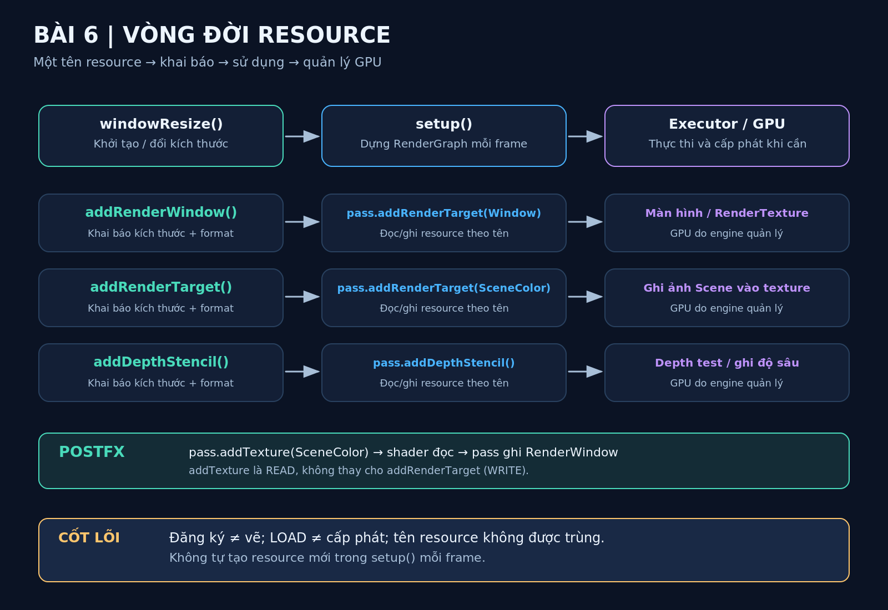
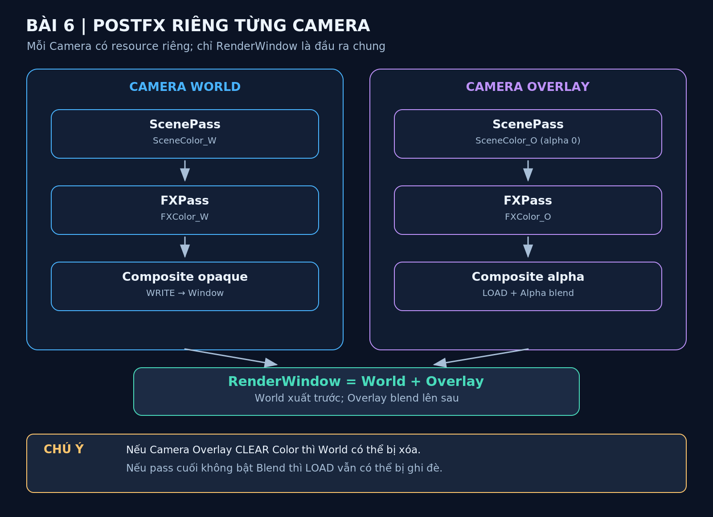
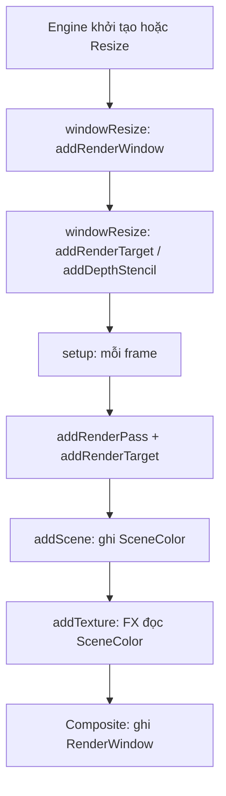

# Cocos Creator 3.8.8 – Bài 6: RenderTarget, Resize và PostFX riêng từng Camera

> **Đầu vào:** Bài 3 (World/Overlay, ClearFlag, Queue) + Bài 4 (SceneColor và Grayscale) + Bài 5 (PostFX và RenderGraph).
> **Đầu ra:** `LearnCRPPipeline_Bai06.ts` và `Lesson6ColorFX.effect`. Ví dụ này ưu tiên minh họa resource/resize/compositing, mỗi Camera chọn **một** hiệu ứng Grayscale / Invert / Tint. Bài 5 là bài thực hành *chuỗi nhiều hiệu ứng*; Bài 6 không thay thế hoàn toàn phần đó.
> **Kiểm thử:** Đã kiểm tra cú pháp TypeScript ở mức transpile và YAML phần `CCEffect`; **chưa chạy trực tiếp trong Cocos Creator 3.8.8 custom**. Phần blending alpha của Scene tùy thuộc Material và chế độ render.

## 1. Kết quả cần đạt

- Hiểu tại sao resource phải đăng ký theo tên duy nhất; World và Overlay không dùng chung SceneColor riêng.
- Nắm được vai trò của `windowResize()` và `setup()`; biết khi nào GPU mới dùng texture.
- Thay đổi kích thước Preview và nhận diện resource được cập nhật đồng bộ.
- Bật PostFX riêng cho World và Overlay, gán strength/mode khác nhau trong Inspector.
- Hiểu bước ghép `CompositePass` cần `LoadOp.LOAD` và alpha blending.
- Biết chẩn đoán `Could not find texture with resource name...`, `Unsupported Format`, `Invalid render pass`.

## 2. Sơ đồ render



[SVG nguồn: Bai06_Resource_Lifecycle.svg](Bai06_Resource_Lifecycle.svg)



[SVG nguồn: Bai06_PerCamera_Composite.svg](Bai06_PerCamera_Composite.svg)

### 2.1. Vòng đời tài nguyên



`windowResize()` thêm hoặc cập nhật mô tả resource (tên, format, kích thước); `setup()` dựng các pass sử dụng nó. **Không có quy tắc rằng resource vừa đăng ký nhất thiết được cấp phát ngay**: engine quyết định dựa trên sử dụng thực tế. Không đăng ký resource mới trong `setup()` mỗi frame.

### 2.2. Hai Camera cùng có PostFX

```text
WorldCamera (Priority thấp)       OverlayCamera (Priority cao)
  ScenePass → SceneColor_W          ScenePass → SceneColor_O (clear alpha = 0)
  FXPass    → FXColor_W             FXPass    → FXColor_O
  Composite → RenderWindow         Composite → RenderWindow
  OPAQUE (ghi trực tiếp)             ALPHA (LOAD + Blend)
                         ↓
                   Output cuối cùng
```

**Điểm quan trọng:** Kết quả World được ghi vào RenderWindow trước; Overlay giữ World bằng `LoadOp.LOAD`, và shader composite phải bật blend. `LOAD` một mình không đảm bảo kết quả trước còn hiển thị vì lệnh vẽ fullscreen có thể ghi đè pixel.

## 3. Chuẩn bị Scene (không tạo lại Scene cũ)

Giữ Camera World/Overlay và Cube từ Bài 3. Trong project chỉ để **một module** gọi `rendering.setCustomPipeline('LearnCRP', ...)`. Tắt/xóa file pipeline đăng ký cũ ở Bài 3–5 để tránh giành tên `LearnCRP`.

Tạo `assets/shaders/Lesson6ColorFX.effect`, import rồi tạo **Material** từ Effect. Mỗi Camera được gắn `Lesson6CameraSettings` (định nghĩa ngay trong file TypeScript Bài 6); component được thêm vào **Node chứa Camera**.

Đề xuất cho lần chạy đầu:

| Inspector | Camera World | Camera Overlay |
|---|---|---|
| Priority | 0 | 10 |
| Enable Post | true | true |
| Post Material | Material Lesson6ColorFX | Material Lesson6ColorFX |
| Effect Mode | GRAYSCALE | INVERT |
| Strength | 1 | 1 |
| Transparent Background | false | true |
| Composite With Alpha | false | true |
| Clear Flags | SOLID_COLOR | DEPTH_ONLY |
| Viewport / Rect | Full (0,0,1,1) | Full (0,0,1,1) |

**Lưu ý:** `Transparency` của texture không đồng nghĩa với việc Mesh được vẽ. Cube vẫn phải thuộc layer mà Camera nhìn thấy. Nếu Overlay không có vật thể nhìn thấy, lớp Overlay trong suốt nên hiển thị World chứ không vẽ thêm gì.

## 4. Resource naming – bảo vệ khỏi lỗi cũ

Hàm `resources(camera)` tạo một prefix từ **renderWindowId + UUID Node Camera**, sau đó nối hậu tố:

```ts
const key = `L6_W${windowId}_C${nodeId}`;
return {
  sceneColor: `${key}_SceneColor`,
  sceneDepth: `${key}_SceneDepth`,
  fxColor: `${key}_FXColor`,
};
```

Không dùng `camera.name` và không dùng index của Camera trong mảng, vì tên có thể trùng còn thứ tự có thể thay đổi khi bật/tắt Camera. Điều kiện giáo trình: mỗi Camera nằm trên một Node riêng (thông dụng trong Cocos). Tránh đổi UUID/tạo Node mới trong runtime mà không cho pipeline đăng ký lại resource.

**Lỗi Bài 4 từng gặp:** SceneColor/SceneDepth cùng tên gây lỗi format. **Lỗi Bài 5 từng gặp:** PostPass vẫn đọc SceneColor sau khi đã tắt nhánh ghi nó. Hai lỗi này được ngăn bằng cách dùng tên khác nhau và quyết định có tạo cả chuỗi post hay không từ cùng `applyPost`.

## 5. Giải thích các API trong chính code

### `ppl.addRenderWindow(name, format, w, h, renderWindow, depthStencilName)`

Đăng ký output gắn với RenderWindow. Các Camera dùng chung window vẫn ghi vào **một** `window.colorName`. Tham số cuối nói tới depth stencil thuộc framebuffer/window. Gọi lặp lại trong `windowResize` với thông số tương thích là hợp lệ.

### `ppl.addRenderTarget(name, format, w, h)`

Thêm hoặc cập nhật resource 2D dùng làm color render target. Tài nguyên `sceneColor`, `fxColor` được đăng ký theo **Camera**. `gfx.Format.RGBA8`: 4 byte mỗi pixel trước overhead/phụ thuộc nền tảng; với 1920×1080, xấp xỉ 7,9 MiB cho một RGBA8 (không MSAA).

### `ppl.addDepthStencil(name, format, w, h)`

Đăng ký một depth/stencil buffer riêng; `gfx.Format.DEPTH_STENCIL` dùng theo ví dụ CRP 3.8. Khi World và Overlay có depth riêng, chúng **không** tự occlude lẫn nhau.

### `ppl.containsResource(name)`

Kiểm tra resource đã được đăng ký hay chưa. Trong Bài 6, nếu Camera bật PostFX nhưng resource chưa sẵn sàng, code fallback sang render trực tiếp để tránh `Could not find texture ...`. **Không tự gọi addRenderTarget() trong setup** để chữa triệu chứng.

### `ppl.addRenderPass(w, h, passName)`

Tạo pass trong RenderGraph. Tên `default` dùng cho Scene; `lesson6-fx` / `lesson6-compose-opaque` / `lesson6-compose-alpha` **phải trùng** `pass:` tương ứng trong `.effect` cho fullscreen material.

### `pass.addRenderTarget(name, loadOp, storeOp, color)`

Chọn *attachment* color sẽ được ghi. `CLEAR` bắt đầu bằng màu quy định; `LOAD` lấy kết quả đã có; `STORE` giữ cho pass sau đọc/hiển thị. **Chú ý:** Khi pass được vẽ fullscreen, `LOAD` không ngăn shader ghi đè ảnh cũ; đó là lý do còn cần Blend.

### `pass.addDepthStencil(name, loadOp, storeOp, ...)`

Chọn Depth/Stencil attachment. Offscreen ScenePass của mỗi Camera trong ví dụ luôn CLEAR depth riêng và DISCARD sau vẽ, vì không pass nào cần load lại depth riêng đó. Direct ScenePass dùng window depth và STORE để Camera kế tiếp có thể LOAD, nếu thích hợp. Nếu Camera trước chỉ render offscreen, window depth vẫn *chưa* được khởi tạo; code xử lý tình huống này bằng `initializedWindowDepth`.

### `pass.addTexture(resourceName, 'inputTexture')`

Đọc texture đã được ghi trước đó trong RenderGraph, gán vào sampler `inputTexture` của shader, khai báo `#pragma rate inputTexture pass`. **Không đảo hai đối số**.

### `pass.setVec4('fxParams', ...)` / `pass.setVec4('fxTint', ...)`

Đặt hai uniform dạng `vec4` ở mức pass; `fxParams.x`: 0 = Grayscale, 1 = Invert, 2 = Tint; `fxParams.y`: strength. Cấu trúc shader phải khai báo `#pragma rate Lesson6FXParams pass` và uniform block cùng tên.

### `pass.addQueue(...).addScene(...)`

Vẽ Mesh/Scene theo Camera bằng các hàng đợi OPAQUE/MASK/BLEND | UI. Camera vẫn tuân theo `visibility`, culling/frustum và cài đặt vật liệu; RenderQueue không cho phép Camera bỏ qua culling.

### `pass.addQueue(...).addFullscreenQuad(material, passIndex)`

Vẽ fullscreen quad. `passIndex=0` chạy PostFX; `passIndex=1` dùng copy opaque; `passIndex=2` dùng copy với alpha blending. `passName` của RenderPass phải khớp pass Effect. Khác với vẽ Scene, fullscreen không yêu cầu Camera nhìn thấy Cube.

## 6. Hành trình một frame: World rồi Overlay

1. Engine gọi `setup(cameras, ppl)` với danh sách Camera đã sắp thứ tự.
2. Camera World: kiểm tra `Lesson6CameraSettings`, `containsResource`, viewport full; nếu hợp lệ, `applyPost=true`.
3. `buildOffscreenScene(World)` CLEAR `SceneColor_W`, CLEAR `SceneDepth_W`, vẽ World Scene.
4. `buildFX(World)` đọc `SceneColor_W`, ghi `FXColor_W` với mode World (thí dụ grayscale).
5. `buildComposite(World)` `LoadOp.CLEAR` RenderWindow, copy `FXColor_W` bằng pass không blend.
6. Camera Overlay: nguồn riêng `SceneColor_O`, clear alpha=0, vẽ các object Overlay thấy được.
7. `buildFX(Overlay)` đọc `SceneColor_O`, ghi `FXColor_O` với mode Overlay (thí dụ invert).
8. `buildComposite(Overlay)` `LoadOp.LOAD` RenderWindow, dùng pass 2 (`blend: true`) để vẽ Overlay lên World.
9. GPU thực thi RenderGraph, hiển thị kết quả.

**Quan trọng về alpha:** Overlay cần scene background trong suốt, Material của các đối tượng phải tạo alpha đúng; các trường hợp premultiplied alpha, blending đặc biệt, UI Canvas phức tạp hoặc skybox có thể cần composite shader phù hợp hơn. Đây là ví dụ minh họa, không phải compositor production đầy đủ.

## 7. Resize khác với setup ra sao?

```text
Mở cửa sổ 1280×720
  windowResize(Camera World) -> đăng ký 1280×720
  windowResize(Camera Overlay) -> đăng ký 1280×720
  setup() -> tạo pass đúng 1280×720, chạy mỗi frame

Kéo cửa sổ sang 1600×900
  windowResize(...) -> addRenderTarget(...) cập nhật 1600×900
  setup() -> tạo pass theo kích thước mới
```

**Không** thực hiện thay đổi kích thước giữa một frame, không dùng biến đếm frame làm một phần của tên resource. Trong `BasicPipeline`, `updateRenderTarget()`, `updateDepthStencil()` và `updateRenderWindow()` tồn tại nhưng được API 3.8 đánh dấu *deprecated*. `addRenderTarget()` và `addDepthStencil()` có nghĩa *add or update*, thích hợp dùng trong `windowResize` của bài này.

## 8. Residency và lifetime

Cocos CRP hỗ trợ các loại `ResourceResidency`: **MANAGED**, **MEMORYLESS**, **PERSISTENT**, **EXTERNAL**, **BACKBUFFER**.

- **MANAGED:** pipeline quản lý vòng đời; GPU có thể giải phóng trễ vài frame; không đồng nghĩa với cấp phát mới mỗi frame.
- **MEMORYLESS:** dành cho resource chỉ dùng trong một render pass (phụ thuộc hỗ trợ phần cứng); **không** phù hợp cho `SceneColor` cần được FXPass sample sau đó.
- **PERSISTENT:** giữ cho đến khi pipeline bị hủy, phù hợp khi cần dữ liệu xuyên frame.
- **EXTERNAL:** texture cấp từ ngoài pipeline; người dùng phải quản lý vòng đời phù hợp.
- **BACKBUFFER:** do hệ thống quản lý.

Mã mẫu không chỉ định `residency` tùy chọn, để API dùng thiết lập mặc định. Không tự thêm `MEMORYLESS` vào `SceneColor`/`FXColor` — sẽ làm luồng post-processing nhiều pass không đúng.

### 8.1. Ước lượng bộ nhớ (tham khảo)

Ở 1920×1080: một RGBA8 ≈ **7,91 MiB**. Mỗi Camera dùng 2 color textures ≈ 15,82 MiB, chưa kể Depth/Stencil, RenderWindow, framebuffer, MSAA, mipmap, overhead. Với 2 Camera, riêng 4 color textures ≈ 31,64 MiB, **chỉ khi cả 4 thực sự được cấp phát và giữ đồng thời**. Con số thực tế tùy GPU/engine và thời điểm sử dụng; đây không phải đo đạc.

## 9. Những thử nghiệm đề xuất

**A. Mọi PostFX tắt:** đặt `enablePost=false` trên cả hai Camera. Cả hai vẽ trực tiếp như Bài 3, không tạo các post pass.

**B. Chỉ World bật:** World Grayscale; Overlay vẽ trực tiếp, giữ kết quả World nếu không Clear Color.

**C. World + Overlay cùng bật:** World Grayscale, Overlay Invert, `transparentBackground=true`, `compositeWithAlpha=true`. Quan sát ảnh ghép và xác nhận overlay có object thuộc đúng layer.

**D. Hai Camera cùng một effect:** cả hai Grayscale nhưng strength 1.0/0.25 để thấy cấu hình độc lập.

**E. Resize:** kéo thay đổi kích thước Game Preview; xem log `[Lesson6:windowResize]`, bảo đảm từng Camera có đủ ba tên resource và size đúng.

**F. Thử tắt Camera World:** Overlay trở thành Camera đầu tiên; code composite bằng pass 1 opaque. Khi Overlay clear alpha=0, nền có thể khác lúc World còn bật: đây là hành vi dự kiến, không phải lỗi Scene culling.

**G. Đổi viewport Overlay nhỏ:** Ví dụ chỉ góc trên phải. Vì demo composite giả định full viewport, `applyPost=false` và fallback direct; Console báo cảnh báo. Đây là giới hạn đã được thiết kế để tránh fullscreen quad lấy UV sai.

## 10. Bảng debug khi lỗi

| Triệu chứng | Kiểm tra ưu tiên |
|---|---|
| `Could not find texture ...` | `windowResize` đã chạy cho Camera đang bật chưa? Log tên + `containsResource` |
| `Unsupported Format` | Có đặt nhầm `SceneColor` và `SceneDepth` cùng tên không? Định dạng có hợp lệ không? |
| `Invalid render pass` | Tên `lesson6-fx`, `lesson6-compose-*` trong code và `.effect` khớp chưa? Effect được import lại chưa? |
| World đen trắng, Overlay không vẽ Mesh | Visibility/layer, projection/frustum; debug bằng `enablePost=false` trên Overlay |
| Overlay xóa sạch World | Composite có dùng `LOAD`? `compositeWithAlpha=true`? `transparentBackground=true`? Clear Flags có COLOR? |
| Overlay viền đen | Alpha của Material đầu vào có premultiplied hay không? Composite src alpha có phù hợp? |
| Bật/tắt Camera phát sinh texture mới lỗi | Resource per-Camera phải được đăng ký trong `windowResize`; restart preview/trigger resize, xem containsResource |
| Resize sai vùng vẽ | Độ phân giải source texture phải theo `window.width/height`, post demo chỉ hỗ trợ full viewport |
| WebGPU uniform buffers exceeded | Lỗi hạn mức backend/shader riêng, không được xử lý bằng đổi tên RenderTarget |
| `onboarding.js` | Thường là browser extension content-script, không coi đây là log của CRP nếu engine không dẫn tới script này |

## 11. Mở rộng sau Bài 6

Bài 7 nên làm quen với cách tổ chức của **Builtin Pipeline**, cách tách cấu hình theo từng Camera và lựa chọn pass thay vì chỉ dùng một builder đơn giản; xem `internal/default_renderpipeline/builtin-pipeline.ts`, `builtin-pipeline-types.ts`, `builtin-pipeline-settings.ts` theo đúng engine 3.8.8.

## 12. Nguồn đối chiếu

- [Writing a Customizable Render Pipeline – 3.8](https://docs.cocos.com/creator/3.8/manual/en/render-pipeline/write-render-pipeline.html): `windowResize`, `setup`, resource naming và residency.
- [BasicPipeline – API 3.8](https://docs.cocos.com/creator/3.8/api/en/interface/rendering.BasicPipeline): `addRenderWindow`, `addRenderTarget`, `containsResource`, các hàm update deprecated.
- [Optional Pass Parameters – API 3.8](https://docs.cocos.com/creator/3.8/manual/en/shader/pass-parameter-list): cấu hình `blendState.targets` cho composite.
- [Decorator – 3.8](https://docs.cocos.com/creator/3.8/manual/en/scripting/decorator.html): cấu hình Inspector.

---

## PHỤ LỤC A – Full TypeScript (giữ nguyên với file .ts đính kèm)

```ts
/**
 * Bài 6 - Cocos Creator 3.8.8 CRP
 * Mục tiêu: resource riêng theo Camera, đăng ký/cập nhật ở windowResize,
 * fallback render trực tiếp và ghép alpha khi cả World + Overlay có post-processing.
 *
 * Cần gán Lesson6ColorFX.effect -> Material vào Lesson6CameraSettings.
 * Một Camera component trên mỗi Node; dùng Camera node.uuid làm resource key.
 * Phiên bản giáo trình: chưa kiểm thử runtime trên engine custom của người học.
 */
import {
    _decorator, Camera, Color, Component, Enum, gfx, Material, math,
    renderer, rendering, Vec4,
} from 'cc';

const { ccclass, property, requireComponent, disallowMultiple } = _decorator;

export enum Lesson6EffectMode {
    GRAYSCALE = 0,
    INVERT = 1,
    TINT = 2,
}
Enum(Lesson6EffectMode);

/** Mỗi Camera có một cấu hình riêng, KHÔNG dùng singleton sync() như Bài 5. */
@ccclass('Lesson6CameraSettings')
@requireComponent(Camera)
@disallowMultiple
export class Lesson6CameraSettings extends Component {
    @property
    public enablePost = true;

    @property(Material)
    public postMaterial: Material | null = null;

    @property({ type: Enum(Lesson6EffectMode) })
    public effectMode: Lesson6EffectMode = Lesson6EffectMode.GRAYSCALE;

    @property({ range: [0, 1, 0.05] })
    public strength = 1;

    @property(Color)
    public tintColor = new Color(255, 170, 120, 255);

    /** Camera Overlay: TRUE để clear SceneColor riêng với alpha = 0. */
    @property
    public transparentBackground = false;

    /** Camera thứ hai: TRUE để compose theo src_alpha/one_minus_src_alpha. */
    @property
    public compositeWithAlpha = false;
}

type CameraResources = {
    sceneColor: string;
    sceneDepth: string;
    fxColor: string;
};

export class LearnCRPPipeline implements rendering.PipelineBuilder {
    private debugFramesRemaining = 2;

    /** Tên ổn định qua các frame và resize; KHÔNG dùng index trong mảng cameras. */
    private resources(camera: renderer.scene.Camera): CameraResources {
        const windowId = camera.window.renderWindowId;
        const nodeId = camera.node!.uuid.replace(/[^a-zA-Z0-9_]/g, '_');
        const key = `L6_W${windowId}_C${nodeId}`;
        return {
            sceneColor: `${key}_SceneColor`,
            sceneDepth: `${key}_SceneDepth`,
            fxColor: `${key}_FXColor`,
        };
    }

    public windowResize(
        ppl: rendering.BasicPipeline,
        window: renderer.RenderWindow,
        camera: renderer.scene.Camera,
        nativeWidth: number,
        nativeHeight: number,
    ): void {
        const width = Math.max(1, Math.floor(nativeWidth));
        const height = Math.max(1, Math.floor(nativeHeight));

        // Mỗi window có một màu đầu ra chính; nhiều Camera cùng Window vẫn dùng chung.
        ppl.addRenderWindow(
            window.colorName, gfx.Format.RGBA8,
            width, height, window, window.depthStencilName,
        );

        if (!camera.node) return;
        const r = this.resources(camera);

        // addRenderTarget và addDepthStencil đều có thể thêm / cập nhật.
        // GỌI ở windowResize, KHÔNG đăng ký mới trong setup mỗi frame.
        ppl.addRenderTarget(r.sceneColor, gfx.Format.RGBA8, width, height);
        ppl.addDepthStencil(r.sceneDepth, gfx.Format.DEPTH_STENCIL, width, height);
        ppl.addRenderTarget(r.fxColor, gfx.Format.RGBA8, width, height);

        console.log('[Lesson6:windowResize]', {
            camera: camera.node.name, size: `${width}x${height}`,
            sceneColor: r.sceneColor, sceneDepth: r.sceneDepth, fxColor: r.fxColor,
        });
    }

    public setup(cameras: renderer.scene.Camera[], ppl: rendering.BasicPipeline): void {
        // Cameras đã được engine sắp xếp; thứ tự array ảnh hưởng composite.
        const visitedColorWindows = new Set<renderer.RenderWindow>();
        const initializedWindowDepth = new Set<renderer.RenderWindow>();

        for (const camera of cameras) {
            if (!camera.scene || !camera.window || !camera.node) continue;

            const window = camera.window;
            const isFirstInWindow = !visitedColorWindows.has(window);
            visitedColorWindows.add(window);

            const settings = camera.node.getComponent(Lesson6CameraSettings);
            const r = this.resources(camera);
            const fullViewport = this.isFullViewport(camera);
            const resourcesReady = ppl.containsResource(r.sceneColor)
                && ppl.containsResource(r.sceneDepth)
                && ppl.containsResource(r.fxColor);
            const applyPost = !!settings?.enabledInHierarchy
                && settings.enablePost
                && settings.postMaterial !== null
                && fullViewport
                && resourcesReady;

            if (settings?.enablePost && settings.postMaterial && !applyPost && this.debugFramesRemaining > 0) {
                console.warn('[Lesson6] PostFX bị bỏ qua: kiểm tra resource, viewport hoặc trạng thái component.', {
                    camera: camera.node.name, fullViewport, resourcesReady,
                    settingsEnabled: settings.enabledInHierarchy,
                });
            }

            if (applyPost && settings) {
                // Offscreen Depth riêng: không làm thay đổi depth của RenderWindow.
                this.buildOffscreenScene(camera, ppl, r, settings);
                this.buildFX(camera, ppl, r, settings);
                this.buildComposite(camera, ppl, r, settings, isFirstInWindow);
            } else {
                // Không post -> vẽ trực tiếp; vẫn phải giữ đúng clear/load của window.
                const depthInitialized = initializedWindowDepth.has(window);
                this.buildDirectScene(camera, ppl, isFirstInWindow, depthInitialized);
                initializedWindowDepth.add(window);
            }

            if (this.debugFramesRemaining > 0) {
                console.log('[Lesson6:setup]', {
                    camera: camera.node.name, windowId: window.renderWindowId,
                    isFirstInWindow, applyPost,
                    route: applyPost ? 'SceneColor -> FXColor -> Window' : 'Window direct',
                });
            }
        }

        if (this.debugFramesRemaining > 0) this.debugFramesRemaining--;
    }

    private buildOffscreenScene(
        camera: renderer.scene.Camera,
        ppl: rendering.BasicPipeline,
        r: CameraResources,
        settings: Lesson6CameraSettings,
    ): void {
        const width = Math.max(1, Math.floor(camera.window.width));
        const height = Math.max(1, Math.floor(camera.window.height));
        const clear = this.cameraClearColor(camera);
        if (settings.transparentBackground) {
            clear.x = 0; clear.y = 0; clear.z = 0; clear.w = 0;
        }

        const pass = ppl.addRenderPass(width, height, 'default');
        pass.setViewport(this.fullViewport(width, height));
        // Offscreen độc lập phải CLEAR; không LOAD texture mới với hy vọng có sẵn World.
        pass.addRenderTarget(r.sceneColor, gfx.LoadOp.CLEAR, gfx.StoreOp.STORE, clear);
        pass.addDepthStencil(
            r.sceneDepth, gfx.LoadOp.CLEAR, gfx.StoreOp.DISCARD,
            camera.clearDepth, camera.clearStencil, gfx.ClearFlagBit.DEPTH_STENCIL,
        );
        this.addSceneQueues(pass, camera);
    }

    private buildFX(
        camera: renderer.scene.Camera,
        ppl: rendering.BasicPipeline,
        r: CameraResources,
        settings: Lesson6CameraSettings,
    ): void {
        const width = Math.max(1, Math.floor(camera.window.width));
        const height = Math.max(1, Math.floor(camera.window.height));
        const tint = settings.tintColor;
        const pass = ppl.addRenderPass(width, height, 'lesson6-fx');
        pass.setViewport(this.fullViewport(width, height));
        pass.addRenderTarget(r.fxColor, gfx.LoadOp.CLEAR, gfx.StoreOp.STORE, new gfx.Color(0, 0, 0, 0));
        pass.addTexture(r.sceneColor, 'inputTexture');
        pass.setVec4('fxParams', new Vec4(settings.effectMode, math.clamp01(settings.strength), 0, 0));
        pass.setVec4('fxTint', new Vec4(tint.r / 255, tint.g / 255, tint.b / 255, tint.a / 255));
        pass.addQueue(rendering.QueueHint.OPAQUE)
            .addFullscreenQuad(settings.postMaterial!, 0);
    }

    private buildComposite(
        camera: renderer.scene.Camera,
        ppl: rendering.BasicPipeline,
        r: CameraResources,
        settings: Lesson6CameraSettings,
        isFirstInWindow: boolean,
    ): void {
        const window = camera.window;
        const width = Math.max(1, Math.floor(window.width));
        const height = Math.max(1, Math.floor(window.height));
        const clearWindow = isFirstInWindow || !!(camera.clearFlag & gfx.ClearFlagBit.COLOR);
        const passIndex = !isFirstInWindow && settings.compositeWithAlpha ? 2 : 1;
        const passName = passIndex === 2 ? 'lesson6-compose-alpha' : 'lesson6-compose-opaque';

        const pass = ppl.addRenderPass(width, height, passName);
        pass.setViewport(this.fullViewport(width, height));
        pass.addRenderTarget(
            window.colorName,
            clearWindow ? gfx.LoadOp.CLEAR : gfx.LoadOp.LOAD,
            gfx.StoreOp.STORE,
            this.cameraClearColor(camera),
        );
        pass.addTexture(r.fxColor, 'inputTexture');
        pass.addQueue(rendering.QueueHint.OPAQUE)
            .addFullscreenQuad(settings.postMaterial!, passIndex);
    }

    private buildDirectScene(
        camera: renderer.scene.Camera,
        ppl: rendering.BasicPipeline,
        isFirstInWindow: boolean,
        windowDepthInitialized: boolean,
    ): void {
        const window = camera.window;
        const width = Math.max(1, Math.floor(window.width));
        const height = Math.max(1, Math.floor(window.height));
        const clearColor = isFirstInWindow || !!(camera.clearFlag & gfx.ClearFlagBit.COLOR);
        const clearDepth = !windowDepthInitialized || !!(camera.clearFlag & gfx.ClearFlagBit.DEPTH_STENCIL);
        const pass = ppl.addRenderPass(width, height, 'default');
        pass.setViewport(this.cameraViewport(camera, width, height));
        pass.addRenderTarget(
            window.colorName, clearColor ? gfx.LoadOp.CLEAR : gfx.LoadOp.LOAD,
            gfx.StoreOp.STORE, this.cameraClearColor(camera),
        );
        if (clearDepth) {
            pass.addDepthStencil(
                window.depthStencilName, gfx.LoadOp.CLEAR, gfx.StoreOp.STORE,
                camera.clearDepth, camera.clearStencil, gfx.ClearFlagBit.DEPTH_STENCIL,
            );
        } else {
            pass.addDepthStencil(window.depthStencilName, gfx.LoadOp.LOAD, gfx.StoreOp.STORE);
        }
        this.addSceneQueues(pass, camera);
    }

    private addSceneQueues(pass: rendering.BasicRenderPassBuilder, camera: renderer.scene.Camera): void {
        const S = rendering.SceneFlags;
        const H = rendering.QueueHint;
        pass.addQueue(H.OPAQUE).addScene(camera, S.OPAQUE);
        pass.addQueue(H.MASK).addScene(camera, S.MASK);
        pass.addQueue(H.BLEND).addScene(camera, S.BLEND | S.UI);
    }

    private cameraClearColor(camera: renderer.scene.Camera): gfx.Color {
        const c = camera.clearColor;
        return new gfx.Color(c.x, c.y, c.z, c.w);
    }

    private isFullViewport(camera: renderer.scene.Camera): boolean {
        const v = camera.viewport;
        const eps = 0.0001;
        return Math.abs(v.x) < eps && Math.abs(v.y) < eps
            && Math.abs(v.width - 1) < eps && Math.abs(v.height - 1) < eps;
    }

    private fullViewport(width: number, height: number): gfx.Viewport {
        const viewport = new gfx.Viewport();
        viewport.left = 0;
        viewport.top = 0;
        viewport.width = width;
        viewport.height = height;
        return viewport;
    }

    private cameraViewport(camera: renderer.scene.Camera, width: number, height: number): gfx.Viewport {
        const v = camera.viewport;
        const result = new gfx.Viewport();
        result.left = Math.round(v.x * width);
        result.top = Math.round(v.y * height);
        result.width = Math.max(1, Math.round(v.width * width));
        result.height = Math.max(1, Math.round(v.height * height));
        return result;
    }
}

// Chỉ giữ MỘT module đăng ký tên 'LearnCRP' trong toàn project.
if (rendering) {
    rendering.setCustomPipeline('LearnCRP', new LearnCRPPipeline());
}
```

## PHỤ LỤC B – Full Effect Shader

```glsl
CCEffect %{
  techniques:
  - passes:
    # pass index 0: màu riêng cho Camera -> FXColor
    - vert: lesson6-vs
      frag: lesson6-fx-fs
      pass: lesson6-fx
      rasterizerState:
        cullMode: none
      depthStencilState:
        depthTest: false
        depthWrite: false

    # pass index 1: copy đè hoàn toàn cho World / camera không cần blend
    - vert: lesson6-vs
      frag: lesson6-copy-fs
      pass: lesson6-compose-opaque
      rasterizerState:
        cullMode: none
      depthStencilState:
        depthTest: false
        depthWrite: false

    # pass index 2: Overlay blend alpha để giữ kết quả camera trước
    - vert: lesson6-vs
      frag: lesson6-copy-fs
      pass: lesson6-compose-alpha
      rasterizerState:
        cullMode: none
      depthStencilState:
        depthTest: false
        depthWrite: false
      blendState:
        targets:
        - blend: true
          blendSrc: src_alpha
          blendDst: one_minus_src_alpha
          blendSrcAlpha: one
          blendDstAlpha: one_minus_src_alpha
}%

CCProgram lesson6-vs %{
  precision highp float;
  #include <legacy/decode-standard>
  #include <builtin/uniforms/cc-global>
  #include <common/common-define>

  out vec2 v_uv;
  void main () {
    StandardVertInput In;
    CCDecode(In);
    CC_HANDLE_GET_CLIP_FLIP(In.position.xy);
    gl_Position = In.position;
    v_uv = a_texCoord;
  }
}%

CCProgram lesson6-fx-fs %{
  precision highp float;
  in vec2 v_uv;

  #pragma rate inputTexture pass
  uniform sampler2D inputTexture;

  #pragma rate Lesson6FXParams pass
  uniform Lesson6FXParams {
    vec4 fxParams; // x: 0 gray, 1 invert, 2 tint; y: strength
    vec4 fxTint;
  };

  layout(location = 0) out vec4 fragColor;
  void main () {
    vec4 src = texture(inputTexture, v_uv);
    vec3 outRGB = src.rgb;
    if (fxParams.x < 0.5) {
      float y = dot(src.rgb, vec3(0.2126, 0.7152, 0.0722));
      outRGB = vec3(y);
    } else if (fxParams.x < 1.5) {
      outRGB = vec3(1.0) - src.rgb;
    } else {
      outRGB = src.rgb * fxTint.rgb;
    }
    fragColor = vec4(mix(src.rgb, outRGB, clamp(fxParams.y, 0.0, 1.0)), src.a);
  }
}%

CCProgram lesson6-copy-fs %{
  precision highp float;
  in vec2 v_uv;
  #pragma rate inputTexture pass
  uniform sampler2D inputTexture;
  layout(location = 0) out vec4 fragColor;
  void main () {
    fragColor = texture(inputTexture, v_uv);
  }
}%
```
