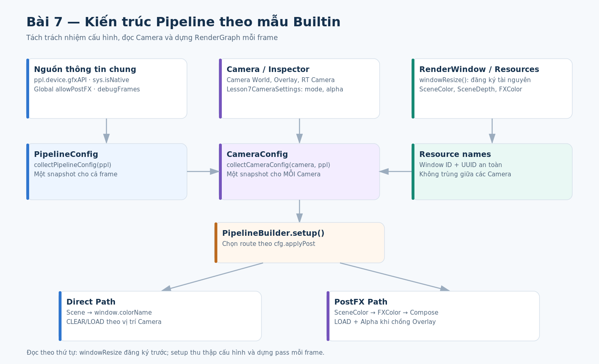
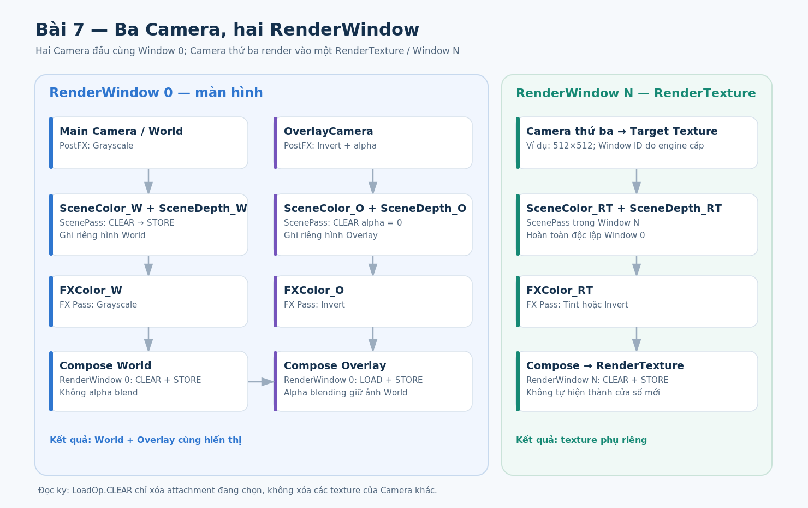
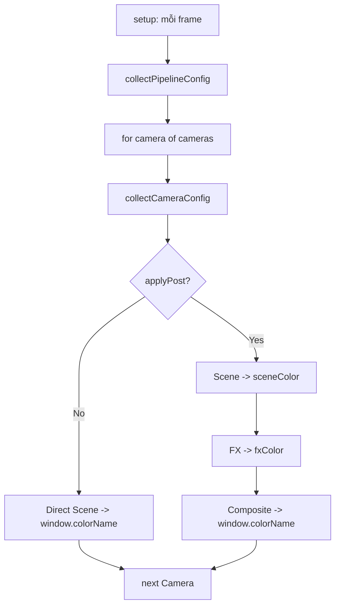

# Bài 7 — Tổ chức Custom Render Pipeline theo kiến trúc Builtin (Cocos Creator 3.8.8)

> **Mục tiêu:** Chuyển pipeline dạng một file của Bài 6 thành cấu trúc **PipelineConfig → CameraConfig → PipelineBuilder** giống *tư duy tổ chức* của Cocos Creator Builtin CRP. Chạy thử 2 Camera chung Window 0 và Camera thứ ba render vào RenderTexture (Window khác).
>
> **Phạm vi:** Ví dụ đào tạo **Forward Scene + một hiệu ứng màu/Camera + Composite**, không sao chép hay thay thế toàn bộ Builtin Pipeline (MSAA, shadow, HDR, bloom, tone mapping, editor gizmos, v.v.).
>
> **Trạng thái:** Đã kiểm tra cú pháp các file TypeScript, liên kết tên trong shader và cấu trúc Effect sơ bộ. **Chưa chạy trong Cocos Creator 3.8.8_Custom của bạn.**

## 0. Sơ đồ trực quan



[SVG vector: kiến trúc module](Bai07_KienTruc_Modules.svg)



[SVG vector: Multi-Camera/Multi-Window](Bai07_HaiRenderWindow_RenderGraph.svg)

**Đọc theo mũi tên:** Cocos gọi `windowResize()` để đăng ký resource; mỗi frame gọi `setup()`, lúc đó mới thu thập `PipelineConfig`, `CameraConfig` và dựng Scene/FX/Composite pass. `Window 0` chứa World + Overlay; `Window N` chứa Camera đang gắn `RenderTexture` (N không bắt buộc là 1).

## 1. Vì sao Bài 7 cần refactor?

Trong Bài 6, `LearnCRPPipeline` tự làm tất cả:

1. Tìm `Lesson6CameraSettings` trên Camera.
2. Tạo tên resource và xem texture đã đăng ký chưa.
3. Kiểm tra Viewport, chọn đường render Direct/PostFX.
4. Tạo pass và xử lý CLEAR/LOAD/STORE.
5. Quản lý Window khác nhau.

Khi thêm nhiều Camera, hiệu ứng hoặc chất lượng khác nhau, class trở nên khó thay đổi và khó kiểm thử. Cocos 3.8 dùng `BuiltinPipelineBuilder` để điều phối, đồng thời có hàm thu thập `PipelineConfigs` và `CameraConfigs` trước khi dựng render graph. **Ta mượn ý tưởng chia trách nhiệm, không copy toàn bộ code Builtin.**

Theo tài liệu chính thức:

- [Writing a Customizable Render Pipeline — Cocos 3.8](https://docs.cocos.com/creator/3.8/manual/en/render-pipeline/write-render-pipeline.html)
- [Using the Built-in Render Pipeline](https://docs.cocos.com/creator/3.8/manual/en/render-pipeline/use-builtin-pipeline.html)
- [Render Pipeline Overview](https://docs.cocos.com/creator/3.8/manual/en/render-pipeline/overview.html)

Tài liệu Cocos nêu file Builtin tại `editor/assets/default_renderpipeline/builtin-pipeline.ts`; và ba file thường dùng khi muốn sao chép Builtin làm nền: `builtin-pipeline.ts`, `builtin-pipeline-types.ts`, `builtin-pipeline-settings.ts`. Vị trí thực tế có thể khác trong bản Editor custom của bạn.

## 2. Cấu trúc file mới

Chép **4 TypeScript + 1 Effect** sau vào `assets/lessons/lesson7/`:

```text
assets/
└── lessons/
    └── lesson7/
        ├── Lesson7PipelineTypes.ts      # enum, interface, resource types
        ├── Lesson7CameraSettings.ts     # Inspector, gắn từng Camera
        ├── Lesson7PipelineConfig.ts     # collectPipelineConfig, collectCameraConfig
        ├── Lesson7PipelineBuilder.ts    # duy nhất đăng ký LearnCRP
        └── Lesson7ColorFX.effect        # FX / Copy Opaque / Copy Alpha
```

> **Quan trọng:** Chỉ một module còn gọi `rendering.setCustomPipeline('LearnCRP', ...)`. Bỏ đăng ký pipeline Bài 3–6 nếu vẫn dùng cùng tên, không nhất thiết xóa file asset nếu bạn vẫn lưu để học. Gỡ component `Lesson6CameraSettings` cũ trên các Camera và thay bằng `Lesson7CameraSettings`.

## 3. Lớp dữ liệu 1 — PipelineConfig

`Lesson7PipelineTypes.ts` định nghĩa:

```ts
export interface Lesson7PipelineConfig {
    graphicsAPI: gfx.API;
    isNative: boolean;
    isMobile: boolean;
    allowPostFX: boolean;
    verbose: boolean;
}
```

Trong `Lesson7PipelineConfig.ts`:

```ts
export const LESSON7_GLOBAL = {
    allowPostFX: true,
    debugFirstFrames: 3,
};

export function collectPipelineConfig(ppl: rendering.BasicPipeline, verbose: boolean): Lesson7PipelineConfig {
    return {
        graphicsAPI: ppl.device.gfxAPI,
        isNative: sys.isNative,
        isMobile: sys.isMobile,
        allowPostFX: LESSON7_GLOBAL.allowPostFX,
        verbose,
    };
}
```

Ý nghĩa: **Một cấu hình cấp pipeline áp dụng chung cho mọi Camera của frame hiện tại.** Giống hướng làm Builtin, có thể mở rộng thêm HDR, MSAA, chất lượng shadow, render scale, loại GPU... Trong Bài 7 các giá trị GPU/nền tảng chủ yếu phục vụ chẩn đoán; **không** tự giả định một API GPU có hỗ trợ một tính năng nào nếu chưa kiểm tra thật.

`allowPostFX = false` là **công tắc tổng**; Camera vẫn có component PostFX nhưng builder sẽ chọn Direct Path.

## 4. Lớp dữ liệu 2 — CameraSettings và CameraConfig

**CameraSettings** là component người dùng sửa trong Inspector; **CameraConfig** là snapshot mà PipelineBuilder sử dụng trong một lần dựng graph. Chúng không phải cùng một thứ.

`Lesson7CameraSettings.ts`:

```ts
@ccclass('Lesson7CameraSettings')
@requireComponent(Camera)
@disallowMultiple()
export class Lesson7CameraSettings extends Component {
    @property({ type: CCBoolean })
    public enablePost = true;

    @property(Material)
    public postMaterial: Material | null = null;

    @property({ type: Enum(Lesson7EffectMode) })
    public effectMode = Lesson7EffectMode.GRAYSCALE;

    // strength, tintColor, transparentBackground, compositeWithAlpha...
}
```

Lưu ý 2 lỗi của Bài 6 đã được phòng tránh:

- Primitive boolean dùng `@property({ type: CCBoolean })`, tránh cảnh báo metadata `undefined type` từng gặp.
- `postMaterial = null` đảm bảo kiểm tra Null/Truthy rõ ràng, không có trạng thái `undefined` ngoài ý muốn.

Hàm `collectCameraConfig(camera, ppl, pipelineConfig, firstInWindow)` lấy:

```ts
const resources = cameraResources(camera);
const settings = camera.node!.getComponent(Lesson7CameraSettings);
const fullViewport = isFullViewport(camera);
const resourcesReady = ppl.containsResource(resources.sceneColor)
    && ppl.containsResource(resources.sceneDepth)
    && ppl.containsResource(resources.fxColor);

const applyPost = pipelineConfig.allowPostFX
    && fullViewport && resourcesReady
    && !!settings && settings.enabledInHierarchy
    && settings.enablePost && !!settings.postMaterial;
```

**Kết quả `applyPost` được quyết định một lần**, sau đó Builder luôn sử dụng chung kết quả đó cho toàn bộ nhánh Scene → FX → Composite. Đây là cách tránh lỗi Bài 4: tắt SceneColor nhưng vẫn để PostPass đọc nó.

### 4.1. `firstInWindow` khác `applyPost`

| Trạng thái | Ý nghĩa |
|---|---|
| `firstInWindow` | Camera đầu tiên trong tập Camera dùng **cùng một RenderWindow** trong frame này |
| `applyPost` | Camera hiện tại có được xử lý PostFX không, dựa trên cấu hình/resources/viewport |

Hai biến hoàn toàn độc lập. World và Overlay đều có thể `applyPost = true`, còn `firstInWindow = true` chỉ dành cho Camera đầu tiên của Window 0.

### 4.2. Tạo tên resource không bị trùng

```ts
export function cameraResourceKey(camera: renderer.scene.Camera): string {
    const uuid = camera.node!.uuid;
    let hex = '';
    for (let i = 0; i < uuid.length; ++i) {
        hex += uuid.charCodeAt(i).toString(16).padStart(2, '0');
    }
    return `L7_W${camera.window.renderWindowId}_C${hex}`;
}
```

Đây là một dạng encode UUID **không làm mất thông tin từng ký tự**, không phụ thuộc regex. Tên dài hơn nhưng rõ ràng, tránh lỗi trước đó `replace(/[!a-zA-Z0-9_]/g, '_')` làm nhiều UUID thành chuỗi gạch dưới giống nhau.

Tên được suy ra từ Window ID + Camera Node UUID và giữ ổn định miễn Camera không đổi Window, không tạo Node mới. Trong ví dụ nếu **đổi `targetTexture` khi đang chạy**, cần để Cocos đăng ký lại resource ở thời điểm thích hợp trước khi `setup()` sử dụng.

## 5. Lớp dữ liệu 3 — Builder dựng RenderGraph

`Lesson7PipelineBuilder.ts` là file **duy nhất** gọi `setCustomPipeline`:

```ts
const BUILDER = new Lesson7PipelineBuilder();
if (rendering) {
    rendering.setCustomPipeline('LearnCRP', BUILDER);
}
```

Các trách nhiệm chính:

| Method | Làm gì? |
|---|---|
| `windowResize()` | Đăng ký `RenderWindow`, `SceneColor`, `SceneDepth`, `FXColor` cho Camera |
| `setup()` | Thu thập config, duyệt danh sách Camera đã sắp xếp, quyết định route |
| `buildDirectScene()` | Scene render trực tiếp ra `window.colorName` |
| `buildOffscreenScene()` | Scene render ra `SceneColor` riêng |
| `buildFX()` | Đọc `SceneColor`, ghi `FXColor` |
| `buildComposite()` | Đọc `FXColor`, ghi `window.colorName` |
| `addSceneQueues()` | Vẽ OPAQUE → MASK → BLEND/UI |

### 5.1. Luồng `windowResize()`

```ts
ppl.addRenderWindow(window.colorName, gfx.Format.RGBA8, width, height, window, window.depthStencilName);
const r = cameraResources(camera);
ppl.addRenderTarget(r.sceneColor, gfx.Format.RGBA8, width, height);
ppl.addDepthStencil(r.sceneDepth, gfx.Format.DEPTH_STENCIL, width, height);
ppl.addRenderTarget(r.fxColor, gfx.Format.RGBA8, width, height);
```

`addRenderWindow()` **không tạo thêm cửa sổ hệ điều hành**. RenderWindow mới phát sinh khi Camera được gán một đích render như RenderTexture. `addRenderWindow` đăng ký đích đó vào pipeline.

`addRenderTarget` ở mức `ppl` là **khai báo resource**, còn `pass.addRenderTarget` ở mức `pass` là **chọn resource để ghi**; không được nhầm hai API trùng tên.

### 5.2. Luồng `setup()`



`cameras` do Cocos đưa vào đã được sắp xếp theo thứ tự render. Builder không tự sắp lại theo tên Camera. Trong ví dụ `firstInWindow` được tính bằng `Set<renderer.RenderWindow>` theo **instance** của Window thay vì lấy string tên Camera.

## 6. RenderGraph của mỗi Camera

### 6.1. PostFX Path

```text
Camera World
  addSceneQueues -> ScenePass (SceneColor_W, SceneDepth_W)
  FXPass: addTexture(SceneColor_W) -> FXColor_W
  ComposePass: addTexture(FXColor_W) -> Window 0

Camera Overlay
  addSceneQueues -> ScenePass (SceneColor_O, SceneDepth_O)
  FXPass: addTexture(SceneColor_O) -> FXColor_O
  ComposePass: addTexture(FXColor_O) -> Window 0 (LOAD + Alpha Blend)
```

**Ghi nhớ:** FXPass Clear `fxColor` chỉ ảnh hưởng tới attachment `fxColor`, không xóa `window.colorName`. `window.colorName` đã chứa ảnh World và được Overlay Composite `LOAD` trước khi blend.

### 6.2. Direct Path

Không có PostFX hoặc không đủ điều kiện → một ScenePass ghi trực tiếp vào `window.colorName`:

```ts
pass.addRenderTarget(window.colorName, firstOrColorClear ? gfx.LoadOp.CLEAR : gfx.LoadOp.LOAD,
                     gfx.StoreOp.STORE, clearColor);
```

Depth window: dùng CLEAR nếu chưa có Direct Camera nào khởi tạo window depth, hoặc Camera yêu cầu Clear Depth/Stencil; nếu không, dùng LOAD. **Đây là quyết định minh họa**, không tương đương toàn bộ chiến lược camera stacking của Builtin.

### 6.3. Transparent Overlay và alpha blend

Trong Editor:

- World: `transparentBackground = false`, `compositeWithAlpha = false`, CLEAR Color theo Camera đầu.
- Overlay: `transparentBackground = true`, `compositeWithAlpha = true`, **Camera Clear Flags không chứa COLOR** để CompositePass LOAD kết quả World.

Cần **cả** vùng background alpha 0 và shader composite alpha blend, nếu muốn nền Overlay cho World hiện xuyên qua. Shader FX trong file giữ `src.a`.

Một Camera khác render sau Overlay với `ClearFlag.COLOR` có thể xóa mọi kết quả đã ghép. Tránh suy luận rằng việc dùng hai Camera cùng Window bảo đảm hiển thị cả hai.

## 7. Hai RenderWindow: Camera thứ ba dùng RenderTexture

Cách thử:

1. Trong Assets tạo `RenderTexture` (ví dụ 512×512).
2. Gán vào `Target Texture` của Camera thứ ba.
3. `Main Camera` và `OverlayCamera` tiếp tục `Target Texture = None`.
4. Mỗi Camera có `Lesson7CameraSettings`; tùy chọn bật/tắt PostFX độc lập.
5. Bật Preview, xem log `[Lesson7:Resize]` và `[Lesson7:Route]`.

Sơ đồ mong đợi:

```text
Window 0 (màn hình)
  MainCamera      -> SceneColor_Main -> FXColor_Main -> window.colorName 0
  OverlayCamera   -> SceneColor_Over -> FXColor_Over -> window.colorName 0 (alpha blend)

Window N (RenderTexture)
  Camera thứ ba   -> SceneColor_RT   -> FXColor_RT   -> window.colorName N
```

**Không có Window thứ hai hiện như tab trình duyệt mới.** Muốn xem RenderTexture, dùng nó làm texture của Sprite/Material hoặc cách preview tương ứng. Window ID được engine cấp, không hard-code `1`.

## 8. Tên pass phải khớp shader

Shader `Lesson7ColorFX.effect` có ba pass theo index:

| Index | `pass:` trong shader | Vai trò |
|---:|---|---|
| 0 | `lesson7-fx` | Grayscale / Invert / Tint |
| 1 | `lesson7-copy-opaque` | Copy fullscreen, không blend |
| 2 | `lesson7-copy-alpha` | Copy fullscreen, Alpha Blending |

Trong builder:

```ts
const fxPass = ppl.addRenderPass(w, h, 'lesson7-fx');
fxPass.addTexture(r.sceneColor, 'inputTexture');
fxPass.setVec4('fxParams', new Vec4(mode, strength, 0, 0));
fxPass.addQueue(rendering.QueueHint.OPAQUE).addFullscreenQuad(material, 0);
```

Shader cần `#pragma rate inputTexture pass` với `uniform sampler2D inputTexture`; `fxParams` và `fxTint` phải nằm trong uniform block `#pragma rate Lesson7FXParams pass`.

Nếu Editor báo `Invalid render pass`, kiểm tra **tên pass trong shader, thứ tự Material passes, material được gán và việc Editor import lại Effect**. Lỗi đó khác lỗi thiếu texture trong RenderGraph.

## 9. Thực hành từng bước (không cần sửa Scene Cube cũ)

1. Sao lưu trạng thái Bài 6. Chép 5 file vào cùng thư mục để các import tương đối đúng.
2. Chỉ còn một module gọi `setCustomPipeline('LearnCRP', ...)`; bật pipeline `LearnCRP` trong Graphics Settings.
3. Tạo Material từ `Lesson7ColorFX.effect`.
4. Gỡ `Lesson6CameraSettings` cũ, gắn `Lesson7CameraSettings` vào **Node chứa Camera**, không phải Cube.
5. Main Camera: Post ON / GRAYSCALE / Strength 1 / Transparent OFF / Composite Alpha OFF.
6. OverlayCamera: Post ON / INVERT / Strength 1 / Transparent ON / Composite Alpha ON. Camera này không Clear Color ở RenderWindow.
7. Camera thứ ba (nếu có): gán `RenderTexture` ở Target Texture, Post ON / TINT. Kích thước RT có thể là 512×512.
8. Play và đối chiếu log route. Sau đó đổi Strength, bật/tắt Post riêng, resize Preview.

### Log mong đợi

```text
[Lesson7:Resize] Camera Main ... windowId: 0 ... sceneColor unique
[Lesson7:Resize] OverlayCamera ... windowId: 0 ... sceneColor khác Main
[Lesson7:Resize] Camera RT ... windowId: N ... sceneColor khác cả hai

[Lesson7:Route] Main Camera    windowId 0  first=true  applyPost=true
[Lesson7:Route] OverlayCamera  windowId 0  first=false applyPost=true
[Lesson7:Route] Camera         windowId N  first=true  applyPost=true
```

Nếu `applyPost=false`, xem `fullViewport`, `resourcesReady` và cấu hình material. `settings.enabledInHierarchy` phải true.

## 10. Bảng thí nghiệm

| Thử nghiệm | Thay đổi | Kết quả cần quan sát |
|---|---|---|
| A | `LESSON7_GLOBAL.allowPostFX=false` | Mọi Camera Direct Path; không còn FX/Composite |
| B | World Post ON, Overlay Post OFF | World Grayscale; Overlay trực tiếp lên Window (nếu camera thấy Cube) |
| C | Overlay `transparentBackground=false`, `compositeWithAlpha=true` | Nền Overlay có thể vẫn che World vì alpha thường = 1 |
| D | Overlay `transparentBackground=true`, `compositeWithAlpha=false` | Overlay Copy Opaque, dù alpha 0 vẫn có thể ghi đè màu World |
| E | Overlay bật cả hai, Clear Flags DEPTH_ONLY | World vẫn thấy ở vùng không có Overlay |
| F | Overlay bật Clear Color | Composite dùng CLEAR; World bị xóa trước khi blend |
| G | Camera thứ ba gán RenderTexture | Window ID tách ra, resource vẫn khác nhau |
| H | Camera thứ ba thay size RT rồi Play lại | `windowResize()` đăng ký resource theo kích thước mới |
| I | Chỉnh Rect của Camera sang non-full | Fallback Direct Path theo giới hạn minh họa của bài |

**Phân tích hiệu năng:** Với một Camera có PostFX, ví dụ thường tạo ScenePass + FXPass + CompositePass thay vì Direct ScenePass, đồng thời thêm SceneColor và FXColor trung gian. Bật nhiều Camera đồng nghĩa nhiều draw fullscreen và nhiều tài nguyên. Chưa dùng cơ chế allocator nâng cao hay reuse ping-pong.

## 11. Những điểm *khác Builtin thật*

Bài 7 chưa xử lý: Skybox/PBR đầy đủ tùy pass/scene; light/shadow pass, MSAA resolve, HDR/Tonemap, bloom, FSR/FXAA, multi-viewport PostFX, camera depth sharing giữa đường offscreen/direct, pipeline event hooks, resource lifetime theo budget, dynamic camera registration ở runtime, alpha premultiplication phức tạp.

Cụ thể, `ScenePass` ở ví dụ chỉ có OPAQUE, MASK, BLEND/UI. **Không nên lấy đoạn code này làm Builtin thay thế cho một game production** mà chưa bổ sung các flow tương ứng.

Cocos gợi ý copy ba script Builtin từ thư mục render pipeline mặc định rồi sửa nếu dự án cần giữ gần như toàn bộ khả năng Builtin. Vì vậy **hướng học sau** là dùng sơ đồ Bài 7 để đọc source `builtin-pipeline.ts`, `builtin-pipeline-types.ts`, `builtin-pipeline-settings.ts`, rồi nhận diện từng config và từng builder/pass.

## 12. Những lỗi thường gặp và cách xác định

| Triệu chứng | Nguyên nhân cần kiểm tra |
|---|---|
| `Could not find texture with resource name ...` | Tên không đăng ký trong windowResize, hoặc pass đọc resource không được ghi |
| `Unsupported Format` | Texture depth/color bị dùng sai type hoặc tên resource bị trùng |
| `Invalid render pass` | `pass` shader không khớp `addRenderPass`, Material, cache Effect |
| `undefined type to cc property` | Boolean decorator thiếu `CCBoolean`, import vòng |
| Cả Camera World/Overlay cùng ra một SceneColor | UUID encoding bị lỗi, tên resource trùng |
| Chỉ thấy Overlay, World mất | Overlay composite CLEAR, không bật blend, background alpha = 1 hoặc Camera thứ ba xóa màu |
| Camera thứ ba không hiện trong Preview | Nó render vào RenderTexture, cần chỗ hiển thị texture này |
| Camera viewport nhỏ không có PostFX | Ví dụ cố ý cho Direct Path khi viewport không full |

**Không nhầm với** `onboarding.js:48 Uncaught (in promise) undefined` có thể đến từ browser extension: xem thêm stack và đường dẫn script trước khi quy lỗi cho Cocos.

## 13. Bài tập tự làm

1. Thêm `Lesson7Quality` enum vào `Lesson7PipelineConfig`, cho phép bỏ PostFX trên các camera tùy ý.
2. Thêm `cameraRenderOrder` vào log và đối chiếu với Camera Priority trong Inspector.
3. Tạo `collectResourceConfigs(...)` trả danh sách resource, để `windowResize` không phải viết ba lần `add...` thủ công.
4. Bổ sung chính sách dùng chung Depth giữa Camera World/Overlay trong cùng Window (cần đánh giá rõ khi nào CLEAR/LOAD/STORE).
5. Thử tìm các hàm tương đương trong source Builtin và ghi lại: **Config thu thập cái gì? Builder dùng config ấy ở pass nào?**

## 14. Tóm tắt kiến thức

```text
Editor/Platform -> PipelineConfig
Camera/Inspector -> CameraConfig

windowResize -> đăng ký resource ổn định, riêng từng camera/window
setup -> collect PipelineConfig -> collect CameraConfig -> chọn Direct hoặc PostFX
PostFX -> SceneColor -> FXColor -> Composite -> RenderWindow
Overlay -> LOAD + Alpha Blend để giữ World
RenderTexture -> một RenderWindow nội bộ khác, không tự sinh cửa sổ Preview mới
```

**Kế hoạch Bài 8:** Bắt đầu đọc source Builtin và xây modular pass builder cho Shadow/Forward/Post; cần nhận diện dependency và ranh giới giữa các flow trước khi thêm chức năng phức tạp.

## 15. Tham khảo chính thức

- [Cocos Creator 3.8 – Writing a Customizable Render Pipeline](https://docs.cocos.com/creator/3.8/manual/en/render-pipeline/write-render-pipeline.html)
- [Cocos Creator 3.8 – Using the Built-in Render Pipeline](https://docs.cocos.com/creator/3.8/manual/en/render-pipeline/use-builtin-pipeline.html)
- [Cocos Creator 3.8 – Render Pipeline Overview](https://docs.cocos.com/creator/3.8/manual/en/render-pipeline/overview.html)
- [Cocos Creator 3.8 – BasicPipeline API](https://docs.cocos.com/creator/3.8/api/en/interface/rendering.BasicPipeline)
