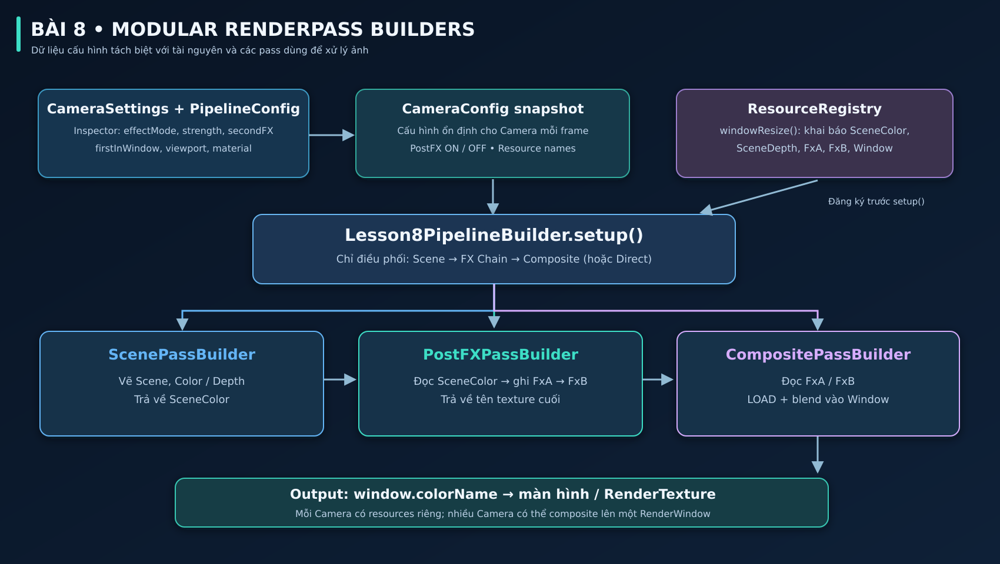
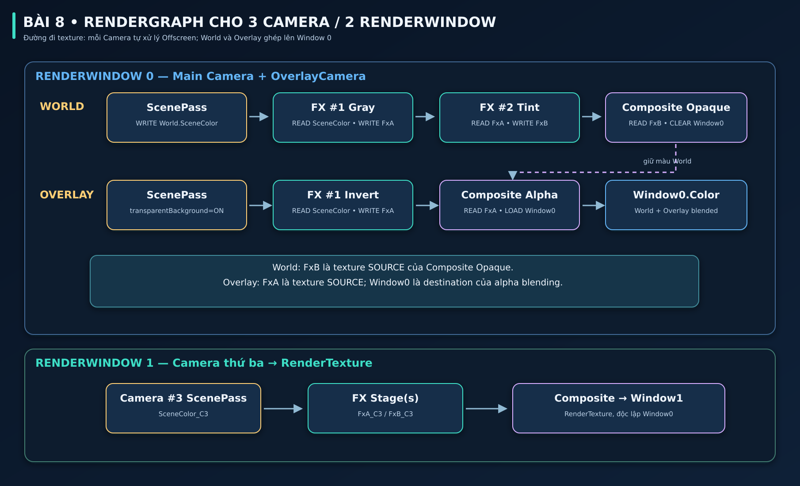
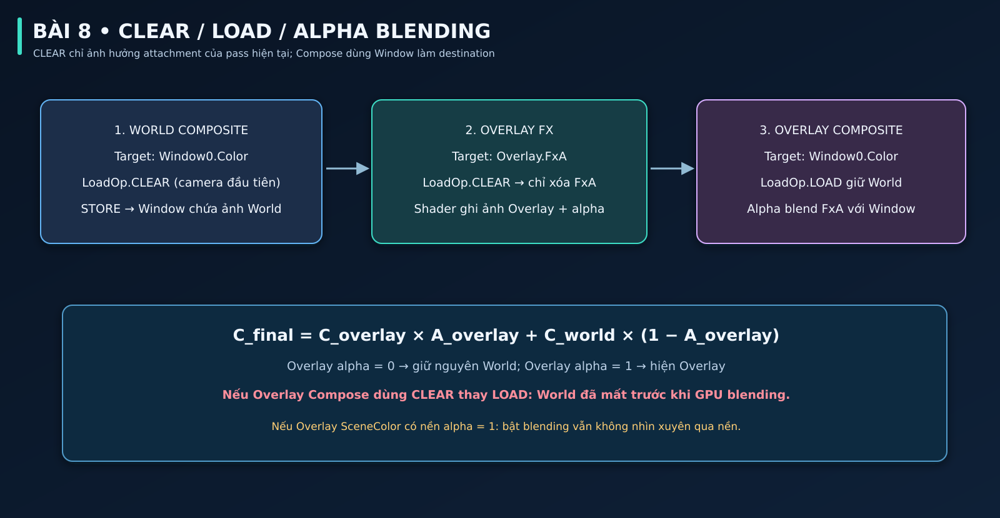

# Bài 8 — Modular RenderPass Builders & PostFX Chain

> **Cocos Creator 3.8.8 / 3.8.8_Custom** · Tiếp nối Bài 7 · TypeScript + `.effect` · Mục tiêu: tách trách nhiệm, nối texture bằng tên resource, hiểu mô hình Builtin CRP ở mức thiết kế.
>
> **Phạm vi**: minh hoạ một hệ forward đơn giản. Đây **không** phải mã chính thức của `BuiltinPipelineBuilder`. Không tích hợp HDR, ShadowMap, MSAA, Bloom, AA hay tính toán color space đầy đủ. Chưa chạy được trên engine custom của học viên.



## 1. Học được gì?

Sau bài này, bạn có thể:

1. Giải thích sự khác nhau giữa **đăng ký resource** (`addRenderTarget`) và **dùng resource làm attachment** (`pass.addRenderTarget`).
2. Hiểu `ScenePassBuilder`, `PostFXPassBuilder`, `CompositePassBuilder` làm gì, và tại sao `PipelineBuilder` không cần gọi `addRenderPass` trực tiếp.
3. Thay đổi *số lượng PostFX pass* mà không sửa ScenePass và CompositePass.
4. Lần theo `SceneColor -> FxA -> FxB -> RenderWindow` và chứng minh không có pass nào vừa đọc vừa ghi cùng một resource.
5. Debug **hai Camera cùng window**, hoặc **3 Camera chia thành 2 window**.
6. Phân biệt `gfx.LoadOp.CLEAR` / `LOAD`, `gfx.StoreOp.STORE` / `DISCARD`, và alpha blending.

## 2. Từ Bài 7 sang Bài 8: tách thành module

### Bài 7

`Lesson7PipelineBuilder` có `buildOffscreenScene`, `buildFX`, `buildComposite`, `buildDirectScene`: tuy có `CameraConfig`, logic xây pass vẫn ở chung một class.

### Bài 8

```text
assets/lessons/lesson08/
├── Lesson8PipelineTypes.ts          — Các interface, enum
├── Lesson8CameraSettings.ts         — Inspector, cấu hình của từng Camera
├── Lesson8PipelineConfig.ts         — Snapshot, tạo tên resource, viewport
├── Lesson8ResourceRegistry.ts       — Đăng ký resource tại windowResize()
├── Lesson8ScenePassBuilder.ts       — SceneOffscreen và SceneDirect
├── Lesson8PostFXPassBuilder.ts      — Chain 1/2 post-processing stages
├── Lesson8CompositePassBuilder.ts   — Copy opaque hoặc alpha blend ra Window
├── Lesson8PipelineBuilder.ts        — Điều phối; file duy nhất gọi setCustomPipeline
└── Lesson8ColorFX.effect            — 3 material passes: FX / Copy / Alpha
```

**Quan trọng:** Cả 9 file đặt cùng thư mục để các import `./...` hoạt động. Tránh giữ file Bài 7 hoặc Bài 6 đang đăng ký **cùng tên** `LearnCRP` (có thể import chồng nhau theo thứ tự script).

### Bản chất của module

- `ScenePassBuilder` không biết effect mode và shader; chỉ biết Camera, Scene, Color/Depth, queues.
- `PostFXPassBuilder` không biết Camera sẽ hiển thị ở màn hình hay RenderTexture; nó chỉ nhận **một tên resource đầu vào** rồi trả **một tên resource đầu ra**.
- `CompositePassBuilder` không biết Scene có bao nhiêu pass; chỉ nhận **tên ảnh cuối**, ghép lên `window.colorName`.
- `Lesson8PipelineBuilder` là **orchestrator**: gọi module theo thứ tự logic.

## 3. Sơ đồ RenderGraph đầy đủ



Giả sử World và Overlay cùng `windowId=0`, World render trước:

```text
World:
  World ScenePass       WRITE World.SceneColor
  FX Grayscale          READ  World.SceneColor -> WRITE World.FxA
  FX Tint               READ  World.FxA       -> WRITE World.FxB
  Composite Opaque      READ  World.FxB       -> WRITE Window0.Color (CLEAR)

Overlay:
  Overlay ScenePass     WRITE Overlay.SceneColor (transparent black)
  FX Invert             READ  Overlay.SceneColor -> WRITE Overlay.FxA
  Composite Alpha       READ  Overlay.FxA -> BLEND with Window0.Color (LOAD)

Final Window0.Color = World + Overlay.
```

Nếu Camera thứ ba có `targetTexture` riêng, Camera đó thuộc một `RenderWindow` khác, có `firstInWindow = true` **đối với Window của nó**; kết quả không trộn với `Window0` trừ khi bạn chủ động đưa RenderTexture của nó lên UI.

## 4. `windowResize()` — ĐĂNG KÝ resource

```ts
public windowResize(ppl, window, camera, nativeWidth, nativeHeight) {
    registerCameraResources(ppl, window, camera, nativeWidth, nativeHeight);
}
```

`Lesson8ResourceRegistry.ts` khai báo mỗi Camera có:

| Resource | Ví dụ | Vai trò |
|---|---|---|
| `sceneColor` | `L8_W0_C<hex>_SceneColor` | Offscreen Scene color |
| `sceneDepth` | `L8_W0_C<hex>_SceneDepth` | Depth/Stencil khi render Scene |
| `fxA` | `L8_W0_C<hex>_FxA` | PostFX pass số 1 |
| `fxB` | `L8_W0_C<hex>_FxB` | PostFX pass số 2 (chỉ dùng nếu bật stage hai) |
| `window.colorName` | Do engine cung cấp | Đầu ra RenderWindow |

Đăng ký:

```ts
ppl.addRenderWindow(window.colorName, gfx.Format.RGBA8,
                    width, height, window, window.depthStencilName);
ppl.addRenderTarget(r.sceneColor, gfx.Format.RGBA8, width, height);
ppl.addDepthStencil(r.sceneDepth, gfx.Format.DEPTH_STENCIL, width, height);
ppl.addRenderTarget(r.fxA, gfx.Format.RGBA8, width, height);
ppl.addRenderTarget(r.fxB, gfx.Format.RGBA8, width, height);
```

**Khai báo ≠ tạo RenderPass**. Tài liệu Cocos giải thích resource không được sử dụng có thể không cần cấp phát GPU. `addRenderTarget` có thể cập nhật mô tả của resource đã tồn tại khi resize. Tuy nhiên không được tự thay đổi kích thước/format của **cùng** resource trong một frame.

### Vì sao tên theo Camera và Window?

Tên được xây bằng ID Window + hex encode UUID của Node Camera. Cách hex encode tránh lỗi regex Bài 6 từng biến mọi UUID thành dấu `_` và gây trùng tên.

Nếu muốn mọi Camera dùng chung SceneColor: cần **thay đổi chiến lược Clear/Load và kiến trúc pass**; không chỉ đổi tên ở `resources()`.

## 5. `setup()` — điều phối các builder

Đây là lõi Bài 8:

```ts
const cfg = collectCameraConfig(camera, ppl, pipelineConfig, firstInWindow);
if (cfg.applyPost && cfg.fx) {
    const sceneInput = Lesson8ScenePassBuilder.buildOffscreen(cfg, ppl);
    const postOutput = Lesson8PostFXPassBuilder.buildChain(cfg, ppl, sceneInput);
    Lesson8CompositePassBuilder.build(cfg, ppl, postOutput);
} else {
    Lesson8ScenePassBuilder.buildDirect(cfg, ppl, seenDepth.has(cfg.window));
    seenDepth.add(cfg.window);
}
```

Với thiết kế này, **builder nào** quyết định cách render khác nhau, còn `PipelineBuilder` chỉ quyết định **khi nào gọi**.

## 6. ScenePassBuilder: vẽ nội dung Scene

### 6.1. Offscreen

- `pipeline.addRenderPass(width, height, 'default')`
- Ghi `sceneColor` bằng `LoadOp.CLEAR`, `StoreOp.STORE`.
- Gắn `sceneDepth` bằng `LoadOp.CLEAR`, `StoreOp.DISCARD`.
- `addQueue(OPAQUE).addScene(camera, SceneFlags.OPAQUE)` v.v.
- **Trả về string** `sceneColor` cho PostFX module.

Vì Depth bị `DISCARD`, nó **không được bảo toàn để Camera khác đọc**. Nếu muốn hai Camera dùng chung Depth thì cần thiết kế khác, dùng cùng resource và STORE/LOAD đúng cách.

### 6.2. Direct

Nếu không có Material, Component bị tắt, viewport không full hoặc resource chưa ready, `buildDirect()` vẽ trực tiếp vào `window.colorName`. Bài này chỉ áp dụng PostFX khi viewport toàn màn hình.

Đường Direct có thể cần Depth của RenderWindow, do đó `seenDepth` theo dõi Window nào từng được ghi Depth bởi **DirectScenePass**. Một Camera offscreen **không** được đánh dấu là đã khởi tạo Window Depth.

## 7. PostFXPassBuilder: chain 1 hoặc 2 stages

Đây là phần **mới** so với Bài 7:

```ts
public static buildChain(cfg, ppl, sceneInput: string): string {
    let input = sceneInput;
    for (let i = 0; i < cfg.fx.stages.length; i++) {
        const output = i === 0 ? cfg.resources.fxA : cfg.resources.fxB;
        const pass = ppl.addRenderPass(cfg.width, cfg.height, 'lesson8-fx');
        pass.addRenderTarget(output, gfx.LoadOp.CLEAR, gfx.StoreOp.STORE, black);
        pass.addTexture(input, 'inputTexture');
        pass.setVec4('fxParams', /* mode, strength */);
        pass.addQueue(rendering.QueueHint.OPAQUE)
            .addFullscreenQuad(cfg.fx.material, 0);
        input = output;
    }
    return input;
}
```

### Tại sao phải có FxA và FxB?

Cocos RenderGraph phân biệt **resource READ** và **resource WRITE**. Ta không cố gắng đọc và ghi cùng resource trong cùng một raster pass. Nếu cố làm:

```ts
pass.addRenderTarget('FxA', ...); // WRITE
pass.addTexture('FxA', 'inputTexture'); // READ CHÍNH resource này
```

đây là nguy cơ hazard/read-write conflict, không phải cách dựng ví dụ bình thường. Giải pháp dễ hiểu là **ping-pong resource**.

### Một stage

`SceneColor → FxA → Composite` (FxB không cần sử dụng).

### Hai stages

`SceneColor → FxA → FxB → Composite`.

Có thể mở rộng 3+ stages bằng A/B ping-pong tuần tự nhưng phải tránh làm mất dữ liệu đầu vào ở pass đang xây và kiểm tra dependency RenderGraph; phần mở rộng đó là bài tập, **code mẫu Bài 8 giới hạn hai stages**.

### Uniform truyền gì cho Shader?

```ts
pass.setVec4('fxParams', new Vec4(mode, strength, 0, 0));
pass.setVec4('fxTint', new Vec4(r / 255, g / 255, b / 255, a / 255));
pass.addTexture(input, 'inputTexture');
```

`.effect` phải chứa đúng `inputTexture`, `fxParams`, `fxTint`. Thứ tự stage quyết định kết quả vì `Tint(Grayscale(x))` **không luôn bằng** `Grayscale(Tint(x))`.

## 8. CompositePassBuilder: đưa ảnh ra Window

```ts
const blend = !cfg.firstInWindow && cfg.fx.compositeWithAlpha;
const passIndex = blend ? 2 : 1;
const clear = cfg.firstInWindow || !!(camera.clearFlag & gfx.ClearFlagBit.COLOR);

pass.addRenderTarget(window.colorName,
    clear ? gfx.LoadOp.CLEAR : gfx.LoadOp.LOAD,
    gfx.StoreOp.STORE, clearColor);
pass.addTexture(postOutput, 'inputTexture');
pass.addQueue(rendering.QueueHint.OPAQUE)
    .addFullscreenQuad(material, passIndex);
```

- `FxA/FxB` được shader **đọc** qua sampler `inputTexture`.
- `window.colorName` làm framebuffer **đích ghi**.
- `LOAD` giữ ảnh Camera trước, **không có nghĩa** shader đang sample `window.colorName` bằng `texture()`.
- Khi `blend: true`, GPU dùng destination color hiện có trong window để alpha blend.

### Công thức alpha blend

```text
C_output = C_overlay * A_overlay + C_world * (1 - A_overlay)
```

`transparentBackground=true` cho Overlay clear `sceneColor` về `(0,0,0,0)`; shader FX giữ `src.a`, nên nền vẫn alpha 0. `compositeWithAlpha=true` chọn Material Pass Index 2, bật blending. Camera Overlay **không được Clear Color ở ComposePass** nếu bạn muốn thấy World phía dưới.

**Chú ý**: hai tùy chọn không đủ nếu Overlay vẽ hình nền opaque toàn viewport, hoặc các shader bên trong Scene viết alpha không đúng. Alpha compositing đơn giản trong bài cũng chưa xử lý mọi trường hợp premultiplied alpha, UI, sRGB/HDR.



## 9. Tên Effect Pass khớp TypeScript

**Đừng nhầm `RenderPass` của RenderGraph với `Material Pass` trong `.effect`.** Hai loại liên hệ qua `passName` và shader.

| `addRenderPass(..., name)` | `effect.pass` | `addFullscreenQuad(..., index)` |
|---|---|---|
| `'lesson8-fx'` | `lesson8-fx` | 0 |
| `'lesson8-copy-opaque'` | `lesson8-copy-opaque` | 1 |
| `'lesson8-copy-alpha'` | `lesson8-copy-alpha` | 2 |

ScenePass dùng `'default'` vì nó render các Mesh/Scene bằng Material của chính các đối tượng, không chạy `Lesson8ColorFX.effect` ở bước đó.

Nếu log báo `Invalid render pass`, kiểm tra material asset có **thực sự** dùng `Lesson8ColorFX.effect`, thứ tự pass và chương trình shader, chứ không chỉ nhìn vào tên string.

## 10. Hướng dẫn chạy trong Editor

1. **Sao lưu Scene Bài 7.** Copy toàn bộ 9 file Bài 8 vào `assets/lessons/lesson08`.
2. Chỉ giữ Bài 8 đăng ký `setCustomPipeline('LearnCRP', ...)`; không để script Bài 6/7 import và đăng ký cùng tên.
3. Trong Cocos, tạo Material từ `Lesson8ColorFX.effect`.
4. Trên **Main Camera**: gắn `Lesson8CameraSettings`, kéo Material vào `postMaterial`, bật Post; mode **Grayscale**, strength 1; bật `enableSecondFX`, mode **Tint**, secondStrength 0.6; `transparentBackground=false`, `compositeWithAlpha=false`.
5. Trên **OverlayCamera**: gắn Settings cùng Material; mode **Invert** (hoặc Tint), `enableSecondFX=false`, `transparentBackground=true`, `compositeWithAlpha=true`; **Clear Color Flag phải tắt** (Depth Only hoặc tương đương).
6. Nếu dùng Camera thứ ba làm minimap, gán RenderTexture vào `Camera.targetTexture`. Nó sẽ render qua `RenderWindow` khác, với resource riêng; tùy chọn có thể bật/tắt PostFX độc lập.
7. Chọn pipeline `LearnCRP` trong **Project Settings → Graphics Settings → Render Pipeline (New)**, chạy Preview.

### Log mong đợi

```text
[Lesson8:Resize] { camera: 'Main Camera', windowId: 0, resourceNames: ... }
[Lesson8:Resize] { camera: 'OverlayCamera', windowId: 0, resourceNames: ... }
[Lesson8:Route]  { camera: 'Main Camera', firstInWindow: true, stages: [0,2], post: true }
[Lesson8:Route]  { camera: 'OverlayCamera', firstInWindow: false, stages: [1], post: true }
```

Nếu Camera thứ ba dùng RenderTexture, `windowId` của nó thường khác 0, **nhưng ID cụ thể do engine cấp**.

## 11. Thí nghiệm bắt buộc (làm theo thứ tự)

| # | Thao tác | Quan sát |
|---|---|---|
| 1 | Chỉ Camera World, chỉ stage Grayscale | Đường Scene → FxA → Window |
| 2 | Bật stage hai Tint trên World | Xuất hiện FxB; ảnh chuyển Gray → Tint |
| 3 | Đổi thứ tự hai Effect Modes | Kết quả ảnh khác nhau |
| 4 | Overlay ON, transparent/alpha ON, Clear Color OFF | Overlay chồng lên World |
| 5 | Overlay transparent OFF, alpha ON | Nền Alpha 1 có thể che World |
| 6 | Overlay transparent ON, alpha OFF | Compose opaque vẫn ghi đè pixel World |
| 7 | Overlay Clear Color ON | World có thể bị xóa trước alpha blend |
| 8 | Tắt Material trên Overlay | Fallback DirectScene, không qua FxA |
| 9 | Tạo RenderTexture cho Camera thứ ba | Window khác, tên resource khác |
| 10 | Resize Preview và RenderTexture | `windowResize()` cập nhật width/height theo từng Window |

## 12. Debug những lỗi đã gặp trong khóa học

**A. Ảnh World biến mất sau Camera Overlay**

- Kiểm tra camera order.
- `Overlay Camera ClearFlag.COLOR` phải **tắt** nếu muốn giữ World.
- `transparentBackground=true` và `compositeWithAlpha=true` nếu cần nền trong suốt.
- Nếu có Camera thứ ba trong **cùng Window**, xem nó có render sau và Clear Color không.

**B. Ba Camera có cùng tên resource**

- Không dùng regex kiểu `/[!a-zA-Z0-9_]/g` (lỗi ở Bài 6).
- Bài 8 encode UUID thành hex trong `cameraResourceKey` để tránh collision do thay nhiều ký tự thành `_`.

**C. `Could not find texture with resource name ...`**

- Kiểm tra `windowResize()` có chạy với Camera/Window đó chưa.
- Kiểm tra `containsResource()`.
- Không gọi pass đọc resource nếu chưa đăng ký hoặc chưa có pass ghi hợp lệ.

**D. `Invalid render pass` / shader không lên màu**

- Material phải dùng **Lesson8ColorFX.effect**.
- Các pass name phải giống bảng mục 9.
- Nếu engine custom đổi `Pass`/shader API, so với mã nguồn `editor/assets/default_renderpipeline` của chính Editor 3.8.8_Custom.

**E. `Uncaught undefined` trong onboarding.js**

- Thường là browser extension chứ không liên quan trực tiếp RenderGraph; ưu tiên stack trace từ `LearnCRPPipeline`, `debug.ts`, Cocos hoặc shader compiler.

## 13. Giới hạn của bản thực hành

- `ScenePassBuilder` direct hỗ trợ viewport Camera một phần, nhưng PostFX route chỉ chạy với **full viewport**.
- Giao diện inspector stage hai có thể hiện đầy đủ dù checkbox OFF (không có custom Inspector toggle UI).
- Chỉ 1–2 FX stages; **hai stage dùng chung tintColor**; shader không blend HDR/chuyển đổi màu nâng cao.
- Scene Depth trong offscreen dùng `DISCARD`, vì vậy không dùng chung depth giữa các Camera/RenderWindow.
- Nội dung alpha của Scene phụ thuộc vật thể và material; kết quả phụ thuộc render state của dự án.
- Không tối ưu memory aliasing, queue scheduling, AO, shadow map, MSAA hay mobile path.
- Chưa kiểm thử runtime trong engine 3.8.8_Custom của bạn; TypeScript được kiểm tra cú pháp nhưng không thể xác nhận mọi API của custom engine nếu thiếu bộ khai báo của engine đó.

## 14. Bài tập nâng cao

1. Sửa `Lesson8PostFXPassBuilder` để nhận một mảng `stages` dài tùy ý. Với mỗi stage hãy chọn luân phiên `FxA`, `FxB`, **không đọc và ghi cùng texture ở một pass**.
2. Tách `buildDirect` và `buildOffscreen` thành hai hàm thuần giúp viết unit test ra danh sách resource READ/WRITE.
3. Thêm `debugResources: true`, log đầu ra (`sceneInput`, `postOutput`, `window.colorName`) của mỗi Camera và kiểm tra tên.
4. Nghiên cứu cách Builtin sử dụng đa pass cho Bloom (downsample/upsample) và giải thích việc `PostFXPassBuilder` nhận/trả tên resource tương tự thế nào.
5. Thêm chế độ riêng `ComposeOverwrite / ComposeAlpha` bằng Enum để thay thế bool `compositeWithAlpha`.

## 15. Câu hỏi tự kiểm tra

- `windowResize()` có vẽ Scene không? **Không**, chỉ đăng ký/cập nhật resource.
- Một FX Pass làm `CLEAR FxA` có xóa `Window.Color` không? **Không**, vì attachment khác.
- `LoadOp.LOAD` có tự động đọc `Window.Color` trong fragment shader không? **Không**, nó giữ destination color của attachment cho blending/ghi tiếp.
- Camera World và Overlay có thể cùng dùng PostFX không? **Có**, mỗi Camera có Scene/FX resources riêng, Composite về cùng Window có quản lý Clear/Load.
- Có thể render Camera thứ ba sang Window riêng không? **Có**, gán RenderTexture cho `Camera.targetTexture` (Window nội bộ của RenderTexture).
- Vì sao không biến `PipelineBuilder` thành 1 class 2000 dòng? **Tách trách nhiệm**, dễ kiểm thử, thay thế pass, bảo trì và tái sử dụng.

## 16. Tài liệu đối chiếu chính thức

- Cocos Creator 3.8 — *Writing a Customizable Render Pipeline*: https://docs.cocos.com/creator/3.8/manual/en/render-pipeline/write-render-pipeline.html
- Cocos Creator 3.8 — *Using the Built-in Render Pipeline*: https://docs.cocos.com/creator/3.8/manual/en/render-pipeline/use-builtin-pipeline.html
- Cocos Creator 3.8 — *BasicPipeline API*: https://docs.cocos.com/creator/3.8/api/en/interface/rendering.BasicPipeline
- Engine source có thể nằm ở `editor/assets/default_renderpipeline/builtin-pipeline.ts` trong bản Editor đang dùng (đối chiếu với engine **custom** thay vì mặc định tin hoàn toàn vào bản upstream).

**Bài 9 (đề xuất):** Thêm `Bloom` theo kiến trúc multi-pass: downsample → blur/upsample → combine; kiểm soát nửa độ phân giải, dependency, tạm dùng FX texture và chất lượng.
