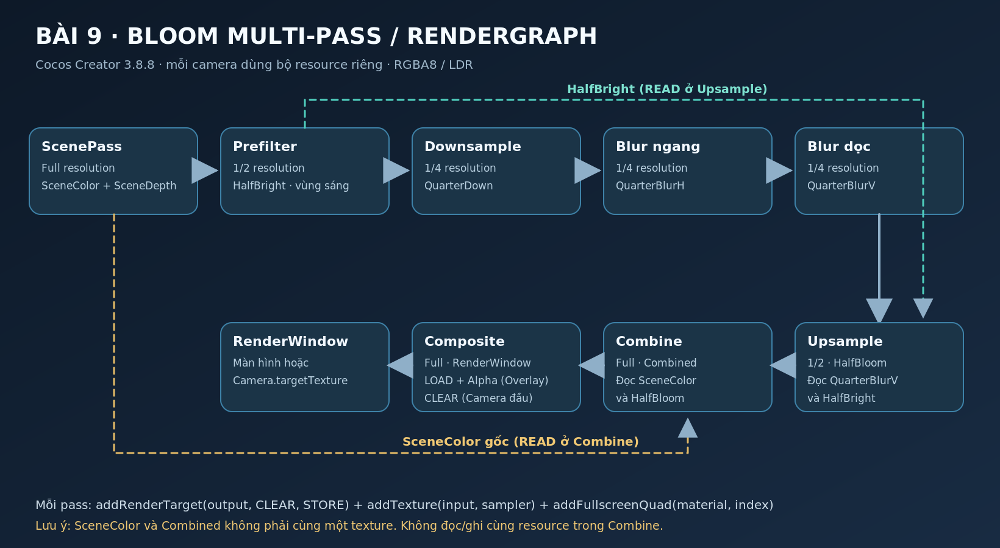
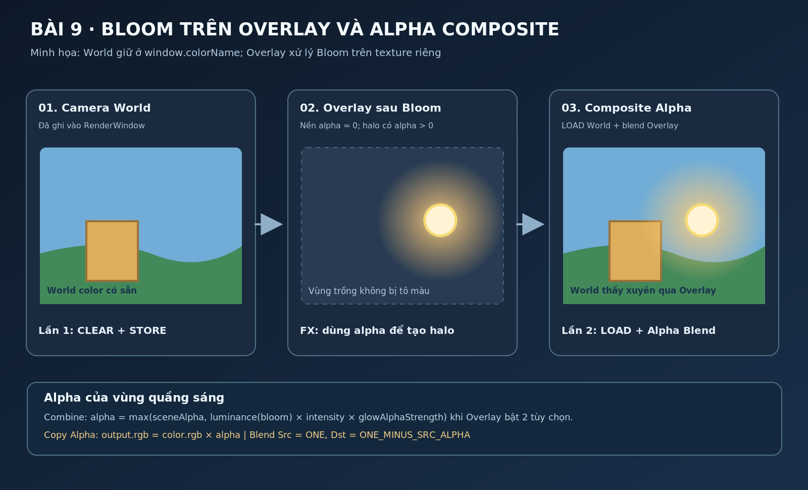

# Bài 9 — Bloom Multi-pass trong Cocos Creator 3.8.8 Custom Render Pipeline

> **Tiếp nối Bài 8 (Modular RenderPass & PostFX Chain).** Bản thực hành xây dựng Bloom ở LDR / `gfx.Format.RGBA8`, gồm 6 pass Bloom + 1 ScenePass + 1 CompositePass trên mỗi Camera được bật Bloom.
>
> **Đã kiểm tra**: cú pháp/type/import TypeScript với bộ declaration Cocos rút gọn, tính nhất quán tên effect pass và sampler, sơ đồ SVG/PNG. **Chưa chạy Preview trên bản engine `3.8.8_Custom` của bạn, chưa biên dịch `.effect` bằng engine thật.** Những chỗ liên quan shader hoặc GPU cần kiểm chứng trong Editor.

## 0. Học được gì sau bài này?

1. Biết vì sao Bloom cần các texture tạm và giảm độ phân giải.
2. Biết đọc đồ thị nhiều nhánh: `SceneColor` vừa đi vào Prefilter vừa đi vào Combine.
3. Biết gắn **hai input texture vào một pass**: `addTexture(input, 'inputTexture')` + `addTexture(detail, 'detailTexture')`.
4. Biết tính bước lấy mẫu `1/width`, `1/height` cho blur.
5. Biết kiểm tra trùng resource, sai pass name, sai size và `LOAD/CLEAR` trong Multi-Camera.
6. Biết tại sao Overlay có nền trong suốt cần xem xét **alpha của quầng Bloom** thay vì chỉ alpha gốc.
7. Biết áp dụng cùng code cho Camera hiển thị trực tiếp và Camera gán RenderTexture.

## 1. Sơ đồ



Nguồn editable: `Bai09_RenderGraph.svg`. Xem tiếp `Bai09_Bloom_Overlay_Alpha.svg` cho việc ghép World + Overlay.

Đồ thị một Camera:

```text
Camera
 └─ ScenePass [Full] ──────────────────────────────────────┐
      WRITE SceneColor       ┌── Prefilter [1/2]           │
                             │    WRITE HalfBright         │
                             ├── Downsample [1/4]          │
                             │    WRITE QuarterDown        │
                             ├── Blur H [1/4]              │
                             │    WRITE QuarterBlurH       │
                             ├── Blur V [1/4]              │
                             │    WRITE QuarterBlurV       │
                             └── Upsample [1/2]            │
                                  READ HalfBright          │
                                  WRITE HalfBloom          │
                                         │                 │
                                         └─────┬───────────┘
                                               ▼
                                   Combine [Full]
                                   READ SceneColor + HalfBloom
                                   WRITE Combined
                                               ▼
                                   Composite [Full]
                                   READ Combined
                                   WRITE window.colorName
```

**Chú ý**: RenderGraph tự quản lý dependency/barrier cho các resource được khai báo đúng tên; điều đó không có nghĩa engine tự suy luận ý đồ `CLEAR/LOAD`. Chúng ta vẫn phải chọn load/store phù hợp.

## 2. Sự khác nhau giữa Bloom của bài này và Builtin Bloom

| Nội dung | Bài 9 | Builtin được Cocos mô tả |
|---|---|---|
| Input | RGBA8 LDR | Có hướng thiết kế radiance/HDR |
| Prefilter | Soft threshold dựa luminance | Prefilter theo bloomParams |
| Downsample | 1 lần từ 1/2 sang 1/4 | Nhiều mức tùy iterations |
| Blur | Gaussian separable: H rồi V | Kawase Dual Filter |
| Upsample | Trộn ảnh blur 1/4 với vùng sáng 1/2 | Nhiều lượt từ thấp lên cao |
| Combine | Texture riêng `Combined` để tránh read/write cùng resource | Có thể blend lên radiance đích bằng LOAD |

Tài liệu Cocos: https://docs.cocos.com/creator/3.8/manual/en/render-pipeline/write-render-pipeline.html — mục **Adding Post-Processing Effects**.

**Vì sao chưa dùng HDR?** Để phù hợp tiến trình bài trước, giữ `RGBA8` tránh khác biệt support/format giữa WebGL2, WebGPU và custom engine. RGB được clamp vào `[0,1]`: vật thể có radiance HDR >1 không được giữ trong mô hình này.

## 3. Danh sách file và vai trò

| File | Chức năng |
|---|---|
| `Lesson9PipelineTypes.ts` | CameraConfig, BloomConfig, danh sách resource |
| `Lesson9CameraSettings.ts` | Inspector từng Camera |
| `Lesson9PipelineConfig.ts` | Snapshot cấu hình + kích thước + resource key |
| `Lesson9ResourceRegistry.ts` | Đăng ký texture trong `windowResize()` |
| `Lesson9ScenePassBuilder.ts` | Render scene trực tiếp / vào SceneColor |
| `Lesson9BloomPassBuilder.ts` | 6 pass Bloom |
| `Lesson9CompositePassBuilder.ts` | Ghép Combined vào window.colorName |
| `Lesson9PipelineBuilder.ts` | Điều phối camera và render graph |
| `Lesson9Bloom.effect` | 8 effect pass theo đúng chỉ số |

**Phải giữ tất cả 8 file `.ts` trong cùng một thư mục**, hoặc chỉnh đường dẫn import tương đối nếu bạn chia thư mục.

## 4. Luồng thực thi trên CPU

```text
Cocos khởi tạo
    └─ import Lesson9PipelineBuilder.ts
        └─ rendering.setCustomPipeline('LearnCRP', BUILDER)

Window tạo hoặc resize
    └─ BUILDER.windowResize(...)
        └─ registerCameraResources(...)
            ├─ ppl.addRenderWindow(window.colorName, ...)
            ├─ ppl.addRenderTarget(SceneColor, full)
            ├─ ppl.addDepthStencil(SceneDepth, full)
            ├─ ppl.addRenderTarget(HalfBright, half)
            ├─ ppl.addRenderTarget(QuarterDown, quarter)
            ├─ ppl.addRenderTarget(QuarterBlurH, quarter)
            ├─ ppl.addRenderTarget(QuarterBlurV, quarter)
            ├─ ppl.addRenderTarget(HalfBloom, half)
            └─ ppl.addRenderTarget(Combined, full)

Mỗi frame
    └─ BUILDER.setup(cameras, ppl)
        ├─ Camera A (Window 0, đầu tiên)
        │   ├─ ScenePass A → SceneColor_A
        │   ├─ Bloom A → Combined_A
        │   └─ Composite A → Window0 (CLEAR)
        ├─ Camera B (Window 0, thứ hai)
        │   ├─ ScenePass B → SceneColor_B
        │   ├─ Bloom B → Combined_B
        │   └─ Composite B → Window0 (LOAD + Alpha nếu bật)
        └─ Camera C (RenderTexture / Window 1)
            ├─ ScenePass C → SceneColor_C
            ├─ Bloom C → Combined_C
            └─ Composite C → Window1 (CLEAR)
```

### 4.1 Không nhầm "đăng ký" với "ghi"

```ts
// ĐĂNG KÝ / cập nhật mô tả resource
ppl.addRenderTarget(r.halfBright, gfx.Format.RGBA8, halfWidth, halfHeight);

// DÙNG resource đó làm output của một pass
pass.addRenderTarget(r.halfBright, gfx.LoadOp.CLEAR, gfx.StoreOp.STORE, black);

// DÙNG resource đó làm input cho pass khác
nextPass.addTexture(r.halfBright, 'inputTexture');
```

`pipeline.addRenderTarget` không tự render. `pass.addRenderTarget` mới gắn attachment ghi màu cho pass cụ thể.

## 5. Bảng đọc/ghi của tất cả pass

| Index trong `.effect` | Pass name | Đọc | Ghi | Kích thước output |
|---:|---|---|---|---|
| — | `default` (Scene) | Scene 3D | `SceneColor`, `SceneDepth` | Full |
| 0 | `lesson9-prefilter` | `SceneColor` | `HalfBright` | 1/2 |
| 1 | `lesson9-downsample` | `HalfBright` | `QuarterDown` | 1/4 |
| 2 | `lesson9-blur-h` | `QuarterDown` | `QuarterBlurH` | 1/4 |
| 3 | `lesson9-blur-v` | `QuarterBlurH` | `QuarterBlurV` | 1/4 |
| 4 | `lesson9-upsample` | `QuarterBlurV`, `HalfBright` | `HalfBloom` | 1/2 |
| 5 | `lesson9-combine` | `SceneColor`, `HalfBloom` | `Combined` | Full |
| 6 hoặc 7 | `lesson9-copy-opaque` / `lesson9-copy-alpha` | `Combined` | `window.colorName` | Full |

**Không có pass nào đọc và ghi cùng tên texture**, kể cả Combine. Cách này khác kiểu cộng trực tiếp bloom vào `SceneColor` bằng blending của Builtin.

## 6. Chi tiết sáu pass Bloom

### 6.1 Prefilter: vùng nào sáng mới được "nở"

```glsl
float luminance = dot(color.rgb, vec3(0.2126, 0.7152, 0.0722));
float knee = max(bloomParams.y, 0.01);
float mask = smoothstep(threshold - knee, threshold + knee, luminance);
fragColor = vec4(color.rgb * mask, 1.0);
```

`threshold` mặc định **0.68**. `softKnee = 0.1` tạo vùng chuyển tiếp thay vì cắt đột ngột. Với ảnh tối toàn bộ, gần như không có gì được trích xuất và Bloom không hiện; đây là hành vi bình thường.

### 6.2 Downsample: trung bình các mẫu gần nhau

Đầu vào HalfBright tại 1/2, đầu ra QuarterDown tại 1/4. Dùng bốn mẫu texture cạnh nhau:

```glsl
vec2 h = sourceTexel.xy * 0.5;
vec3 sum = texture(inputTexture, uv + vec2(-h.x, -h.y)).rgb;
// ... 3 mẫu còn lại
fragColor = vec4(sum * 0.25, 1.0);
```

`sourceTexel.xy = (1 / halfWidth, 1 / halfHeight)`.

### 6.3 Blur ngang, Blur dọc

Hai pass chỉ khác vector lấy mẫu:

```glsl
// Ngang
vec2 d = vec2(blurParams.x * blurRadius, 0.0);

// Dọc
vec2 d = vec2(0.0, blurParams.y * blurRadius);
```

Trọng số 5 taps: `0.070270, 0.316216, 0.227027, 0.316216, 0.070270`. Đây là một kernel blur nhỏ giúp bạn dễ quan sát quan hệ giữa `1 / textureSize`, số lần sample và vùng sáng lan rộng.

Blur diễn ra ở 1/4, nên offset 1 pixel trong ảnh Blur tương đương xấp xỉ 4 pixel trên ảnh gốc (có thể có sai lệch làm tròn).

### 6.4 Upsample: hợp nhất hai độ phân giải

```ts
pass.addTexture(r.quarterBlurV, 'inputTexture');
pass.addTexture(r.halfBright, 'detailTexture');
```

Shader:

```glsl
fragColor.rgb = texture(inputTexture, uv).rgb
              + texture(detailTexture, uv).rgb * detailWeight;
```

Nhánh QuarterBlurV giữ quầng mềm, nhánh HalfBright đưa phần lõi vùng sáng sắc nét hơn trở lại. Hai resource không bao giờ bị ghi ở pass này; chỉ có `HalfBloom` được ghi.

### 6.5 Combine: trộn lại SceneColor gốc

```ts
pass.addRenderTarget(r.combined, gfx.LoadOp.CLEAR, gfx.StoreOp.STORE, black);
pass.addTexture(r.sceneColor, 'inputTexture');
pass.addTexture(r.halfBloom, 'bloomTexture');
```

```glsl
vec3 rgb = min(scene.rgb + bloom.rgb * intensity, vec3(1.0));
```

Do đầu ra `RGBA8`, màu có thể bị clipping ở 1. Đây là điểm khác quan trọng với Bloom HDR có tone mapping.

## 7. Vì sao Overlay Bloom có thể mất quầng sáng?

Trong Bài 6–8, FX thông thường giữ nguyên `scene.a`. Nhưng quầng Bloom lan ra những pixel **không được vật thể gốc vẽ**, nơi `scene.a = 0`. Nếu Composite dùng blend theo alpha gốc, quầng này bị cắt mất.

Bài 9 giải quyết minh họa như sau khi *đồng thời* bật `transparentBackground`, `compositeWithAlpha` và Camera **không** là Camera đầu tiên của Window:

```glsl
float glow = dot(bloom, vec3(0.2126, 0.7152, 0.0722));
a = max(scene.a, clamp(glow * glowAlphaStrength, 0.0, 1.0));
```

Và shader `lesson9-copy-alpha` chuyển màu sang premultiplied-alpha trước khi blend:

```glsl
fragColor = vec4(src.rgb * src.a, src.a);
```

```yaml
blendState:
  targets:
  - blend: true
    blendSrc: one
    blendDst: one_minus_src_alpha
```

Sơ đồ: 

**Đây là mô phỏng thực hành.** Với Bloom chính xác trong HDR, alpha mượt, nhiều vật thể trong suốt và thứ tự UI phức tạp, cần một thiết kế premultiplied/coverage/tone-map toàn pipeline riêng; ví dụ này không thay thế được giải pháp production.

## 8. Quan trọng: CLEAR/LOAD cho hai Camera chung một RenderWindow

World sau Composite ghi màu vào `window.colorName`.

Camera Overlay không đọc `window.colorName` ở `ScenePass` hay `BloomPass`. Đến **Composite** của Overlay:

```ts
pass.addRenderTarget(
    cfg.window.colorName,
    clear ? gfx.LoadOp.CLEAR : gfx.LoadOp.LOAD,
    gfx.StoreOp.STORE,
    cameraClearColor(cfg.camera),
);
pass.addTexture(cfg.resources.combined, 'inputTexture');
```

- `LOAD` giữ màu World làm **destination color** cho blending; shader không cần `texture(window.colorName, uv)`.
- `CLEAR` xóa World. Nếu Camera Overlay muốn nhìn xuyên xuống World, **phải tắt Clear Color** cho Camera đó.
- Depth trong đường Bloom là riêng theo Camera (`SceneDepth`). SceneDepth không được dùng chung để depth-test Overlay với World.
- Camera thứ ba render sau World+Overlay trên **cùng RenderWindow** có thể tiếp tục ghi đè hoặc clear kết quả.

## 9. Kích thước và bộ nhớ minh họa

Giả sử RenderWindow là `1920 × 1080`:

| Tài nguyên | Kích thước | Số lượng |
|---|---:|---:|
| SceneColor, Combined | 1920 × 1080 | 2 |
| HalfBright, HalfBloom | 960 × 540 | 2 |
| QuarterDown, QuarterBlurH, QuarterBlurV | 480 × 270 | 3 |
| SceneDepth | 1920 × 1080 | 1 |

Nếu *giả sử* toàn bộ color resource thật sự cùng tồn tại độc lập và RGBA8 = 4 byte/pixel: tổng color khoảng **21.26 MiB/Camera**; DepthStencil với giả thiết 4 byte/pixel thêm **7.91 MiB**, cộng khoảng **29.17 MiB**, **chưa kể RenderWindow, cấp phát đệm, alignment, transient aliasing và overhead**. RenderGraph có thể tối ưu vòng đời hoặc tái sử dụng tài nguyên; đây không phải phép đo VRAM thực tế.

Tối ưu tiếp có thể giảm số mức Blur, số camera Bloom, số tap, hoặc tái sử dụng texture theo lifetime không chồng lấn.

## 10. Cấu hình Inspector cho Scene Bài 8

1. **Giữ** Main Camera, OverlayCamera, Camera thứ ba. Camera thứ ba có thể tiếp tục dùng `RenderTexture` riêng.
2. Chép **8 file TypeScript** và `Lesson9Bloom.effect` vào `assets/Lesson9` (cùng thư mục).
3. Ngừng sử dụng `Lesson8PipelineBuilder.ts` và mọi file khác đang gọi `setCustomPipeline('LearnCRP', ...)`. Giữ duy nhất module `Lesson9PipelineBuilder.ts` đăng ký pipeline này.
4. Tạo **Material** từ `Lesson9Bloom.effect`. Chờ Effect compile trong Cocos Editor.
5. Gắn `Lesson9CameraSettings` vào từng Node Camera cần thử Bloom, gán Material vừa tạo vào `bloomMaterial`.
6. Đảm bảo project đang sử dụng Custom Pipeline tên `LearnCRP`.

| Thuộc tính | Main Camera | OverlayCamera | Camera thứ ba (RenderTexture) |
|---|---|---|---|
| `enableBloom` | ON | ON (sau khi World ổn) | Tùy |
| `bloomMaterial` | Material từ Lesson9Bloom.effect | Cùng Material cũng được | Cùng Material cũng được |
| `threshold` | 0.68 | 0.6 | 0.68 |
| `softKnee` | 0.10 | 0.10 | 0.10 |
| `intensity` | 0.85 | 1.0 | 0.85 |
| `blurRadius` | 1.25 | 1.25 | 1.25 |
| `detailWeight` | 0.45 | 0.45 | 0.45 |
| `transparentBackground` | OFF | ON | OFF |
| `compositeWithAlpha` | OFF | ON | OFF |
| Camera `Clear Color` | ON/đầu Window | **OFF** | ON/đầu Window riêng |

**Mẹo nhìn Bloom dễ:** đặt một hình/quad/sprite có màu trắng hoặc vàng thật sáng trên nền tối; với RGBA8, nếu toàn bộ vật thể là xám tối thì mask có thể gần bằng 0. Không cần bắt buộc đặt HDR hay ánh sáng vật lý để học luồng pass ở bài này.

## 11. Quy trình test 7 bước

1. **Kiểm thử baseline:** Chỉ Main Camera, tắt `enableBloom` → Scene render trực tiếp, không cần Bloom resource đọc/ghi.
2. **Main Bloom:** Bật `enableBloom`, gán Material; Console có `[Lesson9:Resize]`, `[Lesson9:Route]` và `applyBloom=true`.
3. **Chỉnh threshold:** 0.95 → hầu như ít sáng; 0.45 → nhiều vùng phát sáng hơn.
4. **Chỉnh intensity:** 0 → Combine gần Scene gốc; 1.5 → vùng phát sáng mạnh.
5. **Chỉnh blurRadius:** 0.5 vs 2.5; thay đổi độ loang, chú ý blur chỉ 1/4.
6. **Bật Overlay:** Cho Overlay một hình sáng và nền transparent; `compositeWithAlpha=true`, Camera Overlay không Clear Color; World phải còn thấy.
7. **Camera RenderTexture:** Đưa Camera thứ ba vào RenderTexture, xem log `windowId` khác; resize để quan sát size tài nguyên Full/Half/Quarter và kiểm tra RenderTexture được hiển thị qua Sprite.

## 12. Debug nhanh khi Preview lỗi

| Triệu chứng | Hướng kiểm tra |
|---|---|
| `Invalid render pass` | Tên `ppl.addRenderPass(..., 'lesson9-...')` phải trùng `pass:` trong `.effect`; `passIndex` phải từ 0 đến 7 và đúng thứ tự. Kiểm tra Effect compile trong Editor. |
| `Could not find texture with resource name` | Resource chưa được `windowResize()` đăng ký, tên chưa khớp, Camera mới thêm hoặc `containsResource=false`. |
| Main Camera thấy Scene nhưng không có Bloom | Kiểm tra Material, threshold, vật thể đủ sáng, `resourcesReady`, `fullViewport`, log `applyBloom`. |
| Hình tối/đen | Kiểm tra `.effect` compile, format framebuffer, `ScenePass` có queue, material/pass index, Input texture binding. |
| World biến mất khi bật Overlay | Tắt Clear Color trên Overlay; xác nhận Composite dùng `LOAD`; kiểm tra Camera thứ ba có clear sau cùng không. |
| Overlay nền đen | `transparentBackground=true` + `compositeWithAlpha=true`; shader composite cần pass 7, output premultiplied. |
| Bloom của Overlay bị cắt rìa | Kiểm tra `glowAlphaStrength`, `combineParams.z`, alpha output, và alpha từ scene objects. |
| Khi resize biến mất | Xem `[Lesson9:Resize]`, so sánh size mà `windowResize` đăng ký với `window.width/height` ở `setup()`. |
| Shader báo sampler/unit/UBO | Dùng API `#pragma rate xxx pass` cho input sampler và uniform block, kiểm tra giới hạn của engine/WebGL2. |

### Về `CC_HANDLE_GET_CLIP_FLIP` và UV

Fullscreen VS dựa trên shader Bài 8; nếu riêng một backend hiện kết quả Bloom bị ngược trục Y, hãy so sánh hướng UV ở output `SceneColor` và `RenderTexture`. Điều này **không được xác minh runtime** ở engine custom của bạn, nên không nên đảo UV một cách máy móc trước khi thấy lỗi.

## 13. Bài tập mở rộng

1. **Pass-through:** Cho `intensity=0` mà vẫn dựng toàn bộ graph, giải thích khác gì với tắt `enableBloom` ngay từ đầu.
2. **Visualize intermediate:** Tạo pass debug riêng để copy `HalfBright`, `QuarterBlurV`, `HalfBloom` ra RenderWindow, không đồng thời với Composite thông thường. Giữ aspect ratio.
3. **Ba cấp downsample:** 1/2 → 1/4 → 1/8, sau đó upsample 1/8 → 1/4 → 1/2. Bảo đảm không đọc/ghi cùng texture ở một pass.
4. **Runtime camera routing:** Thử World/Overlay cùng Window và Camera thứ ba render đến `RenderTexture`.
5. **Tối ưu bằng lifetime:** Xác định mốc sử dụng cuối của `QuarterDown` và `QuarterBlurH` để suy nghĩ về transient aliasing; không tự ý reuse tên trong cùng pass.

## 14. Đọc thêm

- [Cocos 3.8 — Writing a Customizable Render Pipeline](https://docs.cocos.com/creator/3.8/manual/en/render-pipeline/write-render-pipeline.html), đặc biệt mục **Adding Post-Processing Effects** và **Resource State Tracking**.
- [Cocos 3.8 — Using the Built-in Render Pipeline](https://docs.cocos.com/creator/3.8/manual/en/render-pipeline/use-builtin-pipeline.html).
- [Cocos 3.8 — Using Post-Processing Effects](https://docs.cocos.com/creator/3.8/manual/en/render-pipeline/use-post-process.html).

## 15. Checklist cuối trước khi Play

- [ ] Chỉ `Lesson9PipelineBuilder` gọi `setCustomPipeline('LearnCRP', ...)`.
- [ ] Có đủ 8 TypeScript + Effect.
- [ ] Material tạo từ đúng `Lesson9Bloom.effect` và gán cho Camera.
- [ ] Effect pass 0..7 trùng tên trong TypeScript.
- [ ] Resource name khác nhau giữa các Camera, kể cả khác RenderWindow.
- [ ] Camera Overlay không Clear Color nếu muốn giữ World.
- [ ] `transparentBackground` và `compositeWithAlpha` bật đồng thời cho Overlay.
- [ ] Preview có ít nhất một vật thể màu sáng trên nền tối.
- [ ] Kiểm tra thay đổi kích thước viewport/RenderTexture.

---

**Bài 10 dự kiến:** HDR + Tone Mapping + Color Space, sau đó gắn Bloom vào chuỗi HDR và so sánh với LDR. Đó mới là bước thích hợp để xử lý radiance > 1, gamma/sRGB và độ sáng chân thực hơn.
