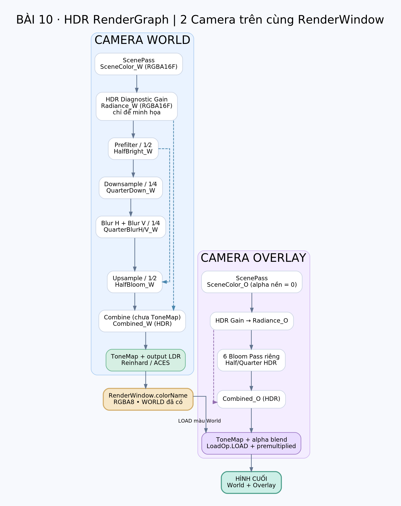
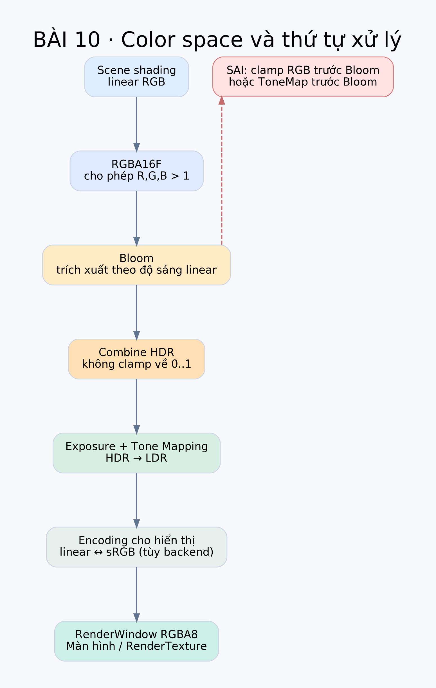

# Bài 10 — HDR RenderTarget, Tone Mapping và Color Space

> Khóa Custom Render Pipeline, Cocos Creator **3.8.8_Custom**, tiếp nối Bài 9 (Bloom). Đây là bài thực hành **có code đầy đủ**, chưa được chạy GPU trên engine custom của bạn.

## 0. Mục tiêu

Sau bài này, bạn có thể:

1. Giải thích tại sao `RGBA8` không lưu được RGB lớn hơn 1, còn `RGBA16F` lưu được (nếu thiết bị hỗ trợ format đó).
2. Tách **resource registration** (`windowResize`) khỏi **RenderGraph execution** (`setup`).
3. Chạy Bloom trên dữ liệu **trước tone mapping**, sau đó nén HDR về LDR bằng Reinhard hoặc ACES approximation.
4. Phân biệt **linear RGB**, **tone mapping** và **sRGB encoding** — ba bước khác nhau.
5. Vẫn chạy 2 Camera trên 1 RenderWindow, Camera thứ 3 trên RenderTexture, hoặc một Camera chạy Direct khi không có Material.
6. Hiểu vì sao tăng format lên `RGBA16F` **không tự biến ánh sáng LDR thành HDR**.

## 1. Khác biệt từ Bài 9

| Bài 9 | Bài 10 |
|---|---|
| Mọi texture `RGBA8` | Trung gian ưu tiên `RGBA16F`, fallback `RGBA8` |
| Threshold thường trong `[0,1]` | HDR threshold có thể `>1` |
| Combine clamp vào `[0,1]` | Combine giữ giá trị HDR (không clamp) |
| Kết quả Combine → Composite trực tiếp | Kết quả Combine → **ToneMap** → RenderWindow |
| Không có Exposure | Có Exposure, Reinhard/ACES, sRGB toggle để thử nghiệm |
| Nếu thiếu ánh sáng mạnh Bloom khó thấy | Có Diagnostic Gain để chủ động sinh giá trị `>1` **phục vụ thí nghiệm** |

**Giới hạn:** Color grading, HDR environment/physical lights, pipeline scene macros, engine lighting linear workflow và sRGB transfer do backend quyết định. Ví dụ không thay thế hoàn toàn Builtin HDR pipeline.

## 2. Luồng RenderGraph



```text
Camera World
  ScenePass: SceneColor_W (RGBA16F nếu hỗ trợ)
    → HDR GainPass: Radiance_W (giá trị có thể > 1)
    → Prefilter(1/2) → Downsample(1/4)
    → Blur H(1/4) → Blur V(1/4)
    → Upsample(1/2)
    → Combine HDR: Combined_W (không clamp)
    → ToneMap (Exposure + Reinhard/ACES)
    → RenderWindow.colorName (RGBA8)

Camera Overlay
  ScenePass riêng, clear alpha=0
    → HDR Gain → 6 Bloom Pass → Combined_O
    → ToneMap Alpha Composite, LoadOp.LOAD để giữ World
    → RenderWindow = World + Overlay
```

Nếu tắt `enableBloom`, pipeline bỏ 6 pass Bloom và tone map trực tiếp `Radiance`. Nếu không gắn Material hoặc tắt `enablePost`, Camera chạy `ScenePass → window.colorName` trực tiếp, tương tự Bài 9.

## 3. `RGBA8` và `RGBA16F`

`RGBA8`: mỗi kênh 8-bit normalized. Thông thường màu R/G/B được lưu trong `[0,1]`. Chẳng hạn `RGB = (3.0, 1.8, 0.4)` bị giới hạn khi ghi vào RGBA8, làm mất thông tin vượt 1.

`RGBA16F`: mỗi kênh dùng half-float 16-bit, lưu được giá trị lớn hơn 1 (không có nghĩa độ chính xác vô hạn). Tốn khoảng gấp đôi dung lượng mỗi pixel so với RGBA8.

| Format | Byte/pixel | Texture 1920×1080 (ước tính) |
|---|---:|---:|
| RGBA8 | 4 | 7.91 MiB |
| RGBA16F | 8 | 15.82 MiB |

Cocos API có `gfx.Format.RGBA16F`, nhưng khả năng **render-to-texture**, **sample** và **linear filter** phụ thuộc GPU/backend. Bài 10 gọi `device.getFormatFeatures(gfx.Format.RGBA16F)` và ưu tiên float nếu các bit yêu cầu đều có. Khi không hỗ trợ, toàn bộ texture trung gian quay về `RGBA8` và threshold hữu hiệu được giới hạn tối đa 0.75.

> Không tự đăng ký `window.colorName` là RGBA16F: RenderWindow hiện là đích RGBA8. HDR nằm ở texture trung gian; Tone Mapping chuyển về output phù hợp.

## 4. Tại sao `RGBA16F` chưa chắc tạo ra HDR?

Có hai yếu tố tách biệt:

1. **Shader/lighting phải xuất màu vượt 1** trong không gian tuyến tính. Nếu shader đã tone map hoặc clamp trong `ScenePass`, dữ liệu đã mất ngay tại nguồn.
2. **Color RenderTarget phải chứa được giá trị đó**, ví dụ RGBA16F.

Một RenderTarget float chỉ giải quyết (2). Bài 10 dùng `diagnosticGain = 2.5` trong `HDRBoostPassBuilder` để chứng minh dữ liệu có thể vượt 1 **sau khi Scene đã render**. Đây là phép nhân màu để học/tìm lỗi, **không phải HDR lighting thực tế**. Khi chuyển sang scene có HDR output đúng, đặt `diagnosticGain = 1`.

Trong engine 3.8.8, Builtin pipeline còn quan tâm các macro và cấu hình HDR như `CC_USE_FLOAT_OUTPUT` / `postSettings.toneMappingType`. Ví dụ minh họa không tự bật các macro này, vì không thể giả định mọi custom build đều đồng bộ.

## 5. Hiểu kỹ các Pass

| STT | TypeScript builder | Input | Output | Format |
|---:|---|---|---|---|
| 1 | `ScenePassBuilder` | Scene | `sceneColor` | HDR/LDR theo capability |
| 2 | `HDRBoostPassBuilder` | `sceneColor` | `radiance` | HDR/LDR |
| 3 | `BloomPassBuilder` / Prefilter | `radiance` | `halfBright` | HDR/LDR, 1/2 |
| 4 | Downsample | `halfBright` | `quarterDown` | HDR/LDR, 1/4 |
| 5 | Blur H | `quarterDown` | `quarterBlurH` | HDR/LDR, 1/4 |
| 6 | Blur V | `quarterBlurH` | `quarterBlurV` | HDR/LDR, 1/4 |
| 7 | Upsample | `quarterBlurV`, `halfBright` | `halfBloom` | HDR/LDR, 1/2 |
| 8 | Combine | `radiance`, `halfBloom` | `combined` | **HDR, không clamp** |
| 9 | ToneMap | `combined`, `radiance` | `window.colorName` | **LDR RGBA8** |

Một Camera bật Bloom cần **9 RenderPass** (không tính scene UI/Camera khác), tương ứng với Effect Shader indices 0..8 và ScenePass `default`. Nếu `enableBloom = false` chỉ còn 3 pass (Scene, Boost, ToneMap).

**Quan trọng:** `ppl.addRenderTarget()` trong `windowResize` là đăng ký texture, không vẽ vào texture; `pass.addRenderTarget` trong `setup` chọn attachment để ghi; `pass.addTexture` chọn texture để shader đọc.

## 6. Code cần đọc trước

### 6.1 Chọn float format có fallback

```ts
const bits = device.getFormatFeatures(gfx.Format.RGBA16F);
const required = gfx.FormatFeatureBit.RENDER_TARGET
               | gfx.FormatFeatureBit.SAMPLED_TEXTURE;
const supported = (bits & required) === required;
// Ví dụ còn yêu cầu LINEAR_FILTER nếu bit tồn tại.
const format = supported ? gfx.Format.RGBA16F : gfx.Format.RGBA8;
```

Xem `Lesson10PipelineConfig.ts`. Format được chọn một lần, giữ ổn định trong session để không tạo resource bị thay format ngẫu nhiên giữa các frame.

### 6.2 Đăng ký resource khi resize

```ts
ppl.addRenderTarget(r.sceneColor, format, w, h);
ppl.addRenderTarget(r.radiance, format, w, h);
ppl.addRenderTarget(r.halfBright, format, halfW, halfH);
ppl.addRenderTarget(r.combined, format, w, h);
```

Cả Camera World và Overlay sử dụng resource có tên khác nhau theo UUID Node; chúng chỉ chung `window.colorName` nếu thật sự cùng RenderWindow.

### 6.3 Combine không clamp

```glsl
vec4 scene = texture(inputTexture, v_uv);
vec3 bloom = texture(bloomTexture, v_uv).rgb * combineParams.x;
fragColor = vec4(scene.rgb + bloom, scene.a);
```

Nếu viết `min(scene.rgb + bloom, vec3(1))` lúc này, mọi pixel HDR bị cắt trước Tone Mapping. Khi đó HDR khác LDR rất ít, làm sai mục tiêu Bài 10.

## 7. Tone Mapping: Reinhard và ACES Approximation

Tone mapping chuyển RGB HDR vào miền hiển thị LDR, khác với gamma/sRGB encoding.

**Reinhard** (theo từng kênh):

\[C_{out}=\frac{C_{hdr}\cdot exposure}{1+C_{hdr}\cdot exposure}\]

**ACES filmic approximation** — đường cong gọn thường dùng trong demo shader, không phải Academy RRT/ODT chuẩn:

\[f(x)=\operatorname{clamp}\left(\frac{x(2.51x+0.03)}{x(2.43x+0.59)+0.14},0,1\right)\]

Ví dụ `HDR luminance = 4`, `exposure = 1`:
- Reinhard ≈ 0.80.
- ACES approximation ≈ 0.973.

ACES giữ độ tương phản trong vùng sáng theo đường cong khác Reinhard; cả hai đều không phục hồi thông tin nếu Scene đã clamp về 1 trước đó.

## 8. Color Space: linear ↔ sRGB



Trình tự đúng về ý tưởng:

```text
Linear shading → HDR linear → Bloom linear → ToneMap
→ display encoding (khi cần) → RenderWindow
```

- **Linear RGB:** các phép cộng năng lượng, Bloom, lighting nên thao tác ở đây.
- **Tone Mapping:** nén dải giá trị HDR vào LDR, chưa đồng nghĩa đổi gamma.
- **sRGB encoding:** hàm transfer encoding cho hiển thị; có thể được phần cứng/backend/material xử lý tùy pipeline.

`Lesson10CameraSettings.manualSRGB` mặc định **false** vì nếu backend đã chuyển sRGB mà shader còn tự gamma thêm, hình sẽ bị sáng sai (double encode). Bật tạm khi bạn xác định RenderWindow là UNORM và pipeline không encode. Đối với Alpha Overlay, blending ngay trên RGBA8 đã mã hóa không bảo toàn trộn màu linear chính xác; bài này ưu tiên hiểu luồng, không tự nhận là color pipeline production.

## 9. World và Overlay

Giữ `transparentBackground = true` cho Overlay để SceneColor của Overlay có alpha nền 0. Giữ `compositeWithAlpha = true` để xuất blend `ONE / ONE_MINUS_SRC_ALPHA`. ToneMap alpha tính riêng:

```glsl
vec3 mappedBase = toneMap(originalScene.rgb);
vec3 mappedAll = toneMap(scenePlusBloom.rgb);
vec3 glow = max(mappedAll - mappedBase, vec3(0));
float outAlpha = max(sceneAlpha, clamp(luminance(glow) * glowAlphaStrength, 0, 1));
vec3 premulRGB = mappedBase * sceneAlpha + glow;
```

Đây là **giải pháp gần đúng trong LDR** để không nhân quầng Bloom lần nữa với alpha quá nhỏ. Tốt hơn cho production là ghép các Camera ở HDR linear trước ToneMap cuối, hoặc tách bloom additive khỏi alpha composite.

Camera Overlay phải **không clear Color** nếu muốn giữ World khi ToneMap Composite:

```ts
pass.addRenderTarget(window.colorName,
    clear ? gfx.LoadOp.CLEAR : gfx.LoadOp.LOAD,
    gfx.StoreOp.STORE, clearColor);
```

`LoadOp.LOAD` giữ RGB của World đang ở output; không khiến shader tự đọc `window.colorName` như một `sampler2D`.

## 10. Thực hành — Cấu hình gợi ý

1. Giải nén ZIP vào `assets/Lesson10` (giữ **9 file TS cùng thư mục** với `.effect`).
2. Vô hiệu hóa đăng ký pipeline `LearnCRP` của Bài 9 và các bài trước. Chỉ module `Lesson10PipelineBuilder.ts` đăng ký `LearnCRP`.
3. Import `Lesson10HDRBloom.effect`; tạo Material và gán vào `Lesson10CameraSettings.postMaterial`.
4. Thay component `Lesson9CameraSettings` trên Main/Overlay bằng `Lesson10CameraSettings`.
5. Test riêng Main Camera trước; sau đó mới bật Overlay và Camera thứ ba.

| Setting | Main Camera | OverlayCamera |
|---|---:|---:|
| `enablePost` | true | true |
| `enableBloom` | true | true |
| `threshold` | 1.20 | 0.90 |
| `softKnee` | 0.25 | 0.25 |
| `intensity` | 0.85 | 1.10 |
| `blurRadius` | 1.50 | 1.50 |
| `diagnosticGain` | 2.50 | 3.00 |
| `exposure` | 1.00 | 1.00 |
| `toneMode` | ACES Approx | ACES Approx |
| `manualSRGB` | false | false |
| `transparentBackground` | false | true |
| `compositeWithAlpha` | false | true |
| Camera Clear Color | bật | **tắt** |

Với Camera thứ ba có `Camera.targetTexture`, vẫn gắn settings nếu muốn. Output cuối của nó là một RenderWindow của RenderTexture, không tự xuất hiện thành cửa sổ hệ điều hành thứ hai.

## 11. 8 thí nghiệm và quan sát

| Thí nghiệm | Thay đổi | Quan sát |
|---|---|---|
| A | `diagnosticGain: 1 → 3` | Màu Scene mạnh hơn; với FP16, dữ liệu có thể >1 trước ToneMap |
| B | `enableBloom: true → false` | Còn ToneMap, không còn quầng sáng |
| C | `threshold: 0.5 → 2` | Bloom chỉ còn vùng thật sự rất sáng, khi đang ở HDR |
| D | `exposure: 0.5 → 2` | ToneMap biến đổi độ sáng cuối |
| E | Reinhard ↔ ACES Approx | Đường cong vùng sáng/contrast khác |
| F | `preferFloatHDR: false` trước khi Play | Fallback RGBA8, mất thông tin >1 |
| G | `manualSRGB: false ↔ true` | Thấy gamma output thay đổi; không mặc định cái nào "đúng" nếu chưa biết backend |
| H | Overlay bật Clear Color | World biến mất tại Compose, dù Overlay alpha blend |

**Lưu ý:** `preferFloatHDR` là cờ code toàn pipeline, không có Inspector. Đổi cờ cần khởi chạy lại Preview để resource format được đăng ký lại sạch sẽ.

## 12. Debug khi không thấy Bloom

- Nhìn `[Lesson10:Format]`: `RGBA16F / HDR` hay `RGBA8 / LDR fallback`?
- Nhìn `[Lesson10:Route]`: `applyPost`, `resourcesReady`, `fullViewport`, `threshold`, `exposure`.
- Main/Overlay `postMaterial` đã trỏ tới `Lesson10HDRBloom.effect` chưa? Pass indices phải là **0..8**, không dùng Material Bài 9.
- Nếu `enableBloom=true` nhưng không có quầng, thử `threshold=0.5`, `diagnosticGain=3`, `intensity=2` để cô lập lỗi.
- Nếu Overlay mất World, kiểm tra `transparentBackground`, `compositeWithAlpha`, Camera Clear Color, Camera thứ ba có clear cuối không.
- Nếu `Unsupported format`, backend chưa render được RGBA16F: đổi `preferFloatHDR=false`, khởi động lại Preview; gửi log capability + thiết bị.
- Nếu Preview đen hoặc `Invalid render pass`, kiểm tra **tên** `pass:` trong Effect khớp `ppl.addRenderPass(..., 'lesson10-...')` và index `addFullscreenQuad(material, index)`.
- Nếu sRGB quá sáng, không bật cả engine encoding và `manualSRGB` cùng lúc.

## 13. Bài tập

**Bài A:** Tách `Lesson10HDRBloom.effect` thành `Bloom.effect` và `ToneMap.effect`, sửa Material và passIndex tương ứng.

**Bài B:** Tạo `HDRDiagnosticView.effect`: hiển thị `min(RGB/4, 1)` để nhìn vùng nào vượt 1; không dùng hình đã tone map làm nguồn kiểm tra HDR.

**Bài C:** Thay `PER_CAMERA` bằng `PER_WINDOW` cho các Camera cùng RenderWindow: ghép Scene HDR trước rồi Bloom/ToneMap **một lần**. Cần thiết kế lại alpha và Depth, không chỉ trùng tên các texture.

**Bài D:** Dùng GPU profiler đo lưu lượng texture trước/sau khi đổi RGBA8↔RGBA16F; không coi số `addRenderTarget()` là số lần allocation vật lý chắc chắn.

## 14. Giới hạn và xác minh

- Đã kiểm tra TypeScript ở mức type-check với **declaration mock** cho giao diện Cocos + kiểm tra các import, tên pass, sampler, cấu trúc YAML; **không có máy chạy Cocos 3.8.8_Custom** để kiểm chứng shader compile/runtime và đồ họa trên GPU.
- Color Space còn phụ thuộc vào cách engine Material xuất màu, macro HDR, backend framebuffer/sRGB.
- Bài này không triển khai Auto-Exposure, Color Grading LUT, physically based emissive calibration, HDR10 hay OpenColorIO.
- Ví dụ tính riêng Bloom cho từng Camera (như Bài 9). Đây là ưu tiên học pipeline, **chưa phải đường render tối ưu** nếu tất cả Camera muốn cùng Bloom.

## 15. Nguồn tham khảo chính thức

- [Cocos Creator 3.8 — Writing a Customizable Render Pipeline](https://docs.cocos.com/creator/3.8/manual/en/render-pipeline/write-render-pipeline.html)
- [Cocos Creator 3.8 — Using Post-Processing Effects](https://docs.cocos.com/creator/3.8/manual/en/render-pipeline/use-post-process.html)
- [Cocos Creator 3.8 — BasicPipeline interface](https://docs.cocos.com/creator/3.8/api/en/interface/rendering.BasicPipeline)
- [Cocos Creator 3.8 — Optional Pass Parameters](https://docs.cocos.com/creator/3.8/manual/en/shader/pass-parameter-list.html)
