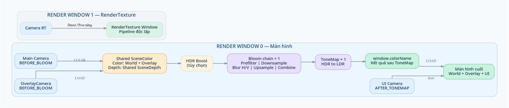
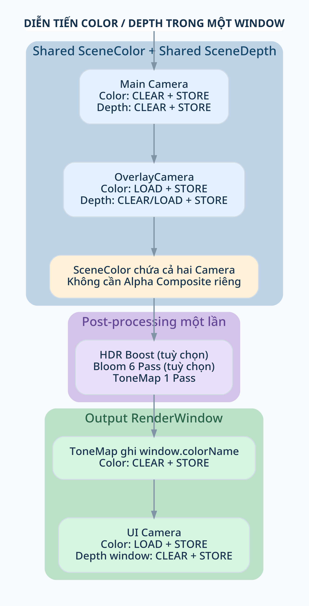

# BÀI 11 — TỐI ƯU RENDERGRAPH: SHARED RENDERTARGET & BLOOM MỘT LẦN CHO MỖI RENDERWINDOW

> Cocos Creator **3.8.8 / 3.8.8_Custom** · TypeScript · CRP · Tiếp nối **Bài 10 (HDR/Bloom/Tone Mapping)**.
>
> **Trạng thái:** ví dụ đã được kiểm tra tĩnh TypeScript, tên pass/shader và mô phỏng RenderGraph bằng harness; **chưa chạy GPU/Editor** trên engine custom của người học.

## 1. Vì sao cần Bài 11?

**Bài 10, theo Camera** (giả sử 2 Camera đều bật Bloom):

```text
Main Camera    -> SceneColor_W -> Boost -> Bloom (6 pass) -> ToneMap -> RenderWindow
OverlayCamera -> SceneColor_O -> Boost -> Bloom (6 pass) -> ToneMap -> RenderWindow (alpha blend)
UI Camera     -> RenderWindow trực tiếp
```

**Bài 11, theo RenderWindow**:

```text
Window 0:
    Main Camera -----(CLEAR+STORE)---┐
                                      ├-> SharedSceneColor [HDR]
    OverlayCamera ---(LOAD+STORE)----┘        |
                                              +-> optional HDR Boost [1 pass]
                                              +-> optional Bloom [6 pass]
                                              +-> ToneMap [1 pass]
                                              +-> window.colorName
    UI Camera ------------------------------(LOAD)----> window.colorName

Window 1 (RenderTexture): xử lý độc lập, dùng resource khác.
```

Tư tưởng: **để các Camera ghi chung dữ liệu scene rồi mới áp dụng hiệu ứng chung**. Đây là một lựa chọn thiết kế; không phù hợp nếu từng Camera phải có Bloom với ngưỡng/độ mờ khác nhau.



## 2. Mục tiêu sau bài học

1. Nhóm `renderer.scene.Camera[]` theo **`camera.window`** trong `setup()`.
2. Đổi tên tài nguyên từ `WindowId + CameraUUID` thành **`WindowId`** để Camera cùng Window dùng chung.
3. Nắm rõ quy tắc `CLEAR/LOAD/STORE` cho color **và** depth khi nhiều ScenePass ghi cùng attachment.
4. Xây **Bloom + Tone Mapping một lần** sau khi tất cả Camera BEFORE_BLOOM hoàn thành.
5. Vẽ UI bằng Camera `AFTER_TONEMAP` để UI không bị threshold Bloom hoặc tone map.
6. Tách HDR/Bloom (7 shader pass) và Tone Mapping (1 shader pass) thành hai Material, tránh lỗi `SubModel can only support 8 passes`.
7. Hiểu khác nhau giữa **giảm số pass**, **giảm số resource logic**, và **GPU memory thực tế**.

## 3. Cấu trúc file

```text
assets/Lesson11/
├── Lesson11CameraSettings.ts
├── Lesson11PipelineTypes.ts
├── Lesson11PipelineConfig.ts
├── Lesson11ResourceRegistry.ts
├── Lesson11ScenePassBuilder.ts
├── Lesson11HDRBoostPassBuilder.ts
├── Lesson11BloomPassBuilder.ts
├── Lesson11ToneMapPassBuilder.ts
├── Lesson11PipelineBuilder.ts       <- file DUY NHẤT đăng ký LearnCRP
├── Lesson11HDRBloom.effect           <- 7 Shader Pass (0...6)
└── Lesson11ToneMap.effect            <- 1 Shader Pass (0)
```

Hai SVG và PNG trong gói là sơ đồ kiến trúc, không phải asset bắt buộc lúc chạy.

## 4. Vai trò của từng Camera

`Lesson11CameraSettings.ts` khai báo:

```ts
export enum Lesson11CameraStage {
    BEFORE_BLOOM = 0,
    AFTER_TONEMAP = 1,
}
```

- `BEFORE_BLOOM`: vẽ scene vào `L11_W{windowId}_SceneColor` cùng các Camera khác của Window; kết quả **đều bị Bloom/ToneMap chung**.
- `AFTER_TONEMAP`: render **trực tiếp** vào `window.colorName`, dùng `LOAD` để giữ hình đã tone map. Dành cho UI, gizmo, overlay cần không bị postFX.
- Camera **không gắn** `Lesson11CameraSettings` được coi là `AFTER_TONEMAP` nếu Window có controller hợp lệ. Nếu Window không có controller, toàn bộ Camera fallback về render direct.

Mỗi Window cần tối đa **một Camera controller**, thường là Main Camera (Settings: `isWindowController=true` và `stage=BEFORE_BLOOM`). Camera này chứa hai Material và các thông số Bloom/ToneMap **cho toàn Window**.

`OverlayCamera` chỉ cần `stage=BEFORE_BLOOM`, `isWindowController=false`.

### Bảng Inspector đề xuất

| Property | Main Camera | OverlayCamera | Camera UI |
|---|---|---|---|
| Settings component | Có | Có | Không bắt buộc |
| Stage | BEFORE_BLOOM | BEFORE_BLOOM | AFTER_TONEMAP (hoặc không gắn) |
| Is Window Controller | **ON** | OFF | OFF |
| HDR Bloom Material | **Material từ Lesson11HDRBloom.effect** | Không cần | Không cần |
| Tone Map Material | **Material từ Lesson11ToneMap.effect** | Không cần | Không cần |
| Enable Bloom | ON | (Không đọc ở Overlay) | (Không dùng) |
| Clear Depth Before Scene | Tùy (Camera đầu luôn CLEAR) | **ON** | (Depth Window tự CLEAR lần đầu) |
| Clear Flags màu | Camera đầu có thể CLEAR | Không cần; code Shared luôn LOAD | Code giữ màu sau ToneMap |

### Về transparentBackground / compositeWithAlpha

**Không cần cặp `transparentBackground + compositeWithAlpha` để chồng World và Overlay trong chế độ Shared SceneColor.**

Lý do: Camera thứ hai **không tạo texture màu phủ kín màn hình để composite**. Nó chỉ vẽ các vật thể của mình **vào cùng SceneColor** đang chứa World. Các vùng không có drawcall từ Overlay không ghi đè World. Material thực sự trong suốt vẫn phải bật blend theo cách thông thường; một mesh opaque che toàn màn hình vẫn che World.

## 5. Resource được chia sẻ như thế nào?

Bài 10:

```ts
const key = `L10_W${windowId}_C${cameraUUID}`;
```

Bài 11:

```ts
const key = `L11_W${window.renderWindowId}`;
```

Các Camera chung Window tham chiếu **cùng 9 resource logic**:

| Tài nguyên | Kích thước | Ghi bởi | Đọc bởi |
|---|---|---|---|
| `sceneColor` | Full | Các Camera BEFORE_BLOOM | HDR Boost hoặc Prefilter |
| `sceneDepth` | Full | Các Camera BEFORE_BLOOM | Các ScenePass kế tiếp nếu Depth LOAD |
| `radiance` | Full | HDR Boost (khi Gain > 1) | Prefilter/Combine hoặc ToneMap |
| `halfBright` | 1/2 | Prefilter | Downsample + Upsample |
| `quarterDown` | 1/4 | Downsample | Blur H |
| `quarterBlurH` | 1/4 | Blur H | Blur V |
| `quarterBlurV` | 1/4 | Blur V | Upsample |
| `halfBloom` | 1/2 | Upsample | Combine |
| `combined` | Full | Combine | ToneMap |

Tổng cộng: **8 color resource + 1 depth resource = 9 resource logic/Window**. Đây là số resource được **đăng ký**, không phải cam kết về số GPU allocation vật lý.

`window.colorName` là RenderWindow output, không tính vào chín resource này.

## 6. `windowResize()` – đăng ký resource theo Window

```ts
const r = lesson11ResourceNames(window);
const format = lesson11IntermediateFormat();

ppl.addRenderWindow(
    window.colorName, gfx.Format.RGBA8,
    w, h, window, window.depthStencilName,
);
ppl.addRenderTarget(r.sceneColor, format, w, h);
ppl.addDepthStencil(r.sceneDepth, gfx.Format.DEPTH_STENCIL, w, h);
ppl.addRenderTarget(r.halfBright, format, halfWidth, halfHeight);
```

Cocos gọi `windowResize()` theo Camera/Window khi cần. Các Camera cùng Window có thể gọi các dòng đăng ký lặp lại; **tên, format, kích thước phải nhất quán**. Cocos API mô tả `addRenderTarget()` là **add or update**. Không được đổi thông số resource nửa chừng trong cùng một frame.

Cocos cho biết resource chỉ đăng ký mà không sử dụng thì chưa cần cấp phát GPU; các resource `MANAGED` cũng được quản lý theo vòng đời của pipeline. Vì vậy không nên lấy `9 × số Window × bytes` làm con số đo VRAM chính xác.

## 7. `setup()` – nhóm Camera theo RenderWindow

Đây là thay đổi quan trọng nhất trong toàn bộ Bài 11:

```ts
const grouped = new Map<renderer.RenderWindow, CameraItem[]>();

for (const camera of cameras) {
    if (!camera.scene || !camera.window || !camera.node) continue;
    let items = grouped.get(camera.window);
    if (!items) {
        items = [];
        grouped.set(camera.window, items);
    }
    items.push({
        camera,
        settings: camera.node.getComponent(Lesson11CameraSettings),
    });
}

for (const [window, items] of grouped) {
    // 1. Camera BEFORE_BLOOM -> SharedSceneColor
    // 2. HDR Boost -> Bloom -> ToneMap một lần cho Window
    // 3. Camera AFTER_TONEMAP -> window.colorName
}
```

Bài 10 tạo PostFX **ngay bên trong vòng lặp Camera**, nên chuỗi lặp cho mỗi Camera. Bài 11 để PostFX **bên ngoài vòng lặp Camera**, nhưng vẫn **bên trong vòng lặp Window**.

Cách phân nhóm dùng `renderer.RenderWindow` làm Map key. Các RenderWindow khác nhau, kể cả khi có kích thước bằng nhau, vẫn không tự động chia sẻ một SceneColor.

## 8. Multi-Camera: Color `CLEAR/LOAD/STORE`

Trong `Lesson11ScenePassBuilder.buildShared()`:

```ts
p.addRenderTarget(
    cfg.resources.sceneColor,
    first ? gfx.LoadOp.CLEAR : gfx.LoadOp.LOAD,
    gfx.StoreOp.STORE,
    first ? lesson11ClearColor(camera) : new gfx.Color(0, 0, 0, 0),
);
```

- **Main Camera (first=true)**: `CLEAR` màu scene cũ, bắt đầu frame sạch.
- **OverlayCamera (first=false)**: `LOAD` giữ World, sau đó draw object Overlay vào shared attachment.
- Cả hai đều dùng `STORE`, vì Pass sau cần dữ liệu.

Trong bài này, `ScenePass` của Camera BEFORE_BLOOM sau Camera đầu **cố ý dùng LOAD bất kể Clear Color flag của Camera**. Đó là lựa chọn để giữ toàn bộ nội dung chung trước Bloom. Nếu dự án của bạn cần Camera thứ hai **xóa toàn cảnh** theo Clear Color riêng, bạn phải thiết kế quy tắc khác.



## 9. Depth `CLEAR/LOAD/STORE` không giống Color

```ts
const clearDepth = first || !!settings?.clearDepthBeforeScene ||
    !!(camera.clearFlag & gfx.ClearFlagBit.DEPTH_STENCIL);

if (clearDepth) {
    p.addDepthStencil(cfg.resources.sceneDepth,
        gfx.LoadOp.CLEAR, gfx.StoreOp.STORE,
        camera.clearDepth, camera.clearStencil,
        gfx.ClearFlagBit.DEPTH_STENCIL);
} else {
    p.addDepthStencil(cfg.resources.sceneDepth,
        gfx.LoadOp.LOAD, gfx.StoreOp.STORE);
}
```

- **Depth CLEAR trên Overlay**: vật thể Overlay không bị Depth World che. Phù hợp layer HUD 3D.
- **Depth LOAD trên Overlay**: Depth World được giữ, có thể ảnh hưởng occlusion của Overlay. Phù hợp các Camera cần depth continuity, nhưng projection/view/layer phải nhất quán để kết quả có ý nghĩa.
- **Depth STORE ở Camera trước**: bắt buộc nếu Camera sau `LOAD` Depth đó. Không dùng `DISCARD` rồi mong Camera sau giữ Depth.

Depth riêng dùng chung theo Window này **khác** `window.depthStencilName` được Camera UI dùng sau ToneMap.

## 10. Shader Pass và RenderPass: không được nhầm

`Lesson11HDRBloom.effect`: **7 Shader Pass** (index 0..6)

| Index | Effect `pass:` | Cocos RenderPass layout | Input chính | Output |
|---:|---|---|---|---|
| 0 | `lesson11-hdr-boost` | `lesson11-hdr-boost` | SceneColor | Radiance |
| 1 | `lesson11-prefilter` | `lesson11-prefilter` | Scene / Radiance | HalfBright |
| 2 | `lesson11-downsample` | `lesson11-downsample` | HalfBright | QuarterDown |
| 3 | `lesson11-blur-h` | `lesson11-blur-h` | QuarterDown | QuarterBlurH |
| 4 | `lesson11-blur-v` | `lesson11-blur-v` | QuarterBlurH | QuarterBlurV |
| 5 | `lesson11-upsample` | `lesson11-upsample` | QuarterBlurV + HalfBright | HalfBloom |
| 6 | `lesson11-combine` | `lesson11-combine` | Scene/Radiance + HalfBloom | Combined |

`Lesson11ToneMap.effect`: **1 Shader Pass** `lesson11-tonemap`, index 0.

**Không có Effect nào vượt 8 Shader Pass**, tránh lỗi Editor `SubModel can only support 8 passes`. Số RenderPass được dựng trong RenderGraph **không bị giới hạn 8** bởi cảnh báo này.

Ví dụ trong code:

```ts
const p = ppl.addRenderPass(hw, hh, 'lesson11-prefilter');
p.addRenderTarget(r.halfBright, gfx.LoadOp.CLEAR, gfx.StoreOp.STORE, black);
p.addTexture(sceneInput, 'inputTexture');
p.setVec4('bloomParams', new Vec4(fx.threshold, fx.softKnee, 0, 0));
p.addQueue(rendering.QueueHint.OPAQUE)
    .addFullscreenQuad(fx.hdrBloomMaterial, 1);  // index 1 của HDRBloom Material
```

`addRenderPass(..., 'lesson11-prefilter')` chọn layout, còn `addFullscreenQuad(material, 1)` chọn Shader Pass index. Cả hai cần khớp cấu hình Effect.

## 11. Số RenderPass: chi phí tính toán trước/sau

Giả sử: **Window 0 có World + Overlay trước Bloom, UI sau Bloom; Diagnostic Gain > 1, Bloom bật.**

| Thành phần | Bài 10 (theo Camera) | Bài 11 (theo Window) |
|---|---:|---:|
| ScenePass của World + Overlay | 2 | 2 |
| HDR Boost | 2 | 1 |
| Bloom (6 pass/chuỗi) | 12 | 6 |
| Tone Mapping | 2 | 1 |
| UI direct | 1 | 1 |
| **Tổng số RenderPass** | **19** | **11** |

Nếu Diagnostic Gain=1, Bài 11 **bỏ hẳn HDR Boost Pass**, còn **10 pass**. Nếu tắt Bloom nữa thì còn: `2 Scene + 1 Tone + 1 UI = 4 pass`.

Lợi ích quan trọng nhất là **giảm số draw fullscreen và số lần sample Bloom**. VRAM thực tế phụ thuộc vào cách Cocos cấp phát/tái sử dụng GPU resources, không thể khẳng định bằng số resource khai báo.

Đổi lại, World và Overlay **dùng cùng Threshold, Blur Radius, Exposure** và quầng sáng có thể lan qua biên của cả hai lớp; đó là sự khác biệt hình ảnh so với Bloom riêng từng Camera.

## 12. Camera UI vẽ sau Tone Mapping

```ts
// ToneMap: output window.colorName, ghi nội dung sau bloom.
p.addRenderTarget(window.colorName, gfx.LoadOp.CLEAR, gfx.StoreOp.STORE, black);

// Camera UI: tiếp tục trên cùng window.colorName, KHÔNG mất kết quả ToneMap.
p.addRenderTarget(window.colorName, gfx.LoadOp.LOAD, gfx.StoreOp.STORE);
```

Bài 11 có cờ `preservePreviousColor=true` cho Camera AFTER_TONEMAP trong chế độ WindowPost. Do đó, dù Camera UI đánh Clear Color, code vẫn cố ý dùng `LOAD` **để bảo vệ hình World đã render**. Khi fallback direct không có WindowPost, cờ này là `false`, code sẽ tôn trọng Camera Clear Flags như ví dụ Bài 10.

**Không nhầm:** Đọc `window.colorName` theo kiểu `LOAD` là giữ **destination attachment**, không phải `addTexture(window.colorName, 'inputTexture')` để shader sample. UI drawcall vẫn tuân theo alpha blending của Material UI.

## 13. RenderTexture tạo RenderWindow thứ hai

Tạo `RenderTexture` và gán vào `Camera.targetTexture`. Camera sẽ gắn với RenderWindow của RenderTexture. Bài 11 có thể có:

```text
Window 0: Main Camera + OverlayCamera + UI Camera
Window 1: MiniMap Camera -> RenderTexture 512×512
```

- Window 0: có controller => Bloom một lần.
- Window 1: nếu chỉ có MiniMap không có controller => **direct fallback**, không Bloom.
- Nếu muốn Window 1 cũng Bloom riêng, gắn `Lesson11CameraSettings` lên MiniMap, chọn `BEFORE_BLOOM`, bật `isWindowController`, cung cấp hai Material.

**Giới hạn quan trọng về thứ tự liên Window:** `setup()` gom Camera theo Window và xử lý các nhóm theo thứ tự Window xuất hiện lần đầu. Nếu **Window 0 (UI) cần sample RenderTexture do Window 1 tạo ngay trong frame**, thứ tự phụ thuộc cần được xem lại. Có thể phải chủ động sắp xếp nhóm Window để Window 1 hoàn thành trước Window 0. Ví dụ Bài 11 **chưa tự tính dependency liên Window**.

## 14. HDR16F trên WebGL2 – vì sao có fallback?

Trong log trước của bạn:

```text
api: WEBGL2
canRender: true
canSample: true
canLinearFilter: false
```

Tức GPU/engine báo có thể render và sample RGBA16F, nhưng **không báo LINEAR_FILTER**. Bloom đang dùng `texture()` và thường cần nội suy tuyến tính giữa pixel. Bài 11 mặc định **an toàn**:

```ts
export const LESSON11_OPTIONS = {
    preferFloatHDR: true,
    allowFloatWithoutLinearFilter: false,
    debugFirstFrames: 3,
};
```

Với log đó, ví dụ **chọn RGBA8**; đây là quyết định **có chủ ý**, không phải bằng chứng thiết bị không hỗ trợ HDR16F. Nếu muốn thử RGBA16F: cần tự kiểm chứng sampler `POINT/NEAREST` cho *tất cả* input HDR và sự tương thích backend; chỉ đổi `allowFloatWithoutLinearFilter = true` **không tự đổi sampler**. Không nên coi bản thử nghiệm đó là an toàn production.

Ngoài ra, chỉ có RGBA16F cũng không tự khiến Scene phát giá trị >1. `Diagnostic Gain` chỉ mô phỏng điều này sau khi Scene đã render, không thay thế lighting HDR thật.

## 15. Hướng dẫn chạy trong Cocos Creator

1. Sao lưu thư mục Lesson10 và scene đã hoạt động.
2. Chép **9 TypeScript + 2 `.effect`** từ thư mục Lesson11 trong ZIP vào `assets/Lesson11/` (cùng thư mục để import `./...` hoạt động).
3. **Vô hiệu hóa hoặc xóa Bài 10 PipelineBuilder đang đăng ký** `LearnCRP`. Chỉ để duy nhất một `setCustomPipeline('LearnCRP', ...)` chạy.
4. Tạo Material **M_L11_HDRBloom** từ `Lesson11HDRBloom.effect` (7 Shader Pass).
5. Tạo Material **M_L11_ToneMap** từ `Lesson11ToneMap.effect` (1 Shader Pass).
6. Main Camera: thêm `Lesson11CameraSettings`, `BEFORE_BLOOM`, bật `isWindowController`, gán **cả hai Material**, bật `enableWindowPost`, `enableBloom`. Dùng Threshold 0.3–0.7 để test trên RGBA8.
7. OverlayCamera: thêm `Lesson11CameraSettings`, `BEFORE_BLOOM`, **tắt `isWindowController`**, bật `clearDepthBeforeScene` nếu không muốn bị Depth World che. Không cần Material riêng.
8. Camera UI thứ ba: không gắn settings, hoặc chọn `AFTER_TONEMAP`. Kiểm tra layer visibility và RenderTexture (nếu có).
9. Play, xem log `[Lesson11:Format]`, `[Lesson11:Resize]`, `[Lesson11:WindowRoute]`.
10. Tắt/bật `Enable Bloom` trên Main Camera và so sánh kết quả (cấu hình này điều khiển toàn Window).

### Cấu hình debug nên thử

```text
Main Camera
    Stage                BEFORE_BLOOM
    Is Window Controller ON
    Enable Bloom         ON
    Threshold            0.35 (nếu RGBA8)
    Soft Knee            0.15
    Intensity            1.50
    Blur Radius          2.00
    Diagnostic Gain      1.00 (hoặc 2.50 để kiểm thử HDR khi đủ điều kiện)
    Exposure             1.00
    Manual SRGB          OFF

OverlayCamera
    Stage                BEFORE_BLOOM
    Is Window Controller OFF
    Clear Depth Before Scene ON

UI Camera
    AFTER_TONEMAP (hoặc không gắn component)
```

Không nên mặc định chỉnh Clear Color của Camera Overlay để bảo toàn World: `buildShared()` của Bài 11 đã cố ý LOAD sau Camera đầu.

## 16. Debug bằng log

Log ví dụ cho Window 0:

```text
[Lesson11:WindowRoute] {
  windowId: 0,
  cameras: ['Main Camera','OverlayCamera','Camera'],
  pre: ['Main Camera','OverlayCamera'],
  after: ['Camera'],
  controller: 'Main Camera',
  route: 'Shared Scene -> HDR/Bloom -> ToneMap -> AFTER',
  resourcesReady: true,
  bloomChains: 1,
  estimatedPassCount: 11  // nếu Diagnostic Gain > 1
}
```

Nếu `route='Direct fallback'`, kiểm tra: controller có phải BEFORE_BLOOM? component đang enabled? `Enable Window Post` có bật? Hai Material đã gán đủ? `resourcesReady=true` chưa?

Nếu Overlay che World: kiểm tra nó có thực sự render vào SharedSceneColor (cùng `windowId`) hay không; nó có vẽ một mesh opaque che toàn màn hình không; Scene queue có đúng visibility/layer không.

Nếu UI che mất hình: trong WindowPost, `Lesson11ScenePassBuilder.buildDirect(..., preservePreviousColor=true)` đã giữ `LOAD` output. Kiểm tra Canvas background, material và layer của Camera UI.

Nếu Overlay bị Depth World che: bật `Clear Depth Before Scene` trên Overlay.

Nếu có crash `SubModel can only support 8 passes`: kiểm tra không vô tình dùng bản `Lesson10HDRBloom.effect` **9 pass** cũ. Bài 11 gồm 7 + 1 pass trên hai Material, không dùng chung một Material 8+ pass.

Nếu Bloom mờ/không xuất hiện: trên fallback RGBA8 dùng threshold dưới 1, ví dụ 0.3; xác nhận `bloomChains=1`, kiểm tra vật thể đủ sáng, tạm nâng intensity.

## 17. Kiểm chứng trước khi phát hành bài

Đã thực hiện trong môi trường thử nghiệm không có editor 3.8.8_Custom:

- `tsc --noEmit` với khai báo Cocos mô phỏng: **pass**, không có lỗi type/import nội bộ.
- TypeScript có 9 file, Shader có 7 + 1 pass; tên `addRenderPass(..., 'lesson11-*')` khớp Effect.
- Harness giả lập Cocos xác nhận: 2 Camera BEFORE_BLOOM + 1 UI + 1 RenderTexture Camera trực tiếp => **12 RenderPass**, gồm **11 Window0 + 1 Window1**; World CLEAR, Overlay LOAD, UI LOAD, Bloom đúng 1 chuỗi Window0.
- Các file SVG hợp lệ và đã render ra PNG.

**Chưa thực hiện:** Compile Effect trong Cocos Creator Editor, chạy GPU thực tế, benchmark FPS/VRAM hoặc kiểm tra RenderTexture dependency liên Window trong dự án của bạn.

## 18. Bài tập mở rộng

1. Thêm Window 1 có hai Camera và controller, xác nhận console `bloomChains=1` cho mỗi Window.
2. Đặt Diagnostic Gain = 1, xác nhận `HDR Boost` không được tạo và giảm 1 RenderPass.
3. Đặt `enableBloom = false`, xác nhận còn ScenePass + ToneMap + UI.
4. Đặt `clearDepthBeforeScene=false` cho Overlay, so sánh kết quả Depth LOAD/CLEAR.
5. Dựng bộ `WindowDependency` để đảm bảo RenderTexture camera hoàn thành trước UI Camera dùng RenderTexture đó.
6. Thử profile riêng GPU time trên WebGL2 và native: đo **số lần Bloom shader chạy**, không chỉ đếm texture name.

## 19. Tài liệu đối chiếu

- [Cocos Creator 3.8 – Writing a Customizable Render Pipeline](https://docs.cocos.com/creator/3.8/manual/en/render-pipeline/write-render-pipeline.html)
- [Cocos Creator 3.8 – BasicPipeline API](https://docs.cocos.com/creator/3.8/api/en/interface/rendering.BasicPipeline)
- [Cocos Creator 3.8 – Built-in Pipeline](https://docs.cocos.com/creator/3.8/manual/en/render-pipeline/use-builtin-pipeline.html)
- [Cocos Creator 3.8 – Effect Pass Parameters](https://docs.cocos.com/creator/3.8/manual/en/shader/pass-parameter-list.html)

**Kết luận:** Bài 11 thay đổi **granularity của post-processing từ per-camera sang per-window**. Đây là tối ưu về công việc render, không chỉ là đổi tên texture. Đồng thời, nó chủ động thay đổi ý nghĩa thị giác: World và Overlay cùng nhận một Bloom/ToneMap chung; UI được vẽ sau cùng.
