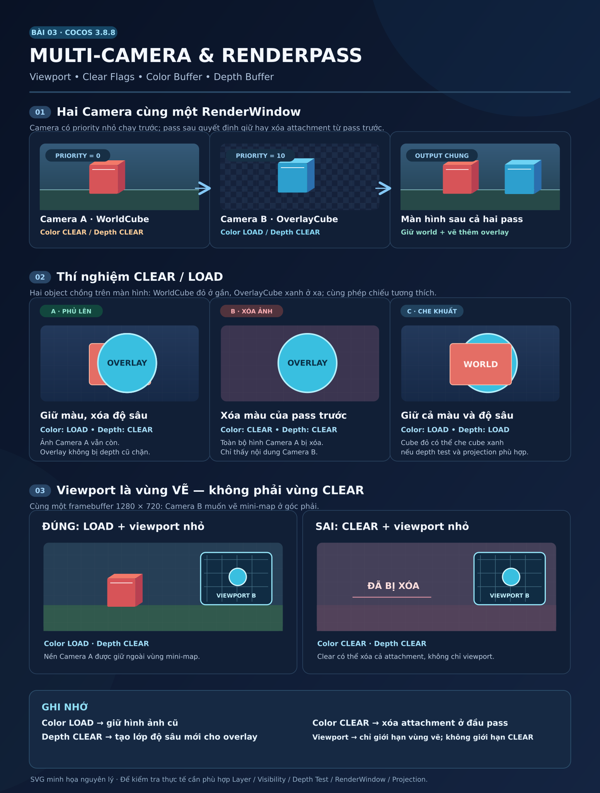

# Cocos Creator 3.8.8 — Bài 3: Sơ đồ SVG minh họa

> Minh họa bổ sung cho **Bài 3: Viewport, Clear Flags, Depth Buffer và Multi-Camera**.
>
> File SVG: [`Cocos_3.8.8_Bai03_MultiCamera_Visual.svg`](./Cocos_3.8.8_Bai03_MultiCamera_Visual.svg)



## 1. Hai Camera cùng RenderWindow

**CameraWorld** (priority = `0`):

- `Visibility`: chỉ layer `DEFAULT`.
- `ClearFlags`: `SOLID_COLOR`.
- Color attachment: `gfx.LoadOp.CLEAR`.
- Depth attachment: `gfx.LoadOp.CLEAR`.
- Output: vẽ Cube đỏ rồi `STORE` color/depth.

**CameraOverlay** (priority = `10`):

- `Visibility`: chỉ layer `UI_3D`.
- `ClearFlags`: `DEPTH_ONLY`.
- Color attachment: `gfx.LoadOp.LOAD`.
- Depth attachment: `gfx.LoadOp.CLEAR`.
- Output: giữ hình của CameraWorld, vẽ Cube xanh đè lên và `STORE`.

```text
CameraWorld (priority 0)
    Color CLEAR + Depth CLEAR
           |
           v
      Red WorldCube
           |
           v
       RenderWindow
           |
           v
CameraOverlay (priority 10)
    Color LOAD + Depth CLEAR
           |
           v
    Red Cube + Blue Cube
```

Camera priority nhỏ được xử lý trước trong mã nguồn engine Cocos Creator `v3.8.8`. Đối với hai Camera trên cùng cửa sổ render, `LOAD` chỉ có ý nghĩa khi kết quả pass trước được lưu và hợp lệ.

## 2. Ba trường hợp quan trọng

| Trường hợp | Color LoadOp | Depth LoadOp | Kết quả muốn quan sát |
|---|---|---|---|
| A. Overlay | `LOAD` | `CLEAR` | Giữ ảnh Camera A, overlay có depth mới và có thể phủ lên world |
| B. Camera B xóa ảnh | `CLEAR` | `CLEAR` | Xóa color attachment cũ; có thể mất hình Camera A |
| C. Dùng chung depth | `LOAD` | `LOAD` | Giữ cả màu và depth; nếu depth test hoạt động, object Camera A ở gần có thể che object Camera B ở xa |

### Ví dụ minh họa Depth

- `WorldCube`: màu đỏ, phía trước.
- `OverlayCube`: màu xanh, phía sau, chiếu chồng lên WorldCube.
- **Depth CLEAR** ở Camera B: bỏ kết quả depth test trước đó, cho phép overlay vẽ lên trên ở phần chồng pixel (nếu material bật depth test theo cách thông thường).
- **Depth LOAD** ở Camera B: giữ depth từ Camera A, do đó overlay phía sau có thể trượt depth test ở vùng bị WorldCube che.

**Điều kiện cần:** Hai Camera phải sử dụng phép chiếu/hệ độ sâu tương thích, cùng RenderWindow, depth attachment được STORE/LOAD đúng cách. Kết quả thực tế còn phụ thuộc depth test/depth write và thứ tự draw.

## 3. Viewport và bẫy `LoadOp.CLEAR`

Viewport chỉ quy định vùng pixel mà GPU rasterize khi vẽ. Nó **không đảm bảo** color attachment chỉ bị xóa trong viewport.

Ví dụ Camera B vẽ mini-map ở góc màn hình:

- `pass.setViewport(minimapViewport)` và Color `LOAD`: giữ phần còn lại của ảnh Camera A.
- `pass.setViewport(minimapViewport)` nhưng Color `CLEAR`: thao tác clear ở đầu pass có thể xóa toàn color attachment trước khi mini-map được vẽ.

> Với Cocos Creator 3.8.8, nên thử hai Camera full-screen trước rồi mới làm viewport chia màn hình, vì có báo cáo vấn đề về nhiều Camera/viewport ở phiên bản này.

## 4. Những thử nghiệm nên chạy

1. Dùng `CAMERA_FLAGS`: CameraWorld `SOLID_COLOR`, CameraOverlay `DEPTH_ONLY`; kiểm tra thấy cả hai Cube.
2. Dùng `FORCE_LATER_COLOR_CLEAR`: quan sát mất hình WorldCube.
3. Dùng `FORCE_LATER_DEPTH_LOAD`: đưa Cube xanh ra phía sau Cube đỏ, kiểm tra che khuất.
4. Dùng `FORCE_LATER_DEPTH_CLEAR`: quan sát overlay không còn bị depth WorldCube cản.
5. Thử viewport nhỏ của Camera B với Color `LOAD` trước; **không giả định** `CLEAR` chỉ xóa trong mini-map.

> Nếu vẫn gặp `uniform buffers (18) exceeds ... (12)` trên WebGPU, đừng xem đó là lỗi của `CLEAR`/`LOAD` cho đến khi đã đối chiếu lại Builtin và scene tối giản. Hình SVG là minh họa lý thuyết, không phải ảnh chụp kết quả runtime.

## 5. Các file liên quan

- `Cocos_3.8.8_CRP_Bai_03_Viewport_ClearFlags_MultiCamera.md`: lý thuyết và mã nguồn đầy đủ.
- `LearnCRPPipeline_Bai03.ts`: ví dụ thực hành TypeScript.
- `Cocos_3.8.8_Bai03_MultiCamera_Visual.svg`: sơ đồ vector, có thể phóng to không vỡ ảnh.
- `Cocos_3.8.8_Bai03_MultiCamera_Visual.png`: ảnh xem nhanh khi phần mềm không hiển thị SVG.
